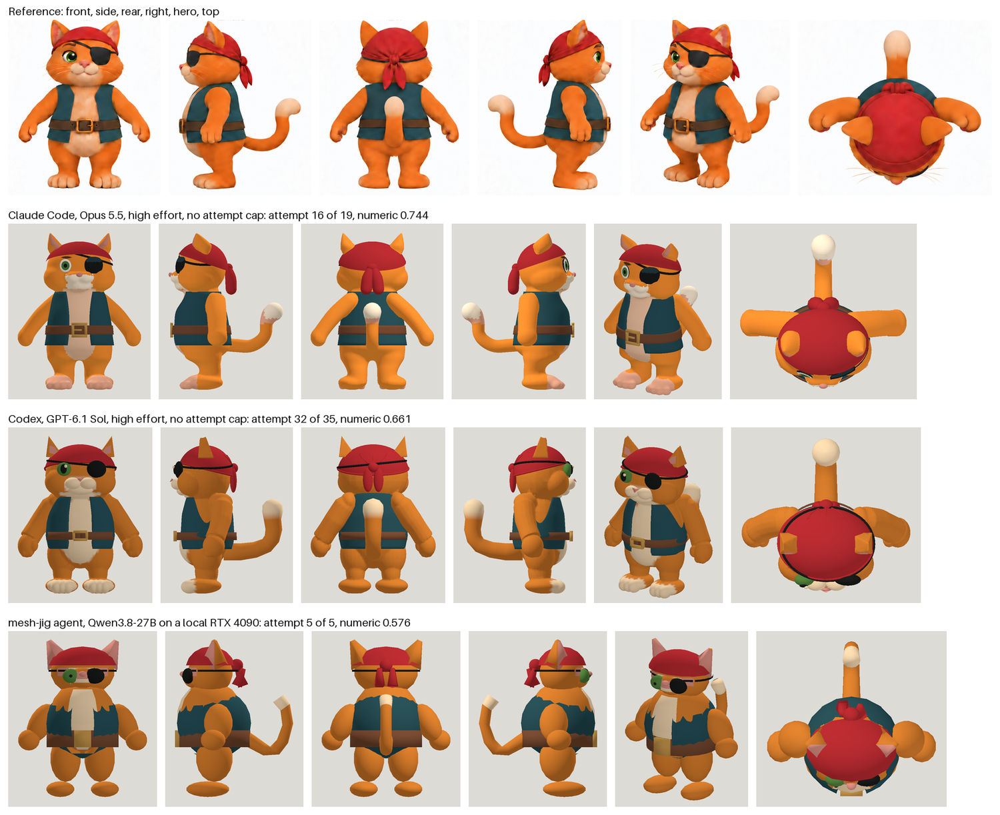
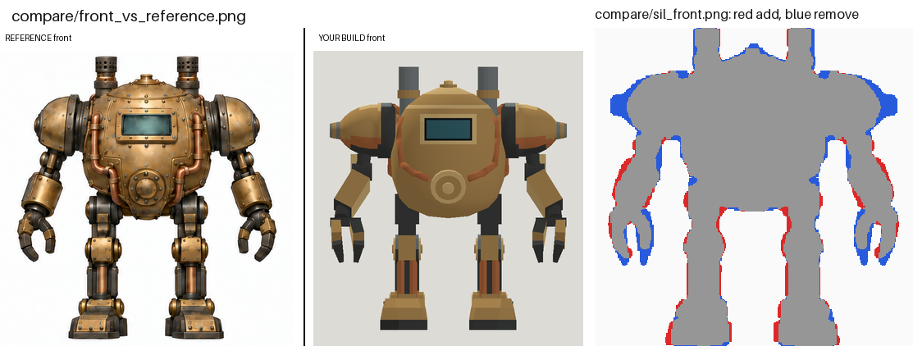
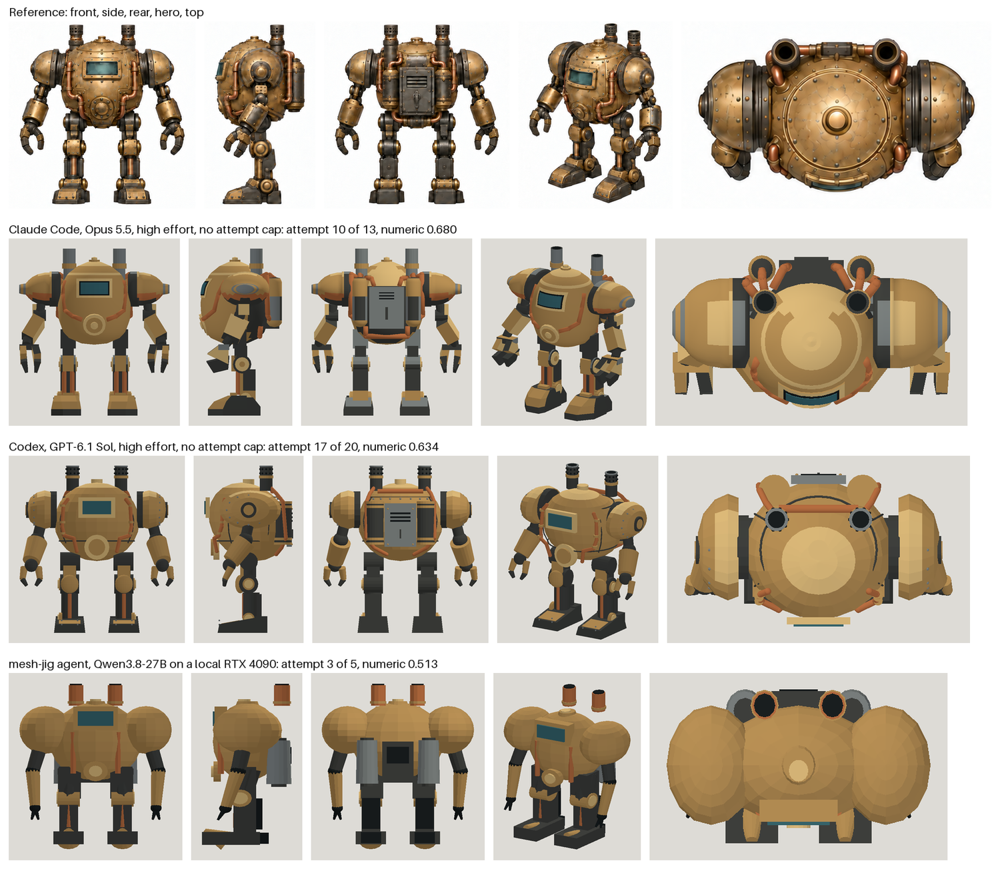

# mesh-jig

**[See the models in 3D](https://joe975.github.io/mesh-jig/)**: six reference sheets, each company's best build,
animated rigs and the worst build, from Claude, Codex, Gemini and local models.

Build Blender scripts with a coding agent, measure the exported GLB against reference views, then
rig the selected model and author animation clips without changing its rest geometry.
Install below, then run the [key-free example](docs/QUICKSTART.md).



Reference above, selected builds below. These are examples, not a model ranking.

## Install

Requires Git, Python 3.12+ and [Blender](https://www.blender.org/download/). Install from this checkout;
mesh-jig isn't on PyPI.

Windows PowerShell:

```powershell
git clone https://github.com/Joe975/mesh-jig.git
cd mesh-jig
python -m venv .venv
.\.venv\Scripts\python.exe -m pip install -e ".[mcp,dev]"
.\.venv\Scripts\python.exe -m mesh_jig doctor
```

Linux/macOS POSIX shell:

```sh
git clone https://github.com/Joe975/mesh-jig.git
cd mesh-jig
python3 -m venv .venv
. .venv/bin/activate
python -m pip install -e ".[mcp,dev]"
mesh-jig doctor
```

Stay in the checkout. In PowerShell, use `.\.venv\Scripts\python.exe` for `python` and
`.\.venv\Scripts\python.exe -m mesh_jig` for `mesh-jig`; activation isn't required.
See [versions and troubleshooting](docs/GUIDE.md#versions-and-troubleshooting) for setup problems.

## Try a local build

This supplied box needs no API key or agent:

```sh
python examples/smoke/prepare.py local-work/smoke
mesh-jig doctor local-work/smoke
mesh-jig brief local-work/smoke
mesh-jig build local-work/smoke --script local-work/smoke/attempts/a00/model.py
mesh-jig preview local-work/smoke local-work/smoke/attempts/a00
mesh-jig eval local-work/smoke --script local-work/smoke/attempts/a00/model.py
mesh-jig show local-work/smoke a00
```

Expect a passing contract and score near 1 against its own reference renders. This checks installation,
not modelling ability. [The walkthrough](docs/QUICKSTART.md) includes PowerShell commands and output paths.

## Choose a builder

| Route | Setup |
|---|---|
| Codex | [Local CLI or MCP](docs/CLIENTS.md#codex) |
| Claude Code | [Local CLI or MCP](docs/CLIENTS.md#claude-code) |
| Direct API runner | [Hosted provider](docs/API.md#hosted-endpoint) or [local server](docs/API.md#local-endpoint) |

Coding clients use their own login and plan. Local build/render/evaluation needs no mesh-jig API key.
The hosted API runner and optional vision judge use separate credentials and billing; a localhost
runner can be key-free. Client subscriptions don't supply API credit.

## Choose a reference

These sheets and selected outputs are included in a clone:

| Reference | Sheet and builds | Ready-to-configure modelling and rig contracts |
|---|---|---|
| Six-limbed horror | [Reference](showcase/reference-horror/README.md) | [Example](examples/six-limbed-horror): sprint, leap |
| Sky whale / manta | [Reference](showcase/reference-sky-whale/README.md) | [Example](examples/sky-whale-manta): hover_glide, fin_flap, gentle_turn |
| Three-eyed caterpillar | [Reference](showcase/reference-caterpillar/README.md) | [Example](examples/three-eyed-caterpillar): idle, crawl, gentle_turn |
| Pirate cat | [Reference](showcase/reference-cat/README.md) | Configure from the sheet |
| Steampunk mech | [Reference](showcase/reference-mech/README.md) | Configure from the sheet |
| Cel-shaded ninja | [Reference](showcase/reference-ninja/README.md) | Configure from the sheet |

Start a fresh horror project from the supplied contract (both shells):

```sh
python -c "import shutil; shutil.copytree('examples/six-limbed-horror', 'local-work/horror')"
mesh-jig sheet local-work/horror
mesh-jig refs local-work/horror --out local-work/horror-reference-check
mesh-jig doctor local-work/horror
mesh-jig brief local-work/horror
```

Keep this two-level layout: the contract's sheet path resolves to `showcase/`. Use a new destination;
inspect the crops before building. The sky whale and caterpillar examples work the same way.
These examples supply briefs and contracts, not finished modelling or rig scripts.

## Build your own model

Follow [the guide](docs/GUIDE.md) to set crops, cameras, dimensions, scored views and brief **before**
cutting references. Freeze them before comparing attempts. Initialization defaults suit a craft;
characters need their own contract. The [reference-sheet skill](skill/mesh-jig-reference-sheet/SKILL.md)
helps prepare consistent views; [JIG.md](docs/JIG.md) defines the fields.

The [modelling skill](skill/mesh-jig/SKILL.md) covers script creation, build/contract checks,
evaluation, fresh visual critique and revision. Preserve each evaluated attempt. Evaluations save
GLBs in `attempts/<name>/out/`, comparison images, silhouette overlays and a ledger. Browse them with:

```sh
mesh-jig view local-work/my-model --open
```

The dashboard runs until Ctrl+C.

Use [selection checkpoints](docs/SELECTIONS.md) to keep latest, numeric best and an explicit visual
choice separately, with a comparison sheet made from saved renders.



## Rig and animate

Inspect [engine readiness](docs/GUIDE.md#after-modelling) before freezing the selected static GLB:

```sh
mesh-jig ready local-work/horror a00 --target quest
```

Substitute your actual attempt. Readiness diagnoses topology and engine costs separately from the
modelling score; it doesn't certify a mesh for animation.

Create `local-work/rig/` with the selected model as `source.glb`, a `rig.json` contract and a
motion `brief.md`. Have your coding agent follow [RIGGING.md](docs/RIGGING.md) to write `rig.py`:
skeleton, blended or rigid weights, and poses. For a standard character, declare **idle, walk, run,
jump** in the contract and describe their motion in the brief. Clip names and durations are authored;
there is no automatic walk generator. The examples above use their own clip sets.

```sh
mesh-jig rig-info --source local-work/rig/source.glb --contract local-work/rig/rig.json
mesh-jig rig-build --source local-work/rig/source.glb --script local-work/rig/rig.py --contract local-work/rig/rig.json --out local-work/rig/animated.glb
mesh-jig rig-check --source local-work/rig/source.glb --rig local-work/rig/animated.glb --contract local-work/rig/rig.json --readings
mesh-jig rig-preview --rig local-work/rig/animated.glb --contract local-work/rig/rig.json --views left front three-quarter --out local-work/rig/poses
```

Output is a glTF skinned/animated GLB plus a `.rig.json` report; preview produces weight sheets and
CPU pose film strips. Inspect every clip, then play it in an animation-capable viewer or engine.
`mesh-jig view` shows the rest pose. Structural checks and sampled loop/deformation gates don't prove
natural motion, foot planting or freedom from intersections. There is no animation-quality score.

An [API rig builder](docs/RIGGING.md#an-api-model-writes-the-rig) is also available with
`--workflow rig`. [Procedural sounds](docs/SOUND.md) can follow rigging. Facial animation and
terrain/scene/runtime-IK stages are experimental work outside public `main`; this workflow does not
combine facial expressions with body locomotion.

## See the models



- [Opus pirate cat](showcase/pirate-cat-opus/README.md): attempt 16 of 19, [GLB](showcase/pirate-cat-opus/model-01.glb).
- [Local Qwen pirate cat](showcase/pirate-cat-qwen-local/README.md): attempt 5 of 5, [GLB](showcase/pirate-cat-qwen-local/model-01.glb).
- [Opus mech](showcase/steampunk-mech-opus/README.md): attempt 10 of 13, [GLB](showcase/steampunk-mech-opus/model-01.glb).
- [Bruce owl](showcase/bruce-owl-comparison/README.md): seven Astra/Sol/Luna/Qwen selections, with workflow,
  budget and visual-versus-numeric differences documented.

Scores compare attempts under one frozen contract. Inspect images and gates too. The script checker
is a denylist, not a sandbox: run scripts you trust. See [known gaps](docs/KNOWN_GAPS.md).

## Develop and share

Run `python -m pytest -q` in the environment; Blender tests skip if Blender is missing.
Keep raw runs, references and transcripts private. Publish selected outputs through the
[sharing skill](skill/mesh-jig-publish-results/SKILL.md) and [publication policy](docs/PUBLICATION.md).
Published content is [MIT licensed](LICENSE).
