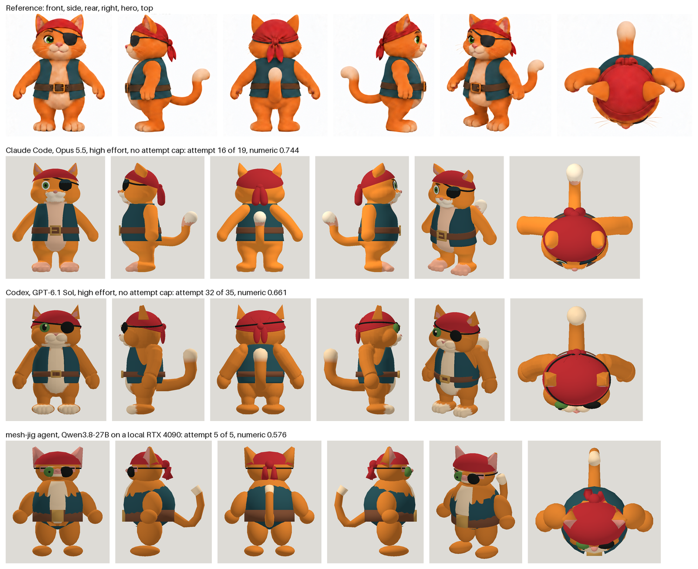
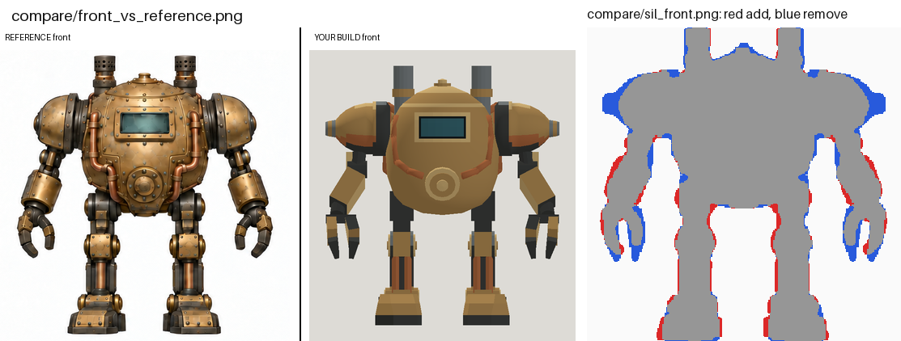
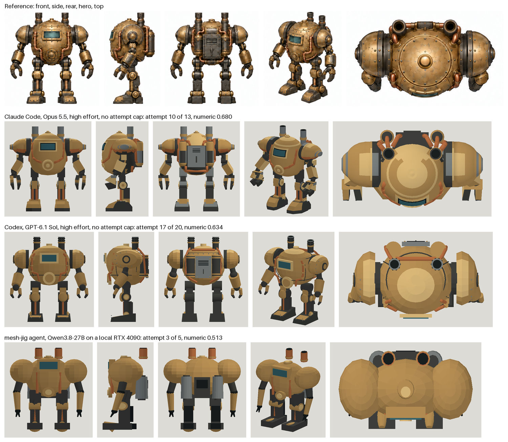

# mesh-jig

Build Blender scripts with a coding agent and measure the exported GLB against reference views.
Install below, then run the [key-free example](docs/QUICKSTART.md).



Reference above, selected builds below. These are examples, not a model ranking.

## Install

Requires Git, Python 3.12+ and [Blender](https://www.blender.org/download/). Install from this checkout;
mesh-jig isn't on PyPI.

Windows PowerShell:

```powershell
git clone https://github.com/Joe975/mesh-jig.git
cd mesh-jig
python -m venv .venv
.\.venv\Scripts\python.exe -m pip install -e ".[mcp,dev]"
.\.venv\Scripts\python.exe -m mesh_jig doctor
```

Linux/macOS POSIX shell:

```sh
git clone https://github.com/Joe975/mesh-jig.git
cd mesh-jig
python3 -m venv .venv
. .venv/bin/activate
python -m pip install -e ".[mcp,dev]"
mesh-jig doctor
```

Stay in the checkout. In PowerShell, use `.\.venv\Scripts\python.exe` for `python` and
`.\.venv\Scripts\python.exe -m mesh_jig` for `mesh-jig`; activation isn't required.
See [versions and troubleshooting](docs/GUIDE.md#versions-and-troubleshooting) for setup problems.

## Try a local build

This supplied box needs no API key or agent:

```sh
python examples/smoke/prepare.py local-work/smoke
mesh-jig doctor local-work/smoke
mesh-jig brief local-work/smoke
mesh-jig build local-work/smoke --script local-work/smoke/attempts/a00/model.py
mesh-jig preview local-work/smoke local-work/smoke/attempts/a00
mesh-jig eval local-work/smoke --script local-work/smoke/attempts/a00/model.py
mesh-jig show local-work/smoke a00
```

Expect a passing contract and score near 1 against its own reference renders. This checks installation,
not modelling ability. [The walkthrough](docs/QUICKSTART.md) includes PowerShell commands and output paths.

## Choose a builder

| Route | Setup |
|---|---|
| Codex | [Local CLI or MCP](docs/CLIENTS.md#codex) |
| Claude Code | [Local CLI or MCP](docs/CLIENTS.md#claude-code) |
| Direct API runner | [Hosted provider](docs/API.md#hosted-endpoint) or [local server](docs/API.md#local-endpoint) |

Coding clients use their own login and plan. Local build/render/evaluation needs no mesh-jig API key.
The hosted API runner and optional vision judge use separate credentials and billing; a localhost
runner can be key-free. Client subscriptions don't supply API credit.

## Build your own model

Follow [the guide](docs/GUIDE.md) to set crops, cameras, dimensions, scored views and brief **before**
cutting references. Freeze them before comparing attempts. Initialization defaults suit a craft;
characters need their own contract. The [reference-sheet skill](skill/mesh-jig-reference-sheet/SKILL.md)
helps prepare consistent views; [JIG.md](docs/JIG.md) defines the fields.

Evaluations save comparison images and silhouette overlays. Browse them with:

```sh
mesh-jig view local-work/my-model --open
```

The dashboard runs until Ctrl+C.

Use [selection checkpoints](docs/SELECTIONS.md) to keep latest, numeric best and an explicit visual
choice separately, with a comparison sheet made from saved renders.



## See the models



- [Opus pirate cat](showcase/pirate-cat-opus/README.md): attempt 16 of 19, [GLB](showcase/pirate-cat-opus/model-01.glb).
- [Local Qwen pirate cat](showcase/pirate-cat-qwen-local/README.md): attempt 5 of 5, [GLB](showcase/pirate-cat-qwen-local/model-01.glb).
- [Opus mech](showcase/steampunk-mech-opus/README.md): attempt 10 of 13, [GLB](showcase/steampunk-mech-opus/model-01.glb).
- [Bruce owl](showcase/bruce-owl-comparison/README.md): seven Astra/Sol/Luna/Qwen selections, with workflow,
  budget and visual-versus-numeric differences documented.

Scores compare attempts under one frozen contract. Inspect images and gates too. The script checker
is a denylist, not a sandbox: run scripts you trust. See [known gaps](docs/KNOWN_GAPS.md).

## Develop and share

Run `python -m pytest -q` in the environment; Blender tests skip if Blender is missing.
Keep raw runs, references and transcripts private. Publish selected outputs through the
[sharing skill](skill/mesh-jig-publish-results/SKILL.md) and [publication policy](docs/PUBLICATION.md).
Published content is [MIT licensed](LICENSE).
