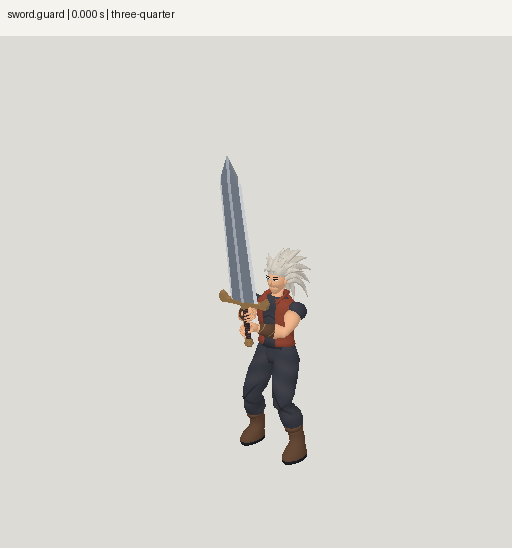

# Anime swordsman: heavy two-handed sword

| Measure | Value |
|---|---|
| Model | GPT-6 Astra |
| Driver | GPT-6 Astra high, Codex subscription |
| Effort | high |
| Scope | Selected sword repair after twelve independently reviewed fitting rounds and three final no-improvement rounds. |
| Completed | unknown |
| Evaluations | unknown |
| Runtime seconds | unknown |
| Driver turns | unknown |
| Prompt tokens | unknown |
| Cached prompt tokens | unknown |
| Cache write tokens | unknown |
| Completion tokens | unknown |
| Reasoning tokens | unknown |
| Model calls | unknown |
| Cost USD (unavailable) | unknown |
| Numeric score | unknown |
| Gates passed | unknown |
| Gates total | unknown |

Token counts use the report's provider conventions. Reasoning is included in completion tokens; cache counters are not extra prompt tokens. Estimated cost is not an invoiced charge.

Three sword clips plus two facial-composition demonstrations. Full character download retains seven facial clips.

Approximate video fit: compact reach and torso motion. Angular elbows and fingers remain. Sampled checks do not certify continuous collision clearance or game-engine readiness.

Source has 23592 triangles. Static score and native token usage are unavailable.

[Download selected model](model-01.glb)

[Download selected model](model-02.glb)

[Download selected model](model-03.glb)
