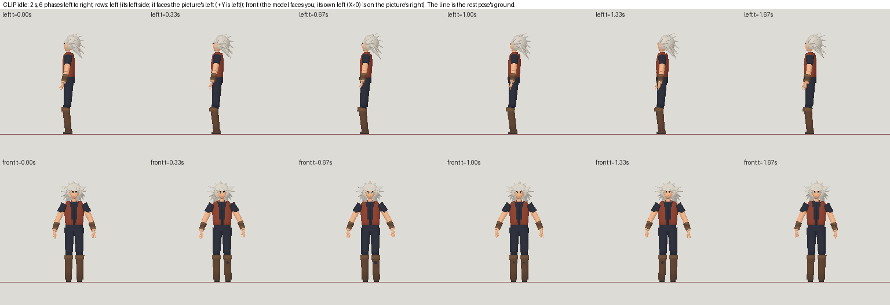
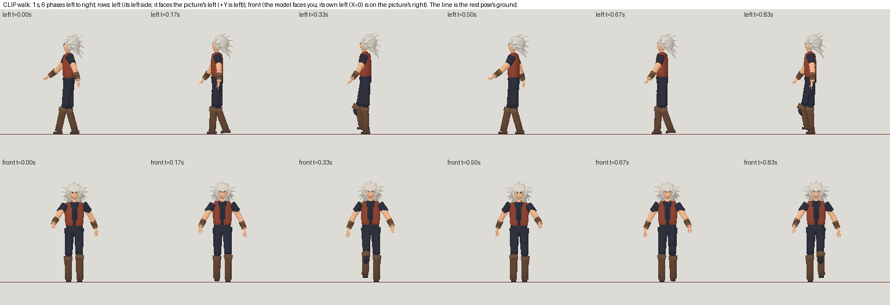
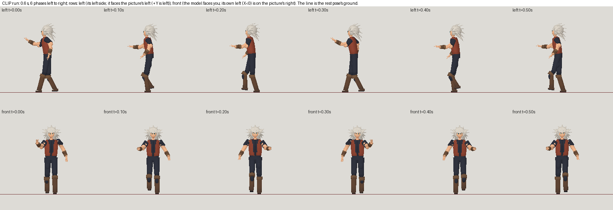
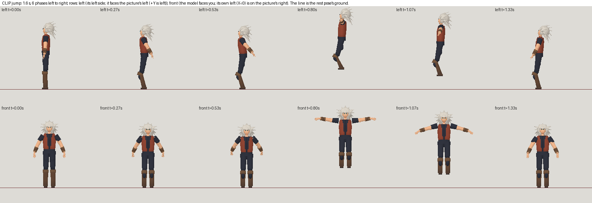
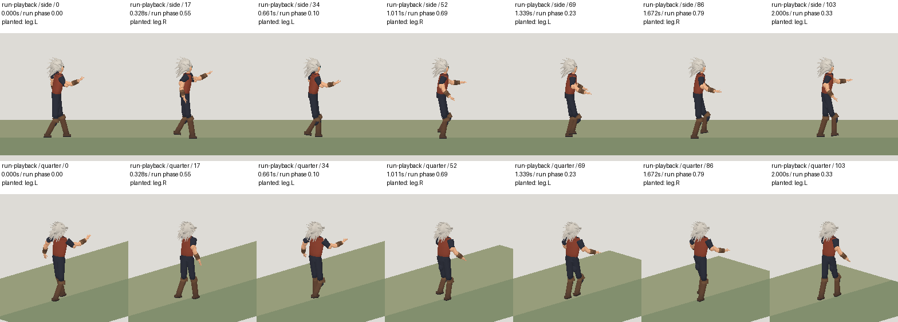
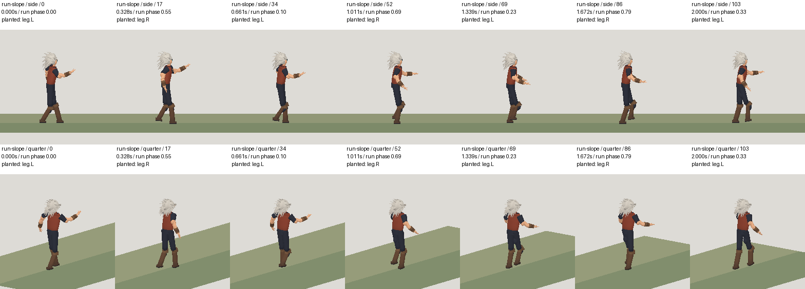
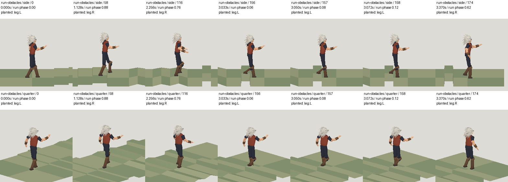

# Local Qwen3.8 high: swordsman with experimental ground IK

| Measure | Value |
|---|---|
| Model | qwen3.8-27b-local |
| Driver | mesh-jig API agent through local llama-server |
| Effort | high |
| Scope | Five reviewed models; visual a05; three passing rigs in five submissions; three failed game proposals; unchanged a03 experimental runtime. |
| Completed | false |
| Evaluations | 5 |
| Runtime seconds | unknown |
| Driver turns | unknown |
| Prompt tokens | 3732153 |
| Cached prompt tokens | 3302446 |
| Cache write tokens | unknown |
| Completion tokens | 1024284 |
| Reasoning tokens | unknown |
| Model calls | 97 |
| Cost USD (reported) | 0 |
| Numeric score | 0.4922 |
| Gates passed | 3 |
| Gates total | 7 |

Token counts use the report's provider conventions. Reasoning is included in completion tokens; cache counters are not extra prompt tokens. Estimated cost is not an invoiced charge.

Experimental terrain demo; game qualification failed. Three passing native rigs from five submissions. All three game proposals failed; unchanged a03 has walk slip 0.353845/0.352321/0.351776 m/s in playback/flat/slope against 0.35. Static colour placement, resemblance, vest and facial smoke checks fail. Four body clips only; no sword attacks or facial animation. Independent blend diagnostics also slip up to 1.525 m/s. No accepted game-ready package.

Visual choice a05 scored 0.4922; numeric leader a03 scored 0.4949. Rig a04 and failed game a03 unchanged. No model, animation or IK repair; no relaxed gates.

First GLB: four native body clips. Second GLB: selected static model. Four native strips followed by three native game scene diagnostics. No extra sword/combat trial.

All 97 completed local calls included. High maps to template xhigh; 120000 reply-token ceiling; Q4_K_XL. No hosted API charge; electricity/hardware unestimated.

[Download selected model](model-01.glb)

[Download selected model](model-02.glb)
