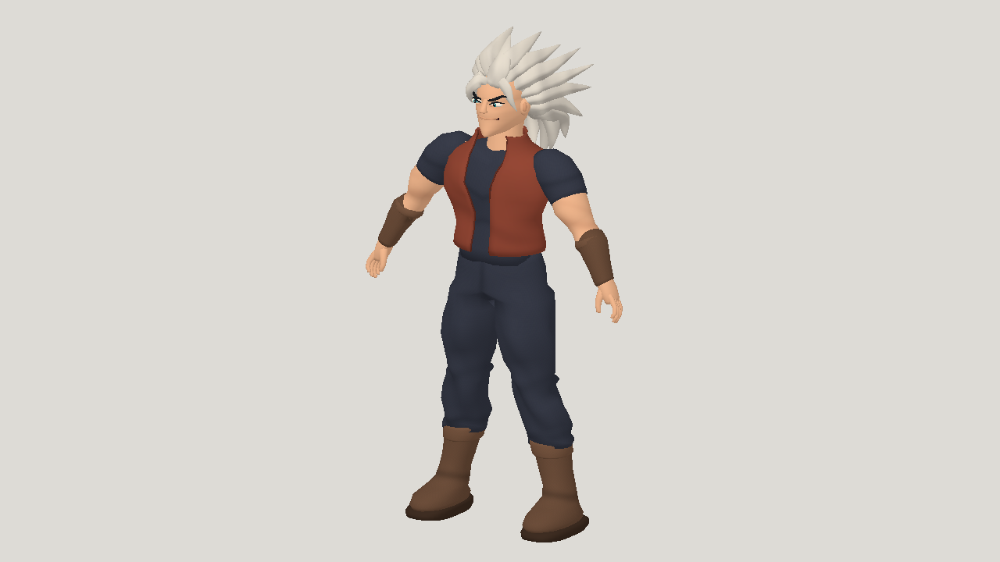
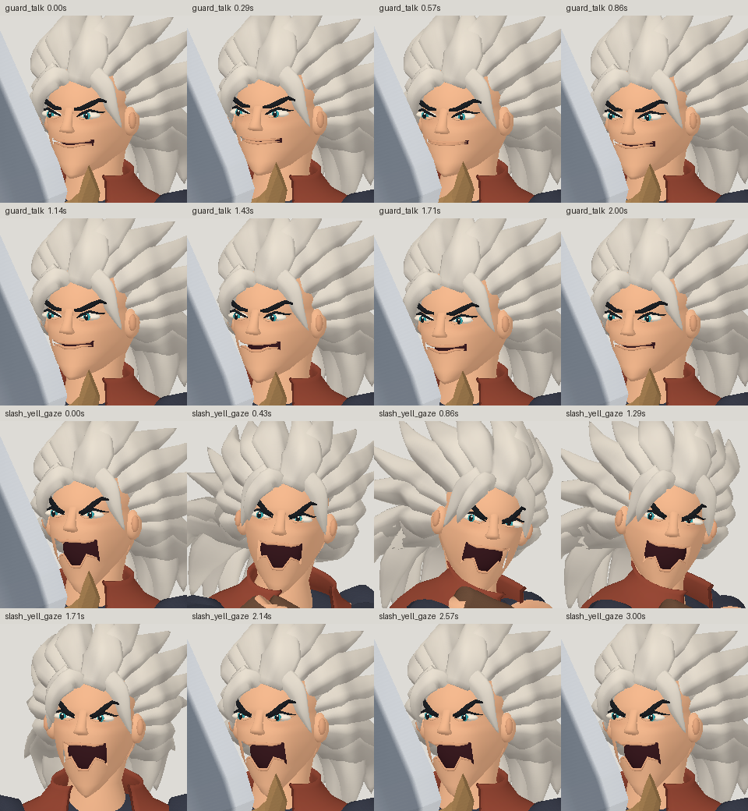

# Silver-haired swordsman, Sol 6.2 high

| Measure | Value |
|---|---|
| Model | GPT-6.2 Sol high |
| Driver | Codex Desktop |
| Effort | high |
| Scope | Fresh model, separate sword, native locomotion, and two-handed combat guided by two approved reference clips |
| Completed | true |
| Evaluations | 5 |
| Runtime seconds | 3131.414602 |
| Driver turns | unknown |
| Prompt tokens | unknown |
| Cached prompt tokens | unknown |
| Cache write tokens | unknown |
| Completion tokens | unknown |
| Reasoning tokens | unknown |
| Model calls | unknown |
| Cost USD (unavailable) | unknown |
| Numeric score | 0.684 |
| Gates passed | 4 |
| Gates total | 7 |

Token counts use the report's provider conventions. Reasoning is included in completion tokens; cache counters are not extra prompt tokens. Estimated cost is not an invoiced charge.

Five completed static model evaluations with five independent critiques, two sword builds, three locomotion rigs and three combat/composition candidates. Displayed runtime is elapsed from input freeze and includes authorship and review. Native subscription usage and cost are unavailable.

Visual model a05 uses a closed neutral lip seam and fuller mane. Numeric-best a03 scored .6869. Selected a05 missed colour placement, resemblance and vest colour limits. All seven sampled face probes passed. Mane, cloth and face remain simplified.

Strict export checks at 120 Hz recorded guard 241/241, overhead chop 361/361, horizontal slash 361/361. 120 Hz support, deformation and contact samples passed. The fixed sample grid leaves gaps between observations.

The overhead load, forward catch and slash reach approximate the approved references. Forearm and wrist shapes remain angular. CPU playback and sampled inspection provide the motion evidence.

Four GLBs in order: five-clip sword viewer, complete sword and face animation, complete locomotion and face animation, and standalone sword.

[Download selected model](model-01.glb)

[Download selected model](model-02.glb)

[Download selected model](model-03.glb)

[Download selected model](model-04.glb)
