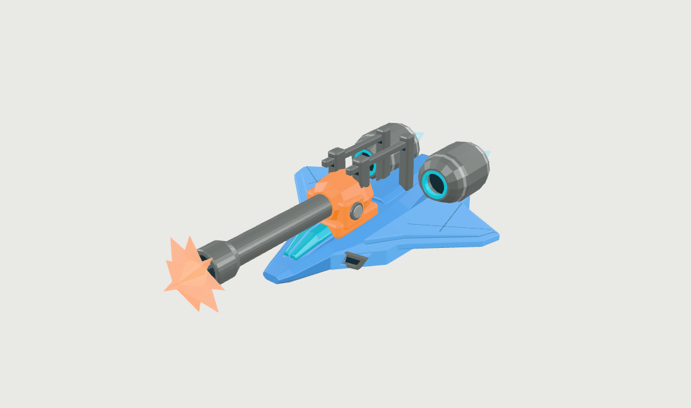
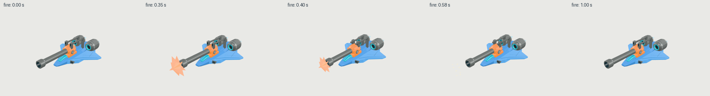
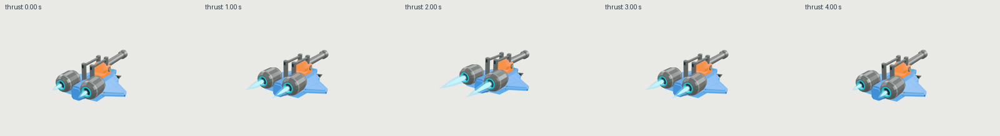
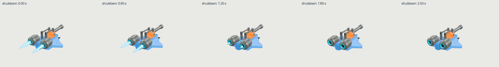

# Cannon gunship: seven clips and baked effects

| Measure | Value |
|---|---|
| Model | GPT-6 Astra high |
| Driver | Codex subscription worker |
| Effort | high |
| Scope | Six successful modeling evaluations: five candidates plus a panel-contact repair; selected visual-best source, rigid rig and two effect refinements. |
| Completed | unknown |
| Evaluations | 6 |
| Runtime seconds | unknown |
| Driver turns | unknown |
| Prompt tokens | unknown |
| Cached prompt tokens | unknown |
| Cache write tokens | unknown |
| Completion tokens | unknown |
| Reasoning tokens | unknown |
| Model calls | unknown |
| Cost USD (unavailable) | unknown |
| Numeric score | 0.7215 |
| Gates passed | 1 |
| Gates total | 1 |

Token counts use the report's provider conventions. Reasoning is included in completion tokens; cache counters are not extra prompt tokens. Estimated cost is not an invoiced charge.

One animated deliverable: idle, bank_turn, aim, fire, burst, thrust and shutdown. All mesh instances total 9,136 triangles including 1,304 baked effect triangles. Scale: about 8 m long.

Barrel recoil is 0.36 m. Muzzle flash follows the moving barrel; sparks travel and shrink away. Two rear plumes and streaks ramp with authored thrust and fully extinguish during shutdown. These are core glTF mesh/TRS animations, not runtime particle simulation. Opacity is fixed; visibility fades by shrinking.

Mechanical geometry, textures and rigid weights retained. Sanitized materials and animation data matched the source. Attachment and lifecycle checks sampled at 120 Hz. Clearance checks use a barrel/canopy height envelope, not complete collision certification.

Simplified faceted craft with painted details. Selected numeric score 0.7215; highest numeric score 0.7221. Source-authored top/underside planform and front/rear height are authoritative. The side reference is 11.63% shallow and excluded from numeric silhouette scoring; hero is illustrative. Subscription token usage, elapsed runtime and cost are not reported.

[Download selected model](model-01.glb)
