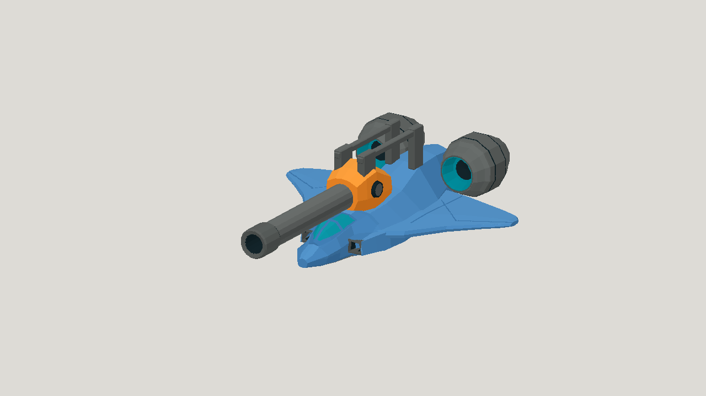

# Cannon gunship: Gemini 4 Hydrogen High

| Measure | Value |
|---|---|
| Model | gemini-4-hydrogen-high |
| Driver | Antigravity subscription CLI |
| Effort | high |
| Scope | One independent run: five successful model evaluations and three passing rig candidates under the frozen reference contract. |
| Completed | true |
| Evaluations | 5 |
| Runtime seconds | unknown |
| Driver turns | unknown |
| Prompt tokens | unknown |
| Cached prompt tokens | unknown |
| Cache write tokens | unknown |
| Completion tokens | unknown |
| Reasoning tokens | unknown |
| Model calls | unknown |
| Cost USD (unavailable) | unknown |
| Numeric score | 0.7451 |
| Gates passed | 1 |
| Gates total | 1 |

Token counts use the report's provider conventions. Reasoning is included in completion tokens; cache counters are not extra prompt tokens. Estimated cost is not an invoiced charge.

Five successful model evaluations and three passing mechanical rig candidates under the unchanged contract. Seven animation clips; 3,336 active triangles including 1,244 triangles of appended baked mesh effects.

The original static source has 2,092 triangles. Original geometry, atlas, materials, skins and mechanical animation data are preserved. Muzzle flashes and forward sparks fire at 0.35 s, with burst shots at 0.35, 1.05 and 1.75 s; two cyan aft plumes strengthen in thrust and extinguish in shutdown.

Simplified cockpit, vents and cannon details. The forward sparks are faint at thumbnail scale and thrust intensity reads mainly as plume size. Independent sampled visual review and offline preservation, attachment, timing and loop checks do not certify continuous interpolation, physical behavior or every collision. Subscription cost is not reported.

[Download selected model](model-01.glb)
