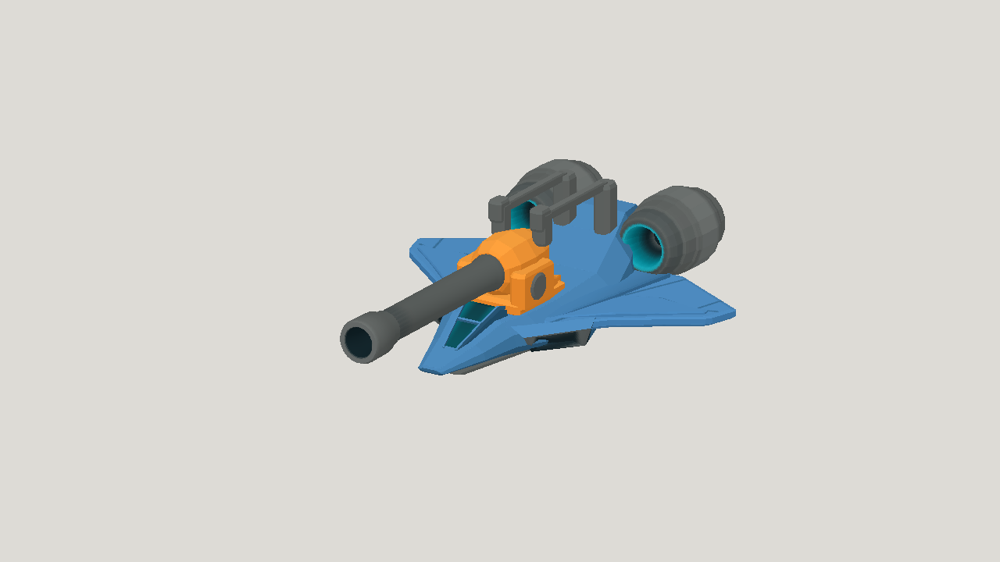
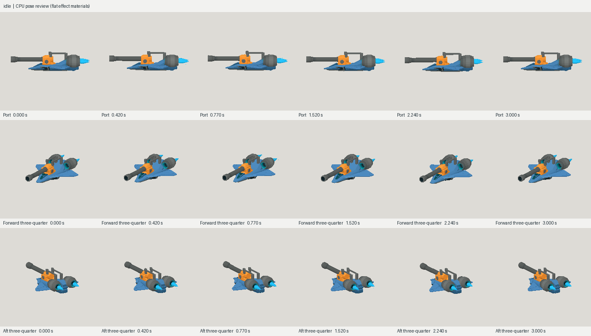
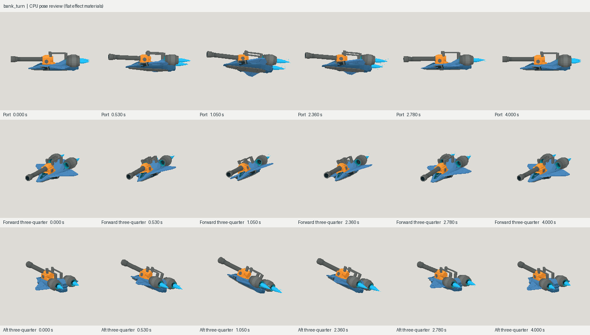
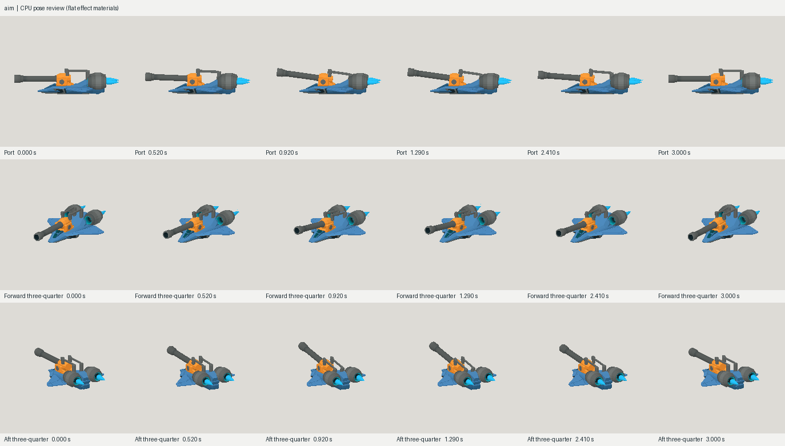
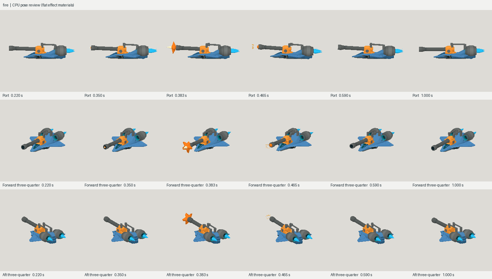
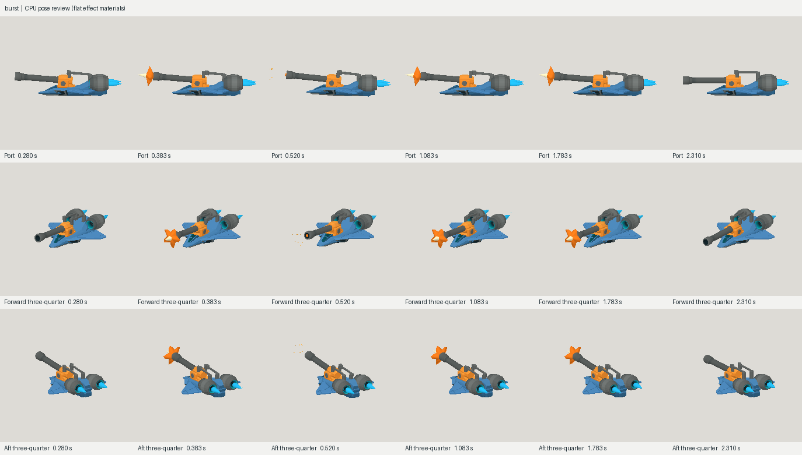
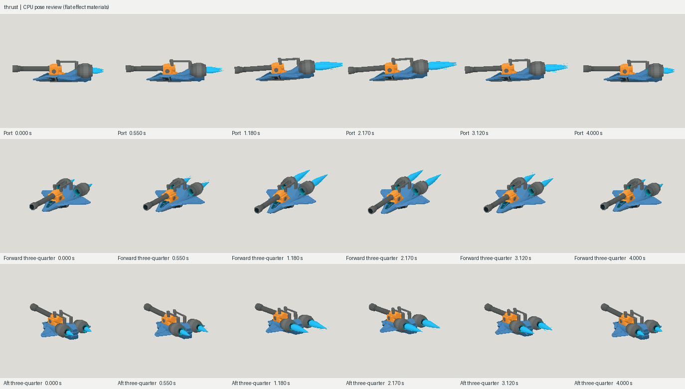
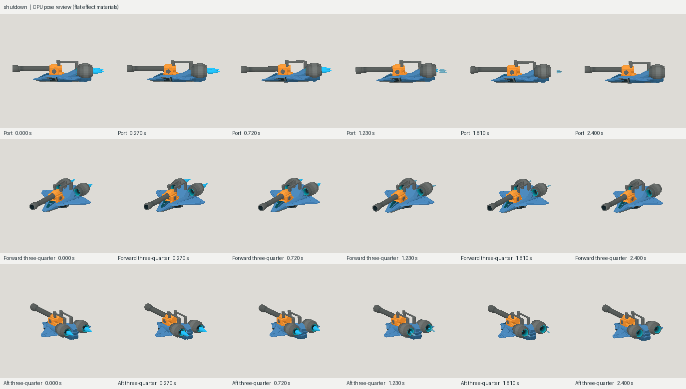

# Cannon gunship by GPT-6.2 Sol high

| Measure | Value |
|---|---|
| Model | GPT-6.2 Sol |
| Driver | Codex subscription session |
| Effort | high |
| Scope | Fresh build with five evaluated static candidates, three complete rigid and baked-effect variants, and seven native clips. |
| Completed | true |
| Evaluations | 5 |
| Runtime seconds | 1530.2 |
| Driver turns | unknown |
| Prompt tokens | unknown |
| Cached prompt tokens | unknown |
| Cache write tokens | unknown |
| Completion tokens | unknown |
| Reasoning tokens | unknown |
| Model calls | unknown |
| Cost USD (unavailable) | unknown |
| Numeric score | 0.7694 |
| Gates passed | 1 |
| Gates total | 1 |

Token counts use the report's provider conventions. Reasoning is included in completion tokens; cache counters are not extra prompt tokens. Estimated cost is not an invoiced charge.

The fifth static candidate is the visual choice, numeric best and latest at 0.7694. One earlier source script failed before evaluation. The third animation is the visual choice. All three held the same mechanical contract, which has gates without a numeric rank.

The animated file includes 8,364 active triangles. A 120 Hz check verified muzzle and nozzle attachment, rigid rail motion, 39.3 cm recoil and shutdown effects effectively hidden by 2.35 seconds. The 14.4 cm barrel to canopy envelope clearance covers sampled cross-sections and poses.

Seven pose strips use a CPU renderer with flat effect materials. The live and static variants have the same original mesh and 1024 px painted atlas. The effects are baked glTF node animation. Polygon edges and faint sparks remain visible limitations at delivery scale.

Top, underside, front and rear are scored. The side concept is 11.63 percent shallow. The build retains flatter wing relief and partly obstructed vent recesses. No approved motion clip is mapped to this subject.

Wall time covers the fresh run through model, motion and sanitizer checks. Provider tokens, usage and subscription cost are unavailable.

[Download selected model](model-01.glb)

[Download selected model](model-02.glb)
