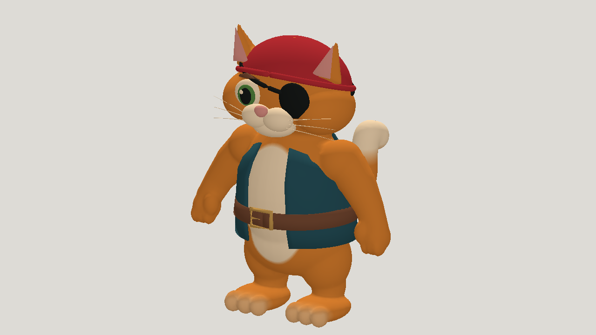

# GPT-6 Astra: pirate cat

| Measure | Value |
|---|---|
| Model | GPT-6 Astra |
| Driver | Codex native subscription agent |
| Effort | high |
| Scope | Five static evaluations; selected model rigged with idle, walk, run and jump. |
| Completed | true |
| Evaluations | 5 |
| Runtime seconds | unknown |
| Driver turns | unknown |
| Prompt tokens | unknown |
| Cached prompt tokens | unknown |
| Cache write tokens | unknown |
| Completion tokens | unknown |
| Reasoning tokens | unknown |
| Model calls | unknown |
| Cost USD (unavailable) | unknown |
| Numeric score | 0.6328 |
| Gates passed | 16 |
| Gates total | 19 |

Token counts use the report's provider conventions. Reasoning is included in completion tokens; cache counters are not extra prompt tokens. Estimated cost is not an invoiced charge.

Face, patch and eye colour gates miss target. Toy-like jog and basic hop; stiff torso, armhole sliding and small instep weight defects remain.

[Download selected model](model-01.glb)

[Download selected model](model-02.glb)
