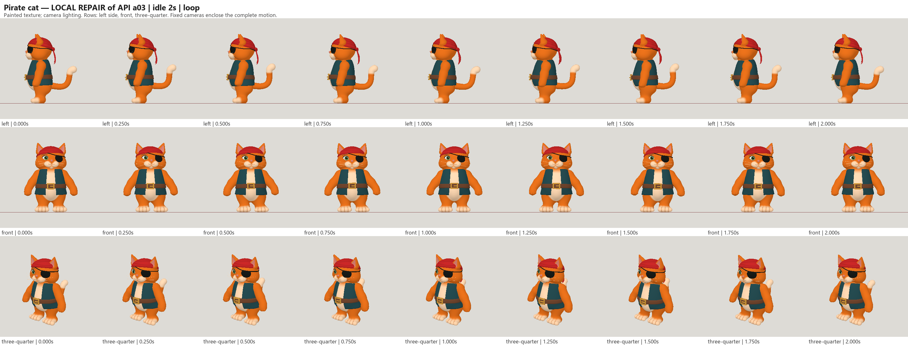
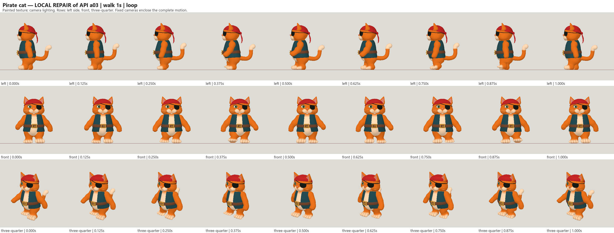
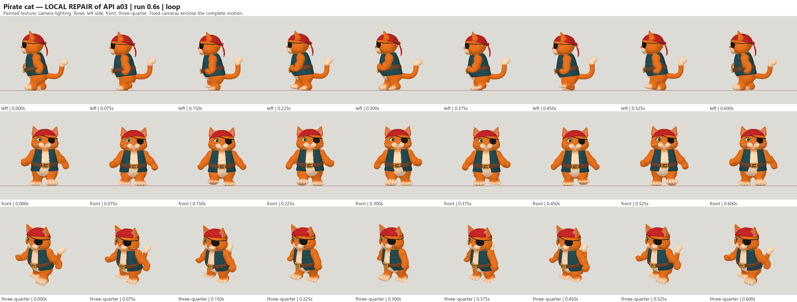
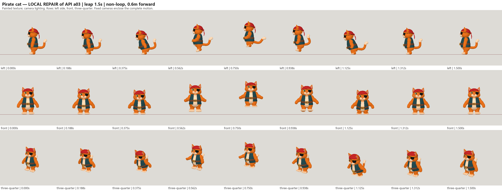

# Pirate cat: Fable 5.2 high API a03 with local repairs

| Measure | Value |
|---|---|
| Model | claude-fable-5-2 |
| Driver | Anthropic API model and initial rig; local Codex export and rig repairs |
| Effort | high |
| Scope | Three static API evaluations; selected a03 with a separately repaired rig and four animations |
| Completed | false |
| Evaluations | 3 |
| Runtime seconds | unknown |
| Driver turns | unknown |
| Prompt tokens | unknown |
| Cached prompt tokens | unknown |
| Cache write tokens | unknown |
| Completion tokens | unknown |
| Reasoning tokens | unknown |
| Model calls | 15 |
| Cost USD (estimated) | 19.80808 |
| Numeric score | 0.6785 |
| Gates passed | 16 |
| Gates total | 19 |

Token counts use the report's provider conventions. Reasoning is included in completion tokens; cache counters are not extra prompt tokens. Estimated cost is not an invoiced charge.

The API experiment stopped early. The delivered texture export and rig repairs are local edits, not additional Fable outputs.

Selected static a03 score 0.6785; 53814 triangles within the 65000 cap, a script-painted 1024 pixel texture, 18 joints and four influences.

Idle 2 s, walk 1 s, run 0.6 s and leap 1.5 s all pass the unchanged motion gates sampled at 60 Hz. Leap travels 0.6 m and clears 323 mm.

Static face, eye-patch and right-eye regional colour gates remain below target; likeness and small facial details remain simplified.

Known recorded API usage estimate is US$19.80808 across modeling and rigging. A separate US$13.92 reservation is unresolved and is not a settled charge. No additional paid calls were made for local recovery.

All three original static evaluations were successful. The API request after two settled rig calls failed with HTTP 400; its response body was unavailable, so the cause is unproven.

[Download selected model](model-01.glb)
