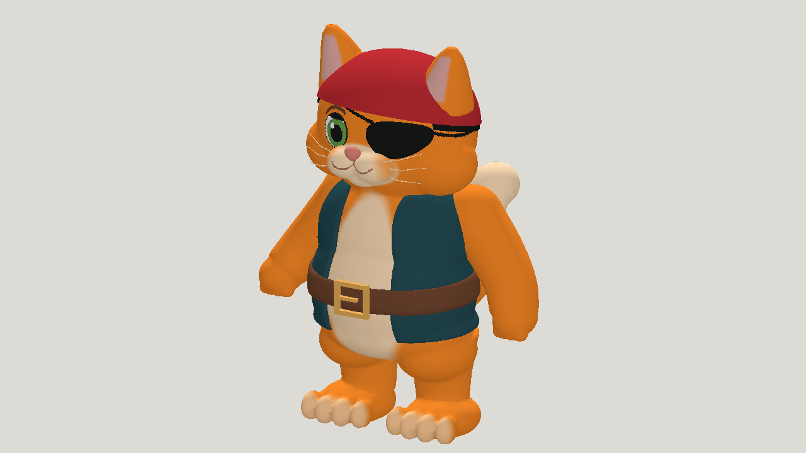

# Latest pirate cat: Fable 5.2 high, Claude Code

| Measure | Value |
|---|---|
| Model | claude-fable-5-2 |
| Driver | Claude Code builder using the mesh-jig CLI |
| Effort | high |
| Scope | One five-evaluation static run and its rig by a Claude Code builder with a shell, selected geometry and animation; idle, walk, run and leap included. The builder saw numeric scores after each build. Not a matched trial against the earlier cat builds, which used vertex colours. Not production quality. |
| Completed | true |
| Evaluations | 5 |
| Runtime seconds | 5820 |
| Driver turns | unknown |
| Prompt tokens | unknown |
| Cached prompt tokens | unknown |
| Cache write tokens | unknown |
| Completion tokens | unknown |
| Reasoning tokens | unknown |
| Model calls | unknown |
| Cost USD (unavailable) | unknown |
| Numeric score | 0.7047 |
| Gates passed | 16 |
| Gates total | 19 |

Token counts use the report's provider conventions. Reasoning is included in completion tokens; cache counters are not extra prompt tokens. Estimated cost is not an invoiced charge.

Five successful static evaluations. The fifth is the visual pick, a blind reviewer's pick and the numeric best at 0.7047: overlap 0.839, resemblance 0.570. Every attempt passed 16 of 19 gates; the front-view colour zones of the face, patch and eye fail. Painted 1024 px script texture, where the earlier cat builds used vertex colours.

Rig: 19 joints, 37,030 triangles; 2 of 12 builds passed, the other ten broke the 2.5x edge limit. The first cat rig with a leap, and it holds 2.5x where the site's animated Opus cat used 6x. Loop seams under 0.001 mm. Leap clears 348 mm at the apex and travels 0.70 m forward. Largest ground drop at 48 Hz is under 1.1 mm in every clip; the run is airborne for 19% of its samples.

Short legs give short strides and a stiff leap. Skin slides under the waistcoat armholes, the buckle parts from the belt by up to 19 mm in the run, and the feet stay flat. The body is blockier than the reference: thick arms, a straight torso and a ledge at the pelvis.

Runtime is approximate: about 97 minutes of work, 63 modeling and 31 rigging and audit, plus a 15-minute usage-limit pause not counted. Claude Code does not report the builder's own token use, so no cost is given.

[Download selected model](model-01.glb)
