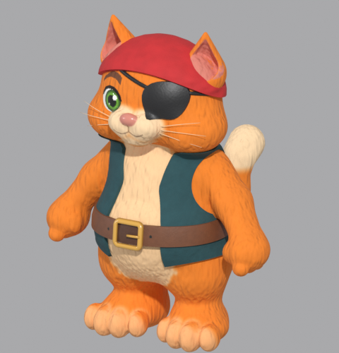
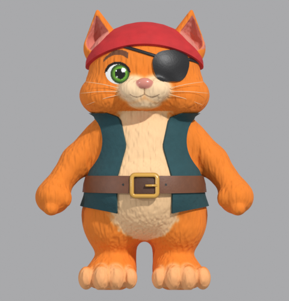
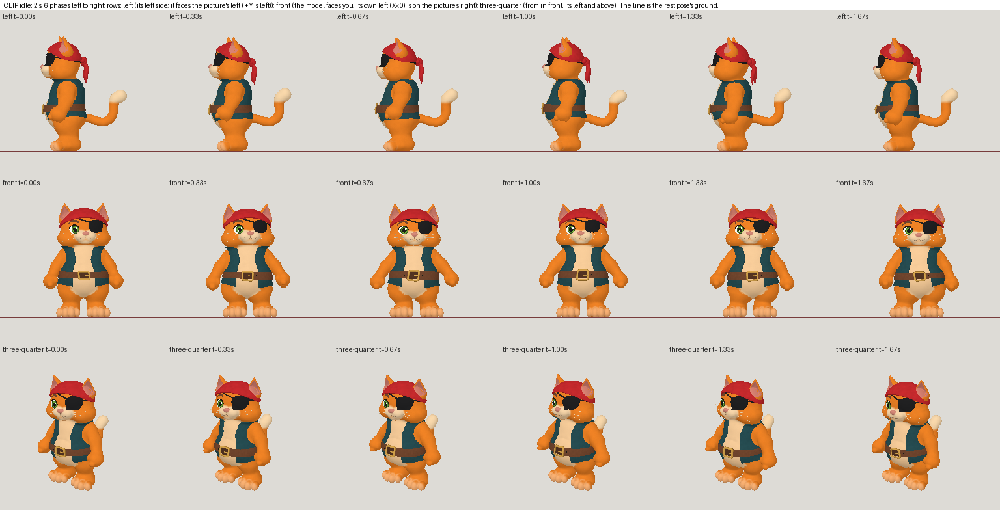
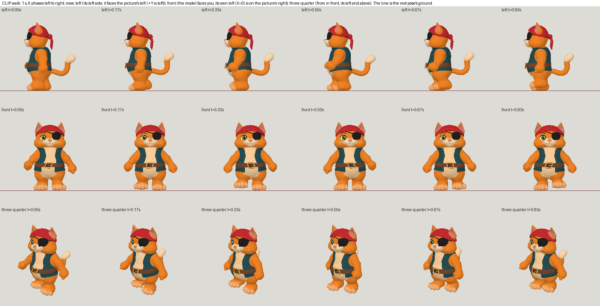
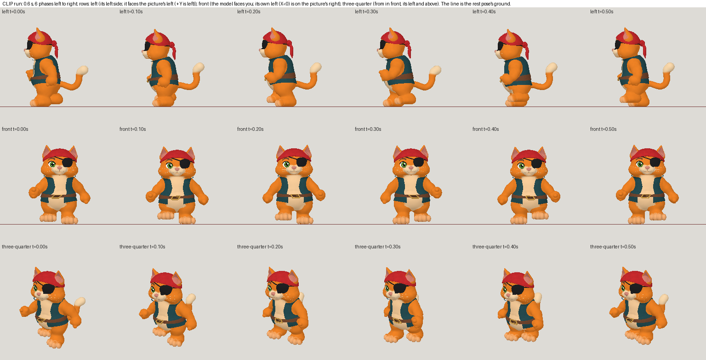
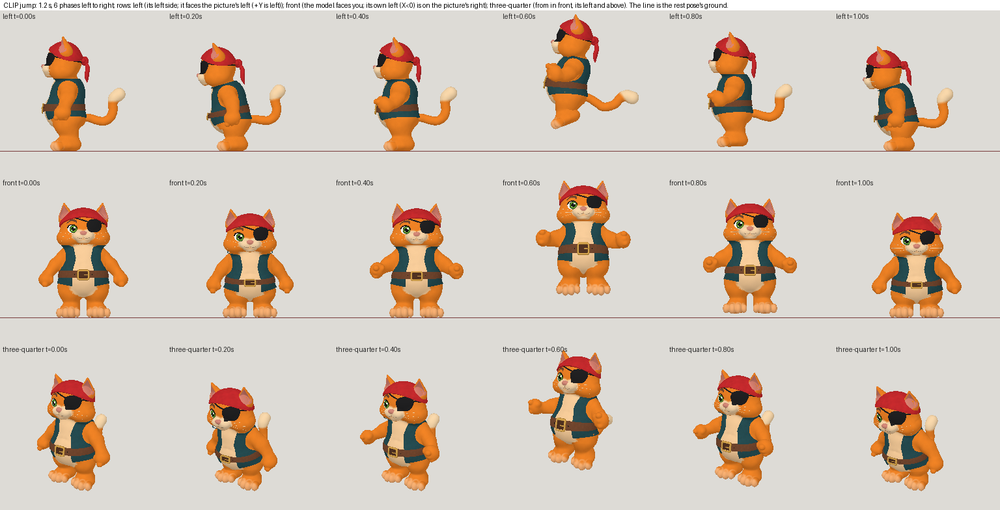
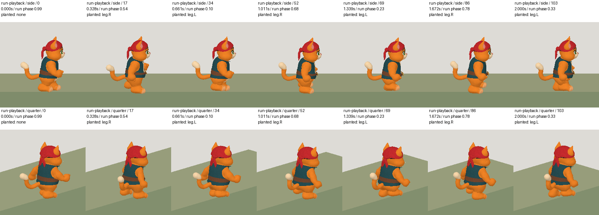
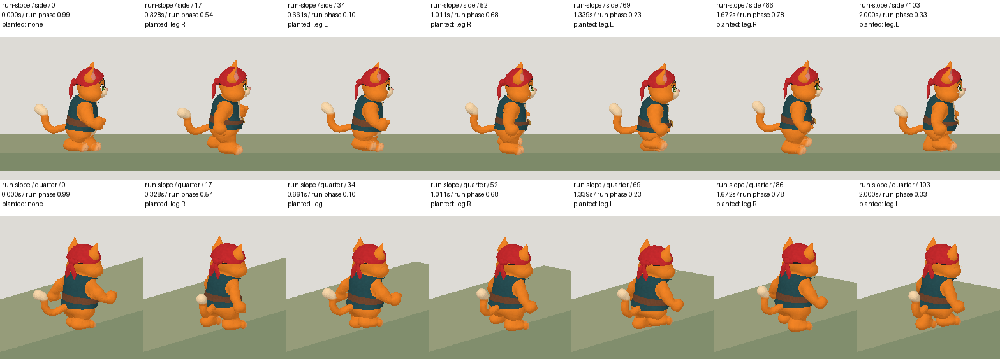
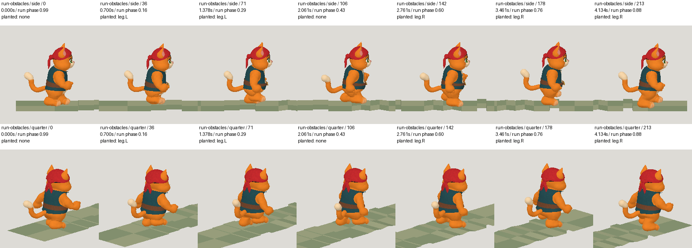

# Fable 5.2 high: pirate cat with builder-chosen production settings

| Measure | Value |
|---|---|
| Model | claude-fable-5-2 |
| Driver | Claude Code (subscription) |
| Effort | high |
| Scope | Five modelling evaluations. 5 of 13 rig submissions passed. Third game job delivered. |
| Completed | true |
| Evaluations | 5 |
| Runtime seconds | unknown |
| Driver turns | unknown |
| Prompt tokens | unknown |
| Cached prompt tokens | unknown |
| Cache write tokens | unknown |
| Completion tokens | unknown |
| Reasoning tokens | unknown |
| Model calls | unknown |
| Cost USD (unavailable) | unknown |
| Numeric score | 0.7133 |
| Gates passed | 16 |
| Gates total | 19 |

Token counts use the report's provider conventions. Reasoning is included in completion tokens; cache counters are not extra prompt tokens. Estimated cost is not an invoiced charge.

Five measured sculpt attempts under a builder-chosen 40,000 triangle ceiling. Visual pick a05 scored 0.7133. Numerical best 0.7196. Base colour uses a script-painted 1024 texture. Finish adds a 1024 normal map and a 1024 roughness map on one material.

5 of 13 rig submissions passed the unchanged 12 November contract. Rig r13 carries idle, walk, run and jump at 30 fps on 18 joints.

Game package: third job, first proposal. Idle, walk and run blend on measured speed (0.21 and 0.71 m/s); jump is an action state; two-bone ground legs. All package gates and six scenario checks pass on the harness limits. The first job failed run slip at 0.57 m/s against 0.35 and the run clip was rebuilt in the rig stage. The builder answered the harness's game loop through files; no API model was called.

Face, patch and eye colour gates missed. The short legs show no readable knee, the buckle skews when the trunk twists and the vest lifts up to 35 mm at the armholes. Fur relief runs straight down. Terrain: the game package passed its flat and 8% cross-slope checks with 7 cm ground limits; stairs and ridges are not qualified. The same builder prepared it offline, with no API model.

[Download selected model](model-01.glb)

[Download selected model](model-02.glb)
