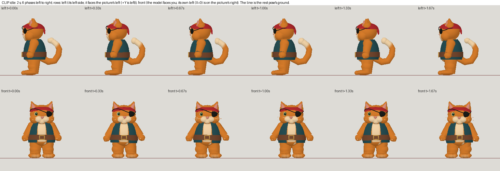
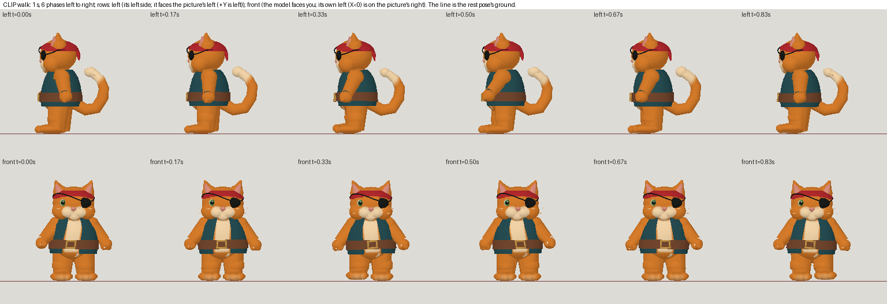
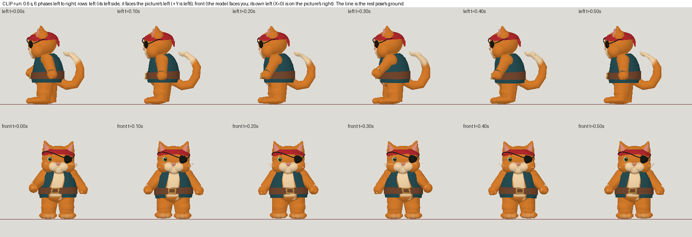
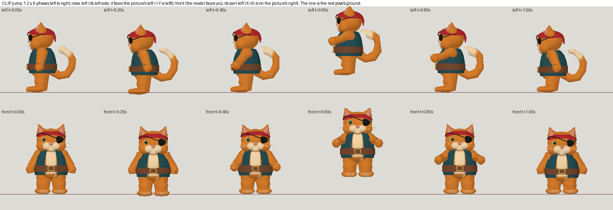

# Muse Ember high: pirate cat, failed animations

| Measure | Value |
|---|---|
| Model | meta/muse-ember |
| Driver | mesh-jig API agent through OpenRouter |
| Effort | high |
| Scope | Five reviewed static evaluations; visual a04; twelve failed rig submissions; last measured a12; IK not reached. |
| Completed | false |
| Evaluations | 5 |
| Runtime seconds | unknown |
| Driver turns | unknown |
| Prompt tokens | 5143127 |
| Cached prompt tokens | 3744684 |
| Cache write tokens | 0 |
| Completion tokens | 227992 |
| Reasoning tokens | 151401 |
| Model calls | 111 |
| Cost USD (reported) | 0.268819 |
| Numeric score | 0.5961 |
| Gates passed | 15 |
| Gates total | 19 |

Token counts use the report's provider conventions. Reasoning is included in completion tokens; cache counters are not extra prompt tokens. Estimated cost is not an invoiced charge.

Failed rig: all 12 submissions failed. Last measured a12 shown unchanged: walk/run/jump edge stretch 6.71x/10.42x/9.01x versus 3x; jump sinks 48.3 mm versus 15 mm. Stiff gait and skin deformation remain. IK was not reached.

Visual pick scored 0.5961; numeric best 0.6160. First GLB is the last measured failed animation; second is the selected static model.

Cost includes all completed model, selection and rig calls, including closing/debugging dialogue. Zero unpriced entries. Geometry, clips and weights were not repaired; no gates relaxed. Unmeasured post-budget drafts are excluded.

[Download selected model](model-01.glb)

[Download selected model](model-02.glb)
