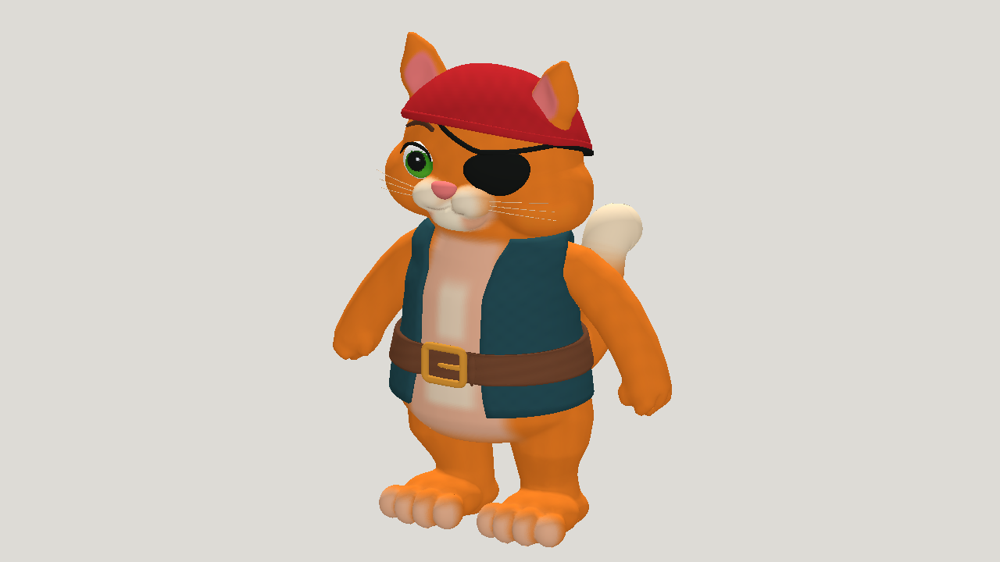
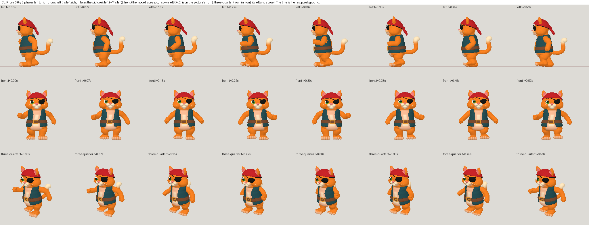
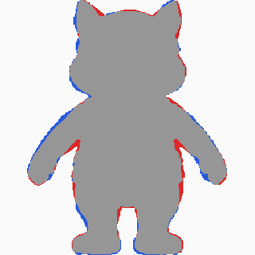

# Gemini 4 Neon High: pirate cat with four clips

| Measure | Value |
|---|---|
| Model | gemini-4-neon |
| Driver | Antigravity subscription CLI |
| Effort | high |
| Scope | One run on the frozen pirate-cat contract: 60,000-triangle cap, script-painted 1024 px texture, the four-clip rig contract. 10 scored meshes in 11 submissions and 3 passing native rigs in 10 submissions. |
| Completed | true |
| Evaluations | 10 |
| Runtime seconds | 9553.009857 |
| Driver turns | unknown |
| Prompt tokens | 25856512 |
| Cached prompt tokens | 24559782 |
| Cache write tokens | unknown |
| Completion tokens | 672112 |
| Reasoning tokens | 218149 |
| Model calls | unknown |
| Cost USD (estimated) | 17.66 |
| Numeric score | 0.7422 |
| Gates passed | 19 |
| Gates total | 19 |

Token counts use the report's provider conventions. Reasoning is included in completion tokens; cache counters are not extra prompt tokens. Estimated cost is not an invoiced charge.

Ten of eleven submissions scored (a03 failed to build); Neon picked its numeric best, a11. The feet are pale with long toes rather than orange paws. Seven of ten rigs exceeded the 3x edge-stretch limit in run or jump; r07, r09 and r10 passed and Neon picked r10. Walk and run are short in-place gaits. The last turn took the estimate to US$17.66, past the US$17.46 stop.

The first GLB carries idle (2 s loop), walk (1 s loop), run (0.6 s loop) and jump (1.2 s). The second is the frozen mesh.

The cost values the logged Antigravity tokens at Google Standard Gemini API rates.

[Download selected model](model-01.glb)

[Download selected model](model-02.glb)

