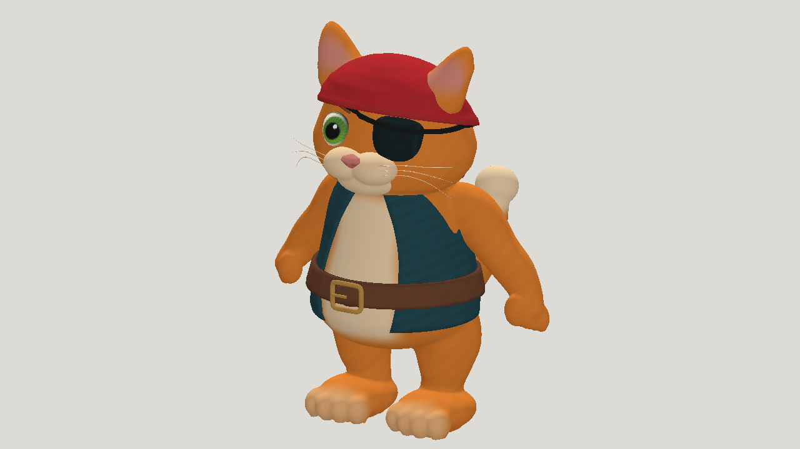
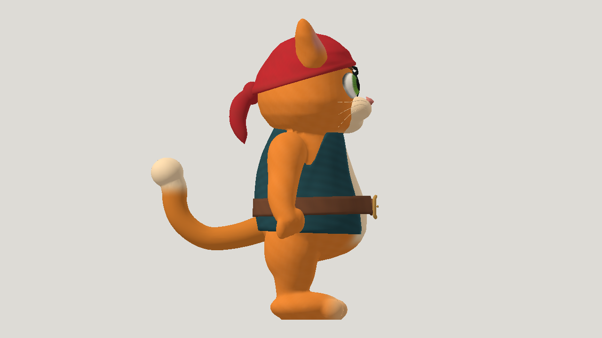

# Pirate cat, GPT-6.2 Sol high

| Measure | Value |
|---|---|
| Model | gpt-6.2-sol |
| Driver | Codex native subscription |
| Effort | high |
| Scope | Five measured models from six submissions and one passing native rig. The older comparison is labeled GPT-6 Sol high. Its exact Sol version is unverified. |
| Completed | true |
| Evaluations | 5 |
| Runtime seconds | unknown |
| Driver turns | unknown |
| Prompt tokens | unknown |
| Cached prompt tokens | unknown |
| Cache write tokens | unknown |
| Completion tokens | unknown |
| Reasoning tokens | unknown |
| Model calls | unknown |
| Cost USD (unavailable) | unknown |
| Numeric score | 0.6934 |
| Gates passed | 16 |
| Gates total | 19 |

Token counts use the report's provider conventions. Reasoning is included in completion tokens; cache counters are not extra prompt tokens. Estimated cost is not an invoiced charge.

The selected 58,114-triangle model scored 0.6934. Three of nineteen checks missed their regional colour thresholds: face, left eye patch and right eye. The green eye still projects from the cheek and the paw digits are simplified.

Idle, walk, run and jump pass the frozen native rig contract at 30 and 60 Hz sampling. The walk has up to 0.12 m/s of contact slide in the harness diagnostic. The run and jump show localized joint compression. Model-01 is animated and model-02 is the static source.

The older comparison used a separate blind reviewer for every measured build. This run used separate blind reviews for the last two builds and builder reviews for the first three. The jig ledger measured 1,196.6 seconds of active modeling commands and 24.0 seconds for the rig build. End-to-end wall time, native tokens and subscription cost were unavailable.

[Download selected model](model-01.glb)

[Download selected model](model-02.glb)
