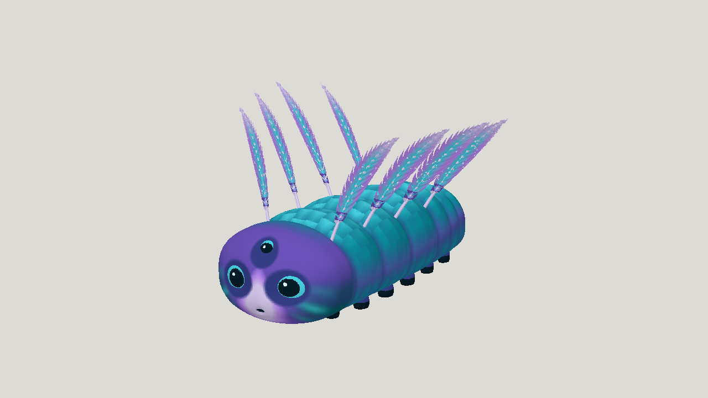

# Three-eyed caterpillar: Gemini 4 Hydrogen High

| Measure | Value |
|---|---|
| Model | gemini-4-hydrogen-high |
| Driver | Antigravity subscription CLI |
| Effort | high |
| Scope | One independent run: five successful model evaluations and three passing rig candidates under the frozen reference contract. |
| Completed | true |
| Evaluations | 5 |
| Runtime seconds | unknown |
| Driver turns | unknown |
| Prompt tokens | unknown |
| Cached prompt tokens | unknown |
| Cache write tokens | unknown |
| Completion tokens | unknown |
| Reasoning tokens | unknown |
| Model calls | unknown |
| Cost USD (unavailable) | unknown |
| Numeric score | 0.4932 |
| Gates passed | 0 |
| Gates total | 1 |

Token counts use the report's provider conventions. Reasoning is included in completion tokens; cache counters are not extra prompt tokens. Estimated cost is not an invoiced charge.

Five successful model evaluations, with the earlier visual selection retained over the latest candidate. Three rig candidates pass the unchanged contract. The selected model fails the resemblance gate.

Simplified sculpted face, layered scales and frond silhouette. Head-led turn and frond sway remain clear, while the crawl reads as a restrained shuffle with a weak contraction wave and subtle foot planting.

Sampled poses show no gross detachment or collapse, but do not certify foot sliding, minor intersections or all frond clearances. Subscription cost is not reported.

[Download selected model](model-01.glb)
