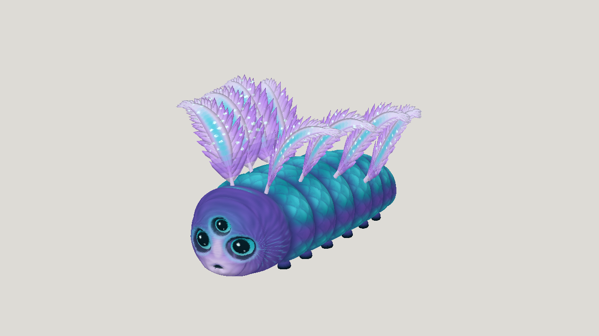
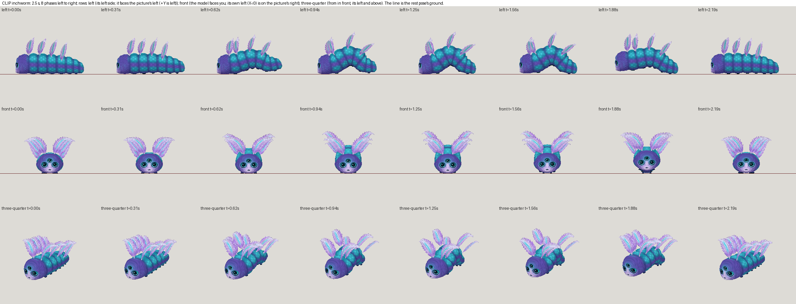

# Gemini 4 Neon High: caterpillar with inch-worm clips

| Measure | Value |
|---|---|
| Model | gemini-4-neon |
| Driver | Antigravity subscription CLI |
| Effort | high |
| Scope | One standalone run under a 60,000-triangle cap and an open rig contract. 10 evaluated meshes and 3 passing native rigs. |
| Completed | true |
| Evaluations | 10 |
| Runtime seconds | 5617.638229 |
| Driver turns | unknown |
| Prompt tokens | 15782756 |
| Cached prompt tokens | 14522466 |
| Cache write tokens | unknown |
| Completion tokens | 444014 |
| Reasoning tokens | 163980 |
| Model calls | unknown |
| Cost USD (estimated) | 12.62 |
| Numeric score | 0.6065 |
| Gates passed | 1 |
| Gates total | 1 |

Token counts use the report's provider conventions. Reasoning is included in completion tokens; cache counters are not extra prompt tokens. Estimated cost is not an invoiced charge.

Different contract from the other caterpillar entries: a 60,000-triangle cap (they had 32,000), an open rig contract and inch-worm clips instead of idle, crawl and turn, so do not compare them like for like. Neon picked a09 (0.6065) over the numeric best a10 (0.6123), whose frond tips hooked down. The arch is low: mid-stride the back dips between two humps instead of rising in one tall hump. The rig was written against AI-generated H3 videos; no gate measures the motion against them.

The first GLB carries the inchworm (2.5 s loop) and inchworm_travel (5 s) clips. The second is the frozen mesh.

The cost values the logged Antigravity tokens at Google Standard Gemini API rates.

[Download selected model](model-01.glb)

[Download selected model](model-02.glb)
