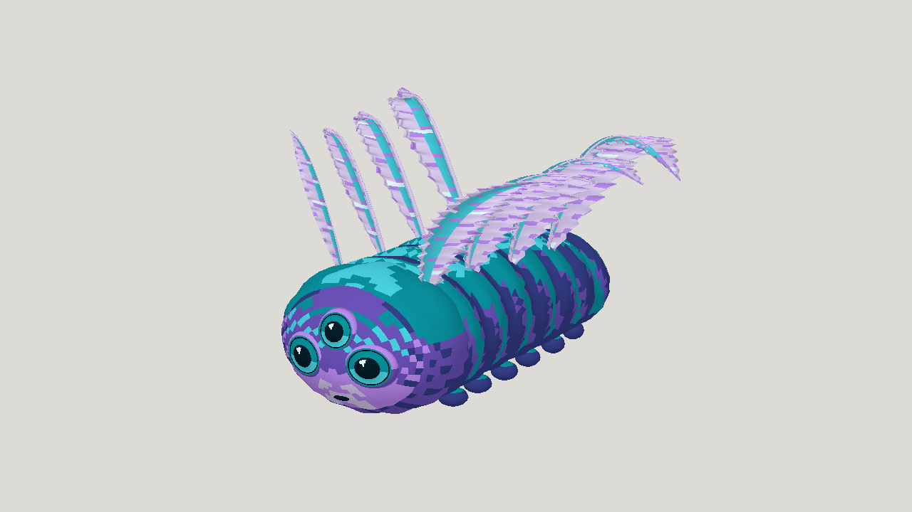
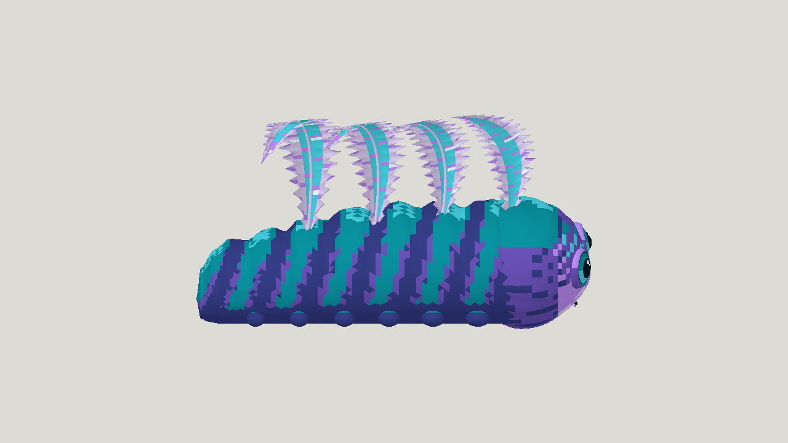

# Three-eyed caterpillar, GPT-6.2 Sol high

| Measure | Value |
|---|---|
| Model | gpt-6.2-sol |
| Driver | Codex native subscription |
| Effort | high |
| Scope | Fresh high-effort run on the original Sol 6.1 caterpillar contracts. Five completed model evaluations from six submissions and three passing native rig builds from three submissions. |
| Completed | true |
| Evaluations | 5 |
| Runtime seconds | unknown |
| Driver turns | unknown |
| Prompt tokens | unknown |
| Cached prompt tokens | unknown |
| Cache write tokens | unknown |
| Completion tokens | unknown |
| Reasoning tokens | unknown |
| Model calls | unknown |
| Cost USD (unavailable) | unknown |
| Numeric score | 0.5213 |
| Gates passed | 0 |
| Gates total | 1 |

Token counts use the report's provider conventions. Reasoning is included in completion tokens; cache counters are not extra prompt tokens. Estimated cost is not an invoiced charge.

The 31,744-triangle selection scored 0.5213. Resemblance was 0.3531 against 0.40 required. The frontal fronds bunch together and some feather surfaces show backface gaps. One earlier build exceeded the triangle cap.

Idle, crawl and gentle turn hold the numeric rig limits. Sampled poses show staggered crawl, with residual proleg contact gaps and sliding during the turn. Model-01 is animated and model-02 is the static source.

Some full modeling diagnostics and close-ups were read after the next revision began. The jig command ledger measured 686.7 seconds active at the model stage and 243.5 seconds at the rig stage. Subscription cost, native tokens and end-to-end wall time were unavailable.

[Download selected model](model-01.glb)

[Download selected model](model-02.glb)
