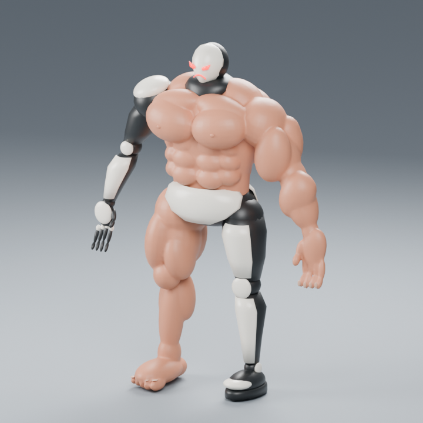
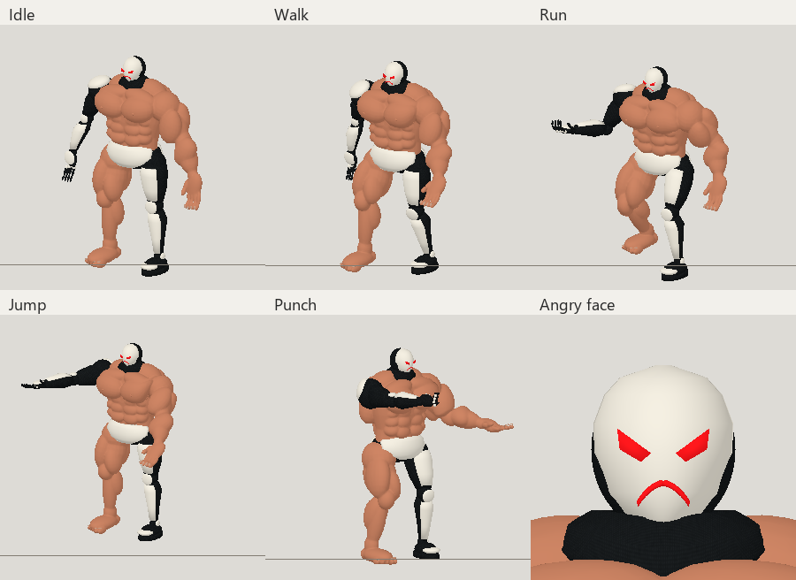

# Hulking cyborg: Astra high

| Measure | Value |
|---|---|
| Model | GPT-6 Astra |
| Driver | Codex subscription worker |
| Effort | high |
| Scope | Seven evaluated models; visually selected a07 and final rig r06 of six iterations |
| Completed | unknown |
| Evaluations | 7 |
| Runtime seconds | unknown |
| Driver turns | unknown |
| Prompt tokens | unknown |
| Cached prompt tokens | unknown |
| Cache write tokens | unknown |
| Completion tokens | unknown |
| Reasoning tokens | unknown |
| Model calls | unknown |
| Cost USD (unavailable) | unknown |
| Numeric score | 0.5618 |
| Gates passed | 2 |
| Gates total | 2 |

Token counts use the report's provider conventions. Reasoning is included in completion tokens; cache counters are not extra prompt tokens. Estimated cost is not an invoiced charge.

55,136 triangles, 31 shared bones, six clips: idle, walk, run, jump, punch and angry_face. All declared rig checks and independent 60 Hz export sampling pass. Simplified muscle sculpt, extremities and carbon weave; no game-runtime or full collision validation.

Walk and run loop in place and require caller forward speeds 0.510753 and 3.009259 m/s. Jump, punch and angry_face are one-shot actions. Sampled interpolation ground penetration reaches 2.06 mm.

The website export uses core glTF unit-strength red emission instead of the native optional 3x emissive-strength extension. Geometry, textures, skinning and all animation channels are unchanged. Runtime, token usage and subscription cost were not reported.

[Download selected model](model-01.glb)
