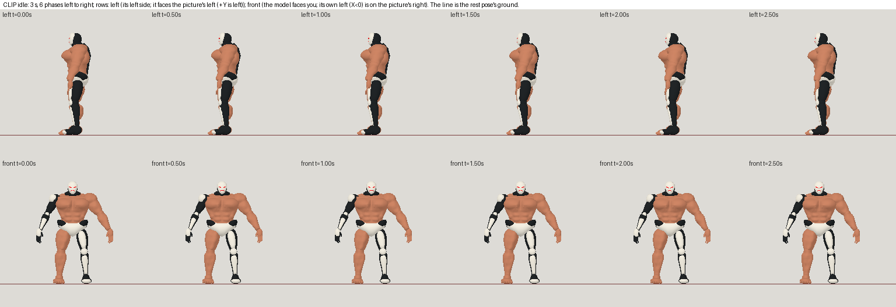
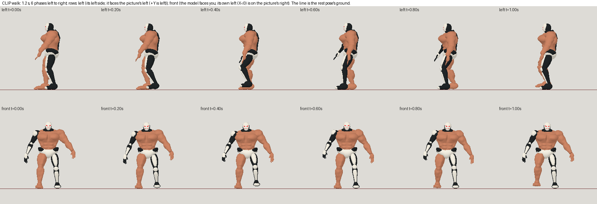
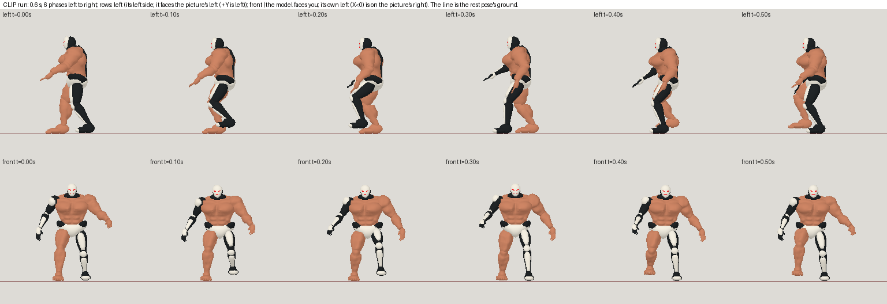
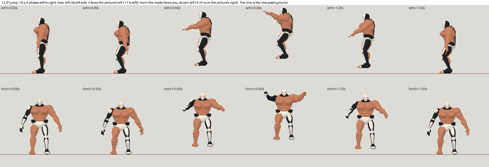
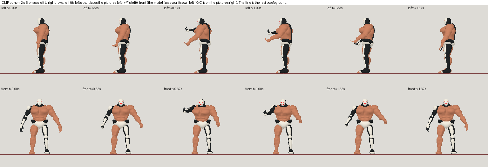
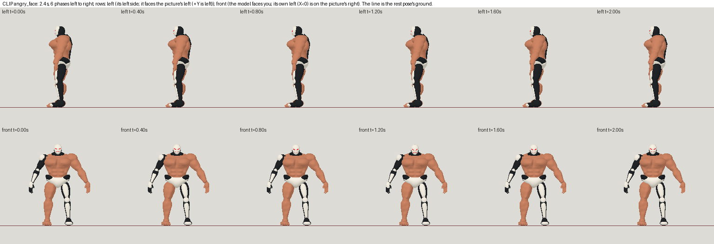

# GPT-6.2 Astra high: cyborg animation and terrain trial

| Measure | Value |
|---|---|
| Model | gpt-6.2-astra |
| Driver | Codex desktop subscription with native mesh-jig tools |
| Effort | high |
| Scope | Five fresh static evaluations, three passing native rigs and three game proposals. Visual selection a05-finish at 0.5841. Numeric best 0.5855. Selected rig r03-recoil, terrain a01. |
| Completed | false |
| Evaluations | 5 |
| Runtime seconds | unknown |
| Driver turns | unknown |
| Prompt tokens | unknown |
| Cached prompt tokens | unknown |
| Cache write tokens | unknown |
| Completion tokens | unknown |
| Reasoning tokens | unknown |
| Model calls | unknown |
| Cost USD (unavailable) | unknown |
| Numeric score | 0.5841 |
| Gates passed | 2 |
| Gates total | 2 |

Token counts use the report's provider conventions. Reasoning is included in completion tokens; cache counters are not extra prompt tokens. Estimated cost is not an invoiced charge.

Experimental terrain. Three native rigs passed all six clips. All three IK proposals missed ground-contact clusters on separate heel and toe meshes. The selected a01 passed walk/run playback, flat ground and cross-slope. The extra run-to-action blend slipped at 2.08 m/s. No game-ready delivery.

The smoother abdomen, cupped pelvic shell and separated bare toes led the visual choice. The organic back and limbs remain simplified. The numeric leader was a04 at 0.5855.

One Codex subscription session authored both subjects at high effort. Per-subject token usage and cost were unavailable.

[Download selected model](model-01.glb)

[Download selected model](model-02.glb)
