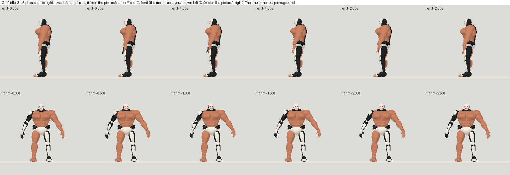
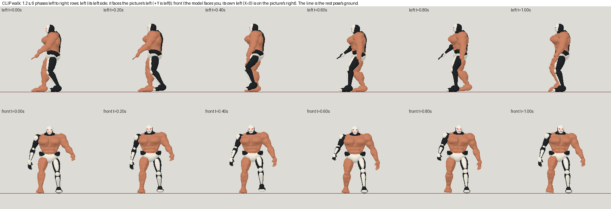
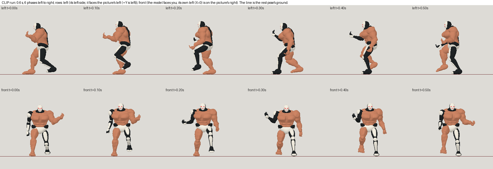
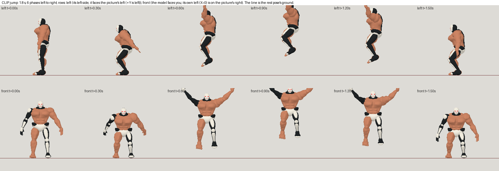
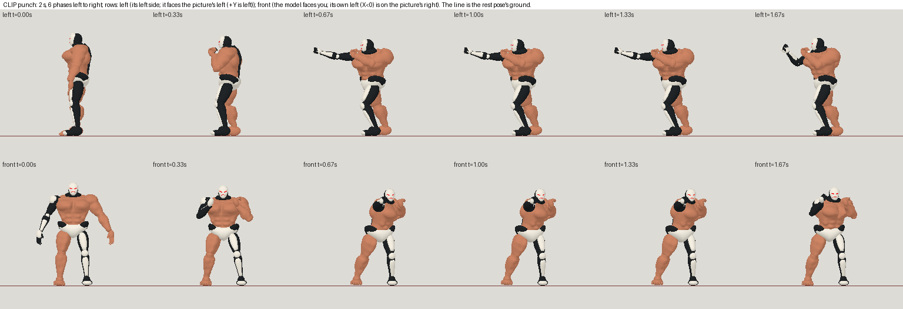
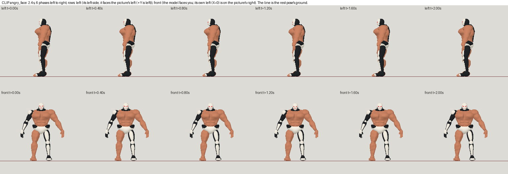

# GPT-6.2 Astra high cyborg video-guided animation continuation

| Measure | Value |
|---|---|
| Model | gpt-6.2-astra |
| Driver | Codex desktop subscription with native mesh-jig tools |
| Effort | high |
| Scope | Animation-only continuation on the original 0.5841 cyborg. Zero new static evaluations. Three of four native rig submissions passed all six clips. Three new terrain proposals used the selected animated GLB. |
| Completed | false |
| Evaluations | 0 |
| Runtime seconds | unknown |
| Driver turns | unknown |
| Prompt tokens | unknown |
| Cached prompt tokens | unknown |
| Cache write tokens | unknown |
| Completion tokens | unknown |
| Reasoning tokens | unknown |
| Model calls | unknown |
| Cost USD (unavailable) | unknown |
| Numeric score | 0.5841 |
| Gates passed | 2 |
| Gates total | 2 |

Token counts use the report's provider conventions. Reasoning is included in completion tokens; cache counters are not extra prompt tokens. Estimated cost is not an invoiced charge.

The approved video references informed idle, walk, run, jump and punch. The right cross holds 99.2% of its peak forward reach through 0.60–1.50 s, up from 40.4%. The strike still lands low in three-quarter view, the opposite fist stays close to the chest, and the guard stays high late in recovery.

The original mesh, skin and angry-face animation are preserved. Walk, run and jump use the original contract durations, so the approved motion is retimed. The original text-guided trial was withdrawn from the live gallery.

Experimental terrain. All three proposals missed separate foot-contact clusters. The selected heel proposal passed six walk/run scenarios. Obstacle penetration reached 20.3 mm and joint speed reached 37.3 m/s. Extra action blends slipped at 0.66 and 3.45 m/s.

This Codex subscription session did not report per-stage tokens or cost.

[Download selected model](model-01.glb)

[Download selected model](model-02.glb)
