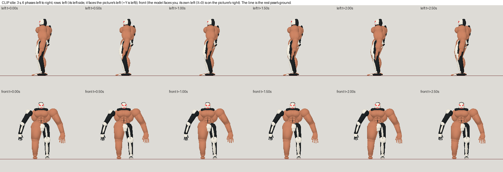
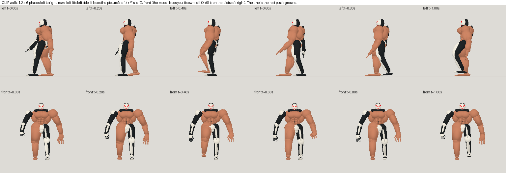
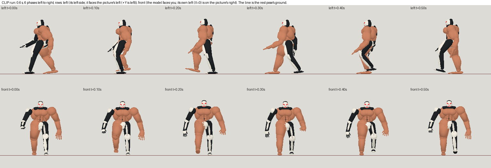
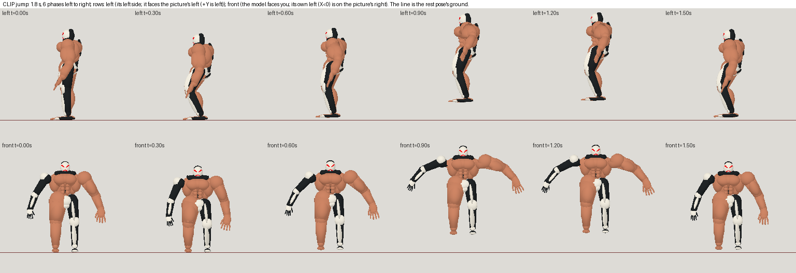
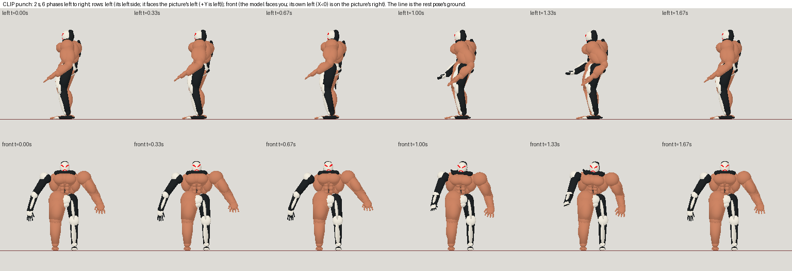
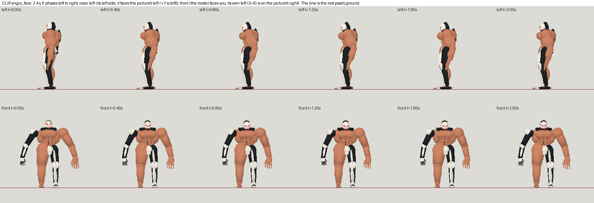

# Muse Ember high: hulking cyborg, failed animations

| Measure | Value |
|---|---|
| Model | meta/muse-ember |
| Driver | mesh-jig API agent through OpenRouter |
| Effort | high |
| Scope | Five reviewed static evaluations; visual a04; twelve failed rig submissions; last measured a08; IK not reached. |
| Completed | false |
| Evaluations | 5 |
| Runtime seconds | unknown |
| Driver turns | unknown |
| Prompt tokens | 5133813 |
| Cached prompt tokens | 3865880 |
| Cache write tokens | 0 |
| Completion tokens | 198918 |
| Reasoning tokens | 126040 |
| Model calls | 106 |
| Cost USD (reported) | 0.241716 |
| Numeric score | 0.4975 |
| Gates passed | 2 |
| Gates total | 2 |

Token counts use the report's provider conventions. Reasoning is included in completion tokens; cache counters are not extra prompt tokens. Estimated cost is not an invoiced charge.

Failed rig: all 12 submissions failed. Last measured a08 shown unchanged: run edge stretch 12.92x versus 2.5x; jump 5.62x and punch 4.42x. Skin and hand deformation remain. IK was not reached.

Visual pick scored 0.4975; numeric best 0.5020. First GLB is the last measured failed animation; second is the selected static model.

Cost includes all completed model, selection and rig calls, including closing/debugging dialogue. Zero unpriced entries. Geometry, clips and weights were not repaired; no gates relaxed. Unmeasured post-budget drafts are excluded.

[Download selected model](model-01.glb)

[Download selected model](model-02.glb)
