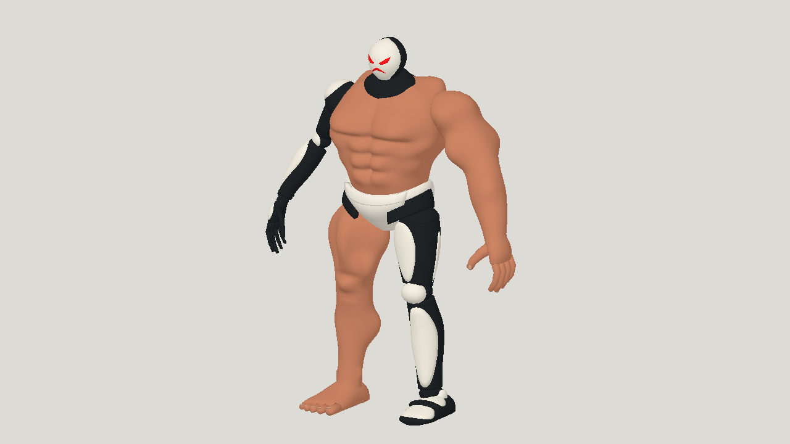
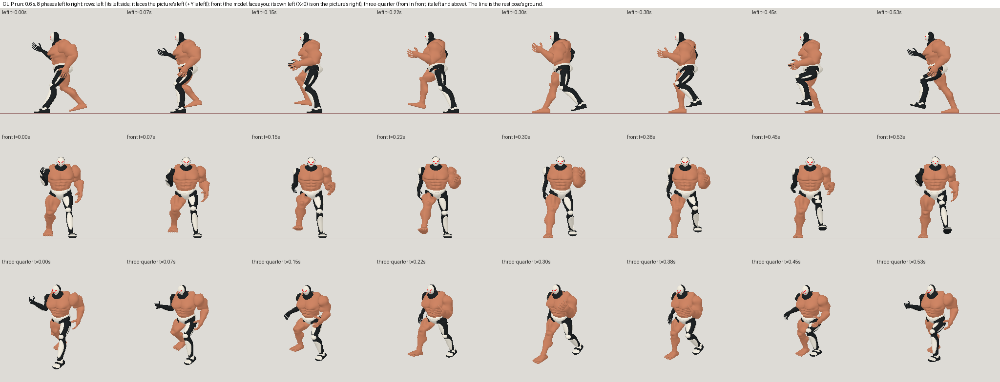
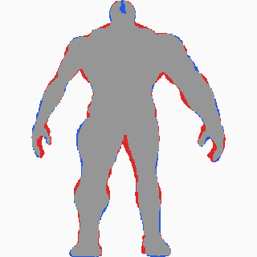

# Gemini 4 Neon High: hulking cyborg with six clips

| Measure | Value |
|---|---|
| Model | gemini-4-neon |
| Driver | Antigravity subscription CLI |
| Effort | high |
| Scope | One run on the frozen v9 cyborg contract: 60,000-triangle cap, the six-clip native rig contract and the approved idle, walk, run, jump and punch video references. 10 scored meshes in 10 submissions and 3 passing native rigs in 4 submissions. |
| Completed | true |
| Evaluations | 10 |
| Runtime seconds | 6510.479659 |
| Driver turns | unknown |
| Prompt tokens | 19974986 |
| Cached prompt tokens | 18295885 |
| Cache write tokens | unknown |
| Completion tokens | 513035 |
| Reasoning tokens | 130850 |
| Model calls | unknown |
| Cost USD (estimated) | 15.48 |
| Numeric score | 0.6358 |
| Gates passed | 2 |
| Gates total | 2 |

Token counts use the report's provider conventions. Reasoning is included in completion tokens; cache counters are not extra prompt tokens. Estimated cost is not an invoiced charge.

Neon picked its numeric best, a10. The head and faceplate are small and the muscles smoother than the sheet. r01 exceeded the 2.5x edge-stretch limit in run and punch; r02, r03 and r04 passed and Neon picked r04. The punch lands with an open hand, not a fist. The coordinator crashed on a wrong file name after modelling; the rig stage was resumed in the same conversation with 40 minutes, and the time shown leaves out the gap.

The first GLB carries idle, walk, run, jump, punch and angry_face. The second is the frozen mesh.

The cost values the logged Antigravity tokens at Google Standard Gemini API rates.

[Download selected model](model-01.glb)

[Download selected model](model-02.glb)

