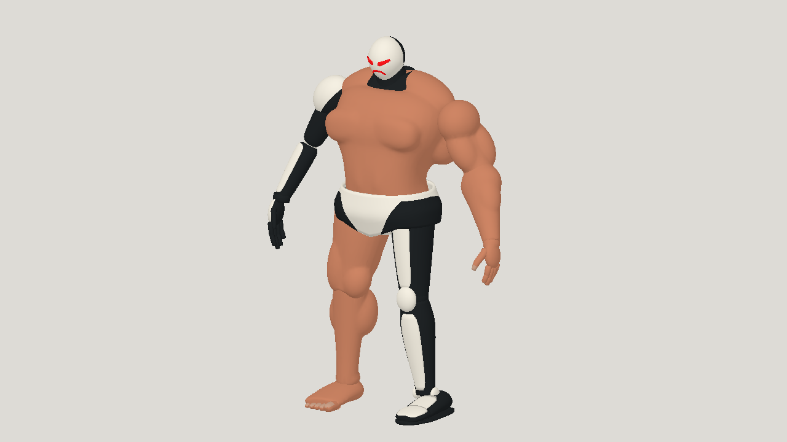
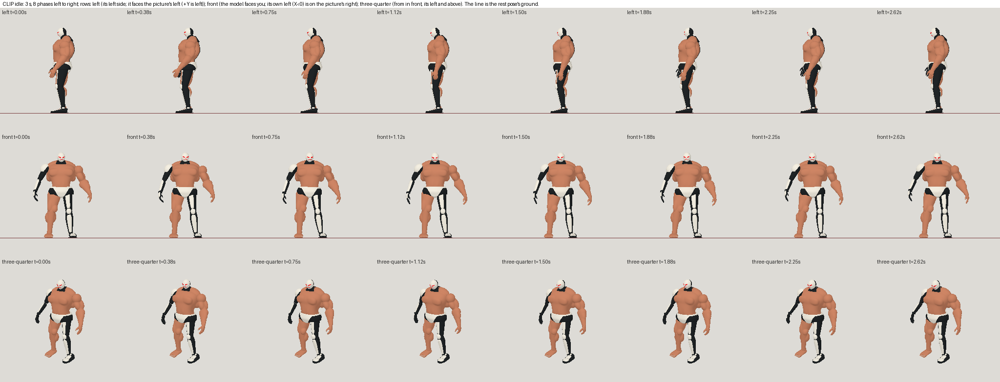
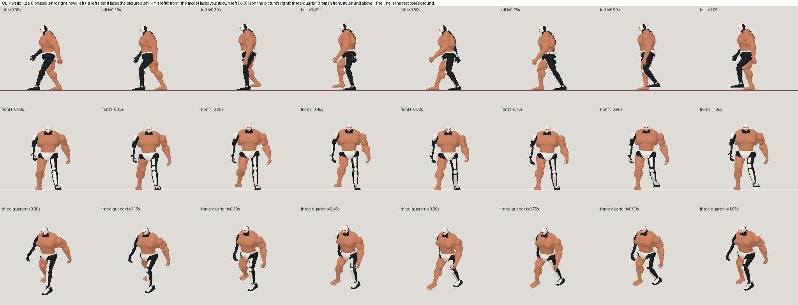
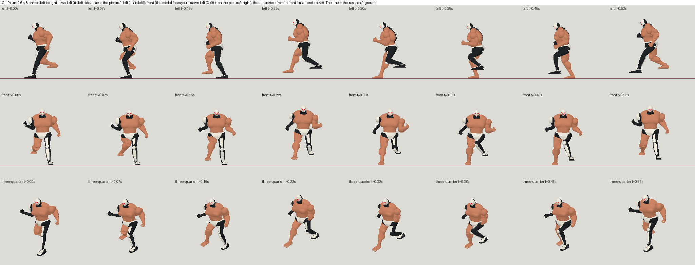
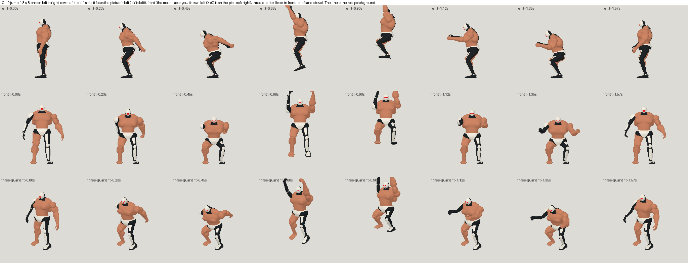
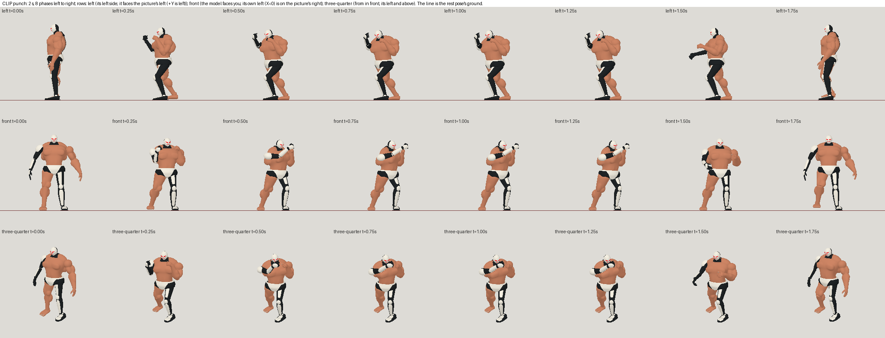
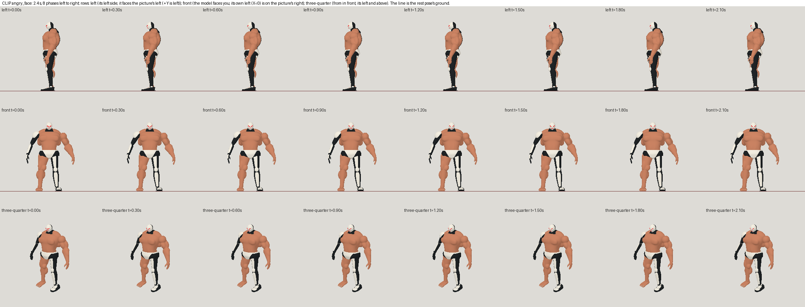

# Claude Opus 5.5 high: hulking cyborg

| Measure | Value |
|---|---|
| Model | claude-opus-5-5 |
| Driver | Claude Code subscription CLI |
| Effort | high |
| Scope | 5 completed evaluations; selected a03; 12 rig builds, 11 passing; delivered r12; offline game package. |
| Completed | true |
| Evaluations | 5 |
| Runtime seconds | 8200.8 |
| Driver turns | 426 |
| Prompt tokens | 148573753 |
| Cached prompt tokens | 146651514 |
| Cache write tokens | 1921193 |
| Completion tokens | 524532 |
| Reasoning tokens | 244072 |
| Model calls | unknown |
| Cost USD (estimated) | 52.6689258 |
| Numeric score | 0.5998 |
| Gates passed | 2 |
| Gates total | 2 |

Token counts use the report's provider conventions. Reasoning is included in completion tokens; cache counters are not extra prompt tokens. Estimated cost is not an invoiced charge.

Smooth barrel torso with small organic hands. Eleven of twelve rig submissions passed. The game package passes only with trial limits: run skate 0.136 m/s and idle–walk blend slip 0.466 m/s against 0.05 and 0.1. Every offline scenario fails in the reference runtime and Godot: flat walk-to-run slip 0.197 m/s (limit 0.05); the 10% slope fails contact gap 13.9 mm (8), penetration 7.7 mm (3), slip and support; the 0.10 m step fails contact gap and recovery at 99 mm (8). Offline game checks only.

Selected static score 0.5998; numeric best 0.6009. First GLB is the delivered animated rig; second is the selected static model.

Cost is Claude Code's own list-price estimate for the whole session, US$52.67; the run used a Max subscription, so it is not an invoice. Runtime is active process time; usage-limit pause excluded.

Geometry, weights and clips are unchanged; no gates relaxed by the publisher. Motion reference videos stay private.

[Download selected model](model-01.glb)

[Download selected model](model-02.glb)
