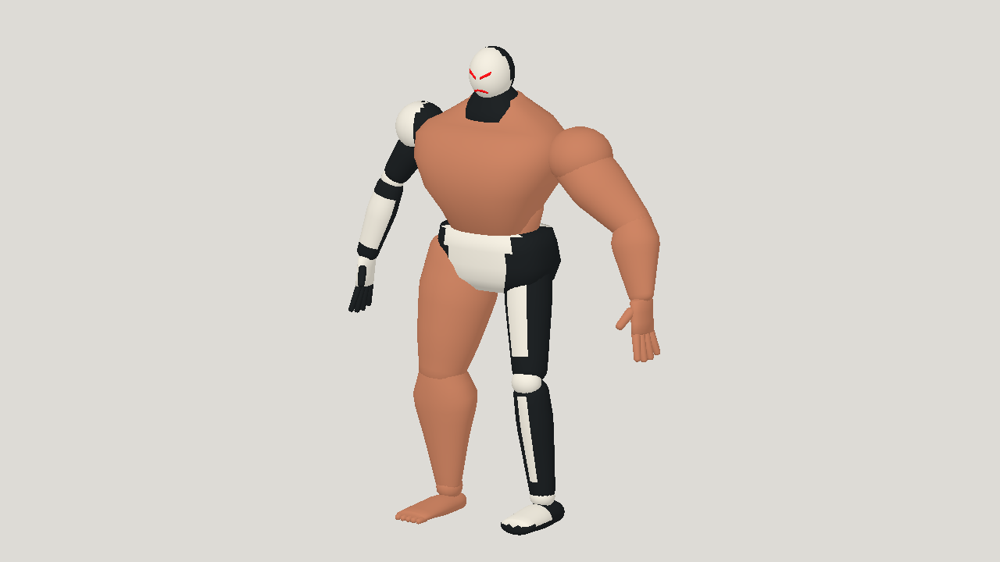
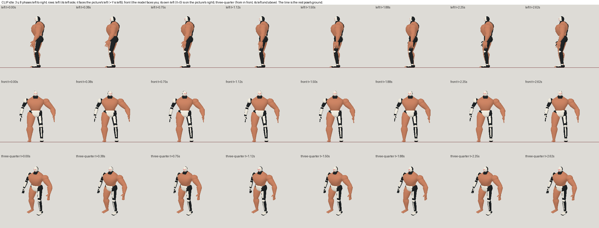
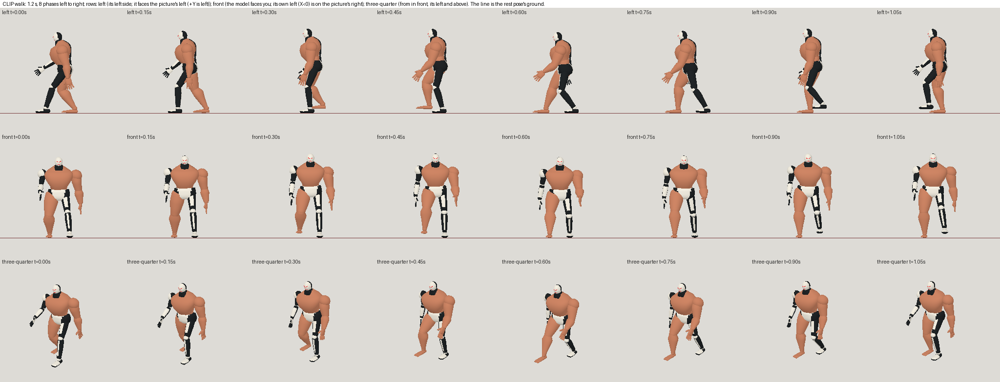
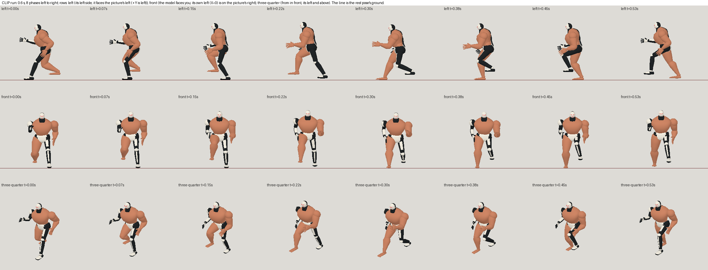
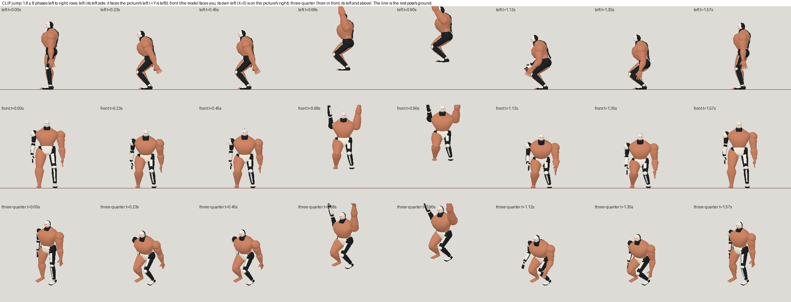
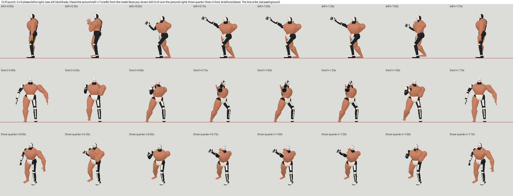
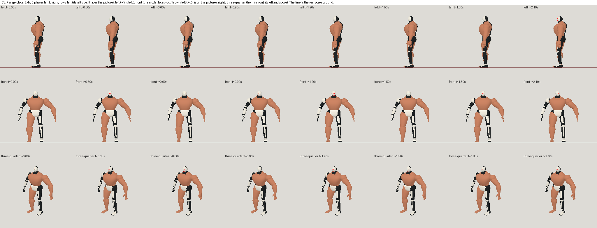

# Claude Opus 5.5 low: hulking cyborg

| Measure | Value |
|---|---|
| Model | claude-opus-5-5 |
| Driver | Claude Code subscription CLI |
| Effort | low |
| Scope | 7 completed evaluations; selected a07; 9 rig builds, 9 passing; delivered r09; offline game package. |
| Completed | true |
| Evaluations | 7 |
| Runtime seconds | 3030.8 |
| Driver turns | 151 |
| Prompt tokens | 31325565 |
| Cached prompt tokens | 29887406 |
| Cache write tokens | 1437775 |
| Completion tokens | 197173 |
| Reasoning tokens | 45168 |
| Model calls | unknown |
| Cost USD (estimated) | 19.3178042 |
| Numeric score | 0.5529 |
| Gates passed | 2 |
| Gates total | 2 |

Token counts use the report's provider conventions. Reasoning is included in completion tokens; cache counters are not extra prompt tokens. Estimated cost is not an invoiced charge.

Seven logged evaluations include two accidental copies of a04 (five distinct models). Rigid parts: every piece rides one bone, so stretch stays at zero but knee and shoulder pieces interpenetrate at deep bends. The game package passes only with trial limits: run skate 0.097 m/s and walk–run blend slip 0.457 m/s against 0.05 and 0.1. The 1-in-10 slope walk fails contact gap 3.5 mm (limit 3), penetration 9.7 mm (3) and support 0.61 (0.95) in the reference runtime and Godot.

Offline game checks only.

Selected static score 0.5529; numeric best 0.5770. First GLB is the delivered animated rig; second is the selected static model.

Cost is Claude Code's own list-price estimate for the whole session, US$19.32; the run used a Max subscription, so it is not an invoice. Runtime is active process time; usage-limit pause excluded.

Geometry, weights and clips are unchanged; no gates relaxed by the publisher. Motion reference videos stay private.

[Download selected model](model-01.glb)

[Download selected model](model-02.glb)
