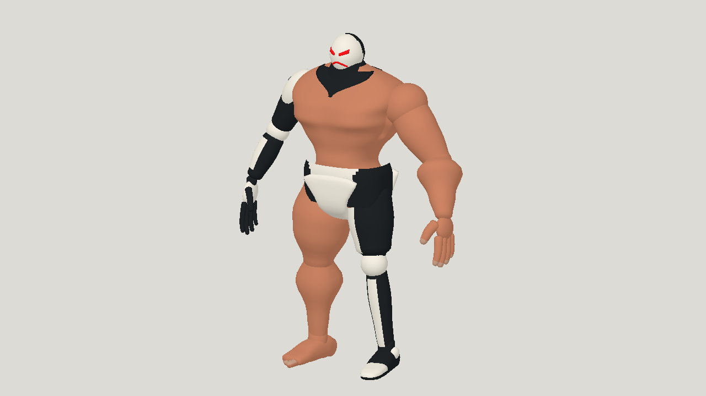
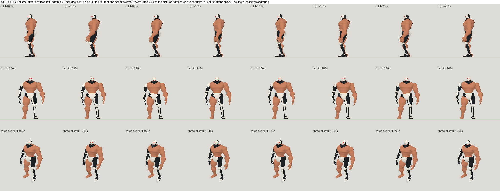
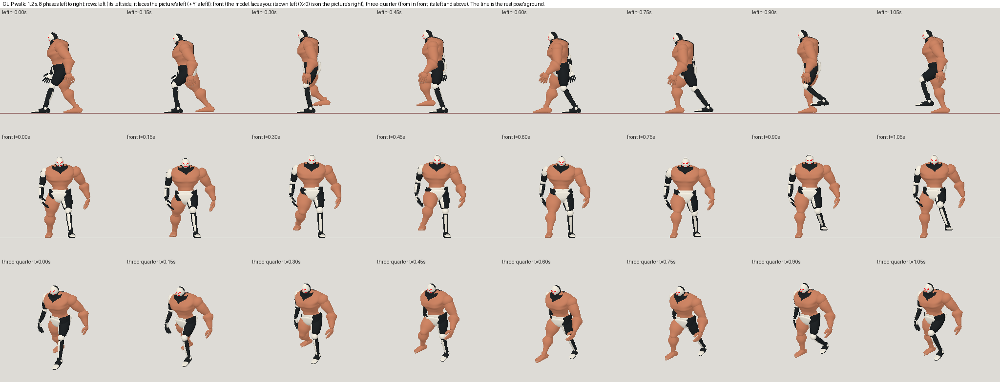
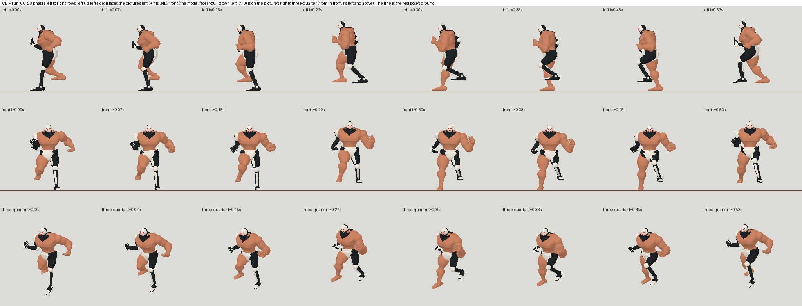
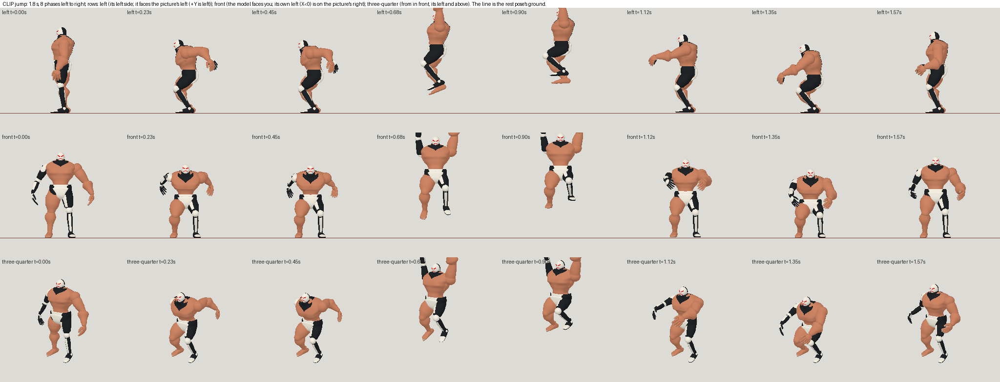
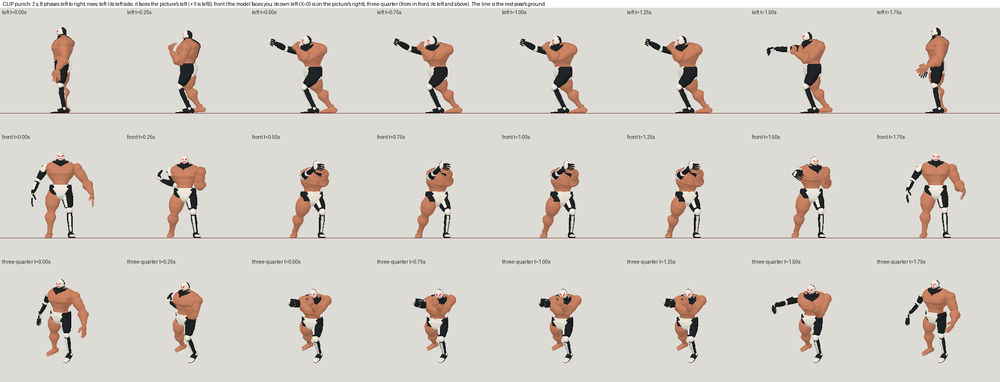
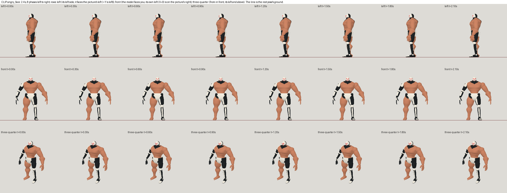

# Claude Opus 5.5 medium: hulking cyborg

| Measure | Value |
|---|---|
| Model | claude-opus-5-5 |
| Driver | Claude Code subscription CLI |
| Effort | medium |
| Scope | 5 completed evaluations; selected a05; 12 rig builds, 12 passing; delivered b12; offline game package. |
| Completed | true |
| Evaluations | 5 |
| Runtime seconds | 6310.2 |
| Driver turns | 270 |
| Prompt tokens | 83631810 |
| Cached prompt tokens | 81767637 |
| Cache write tokens | 1863417 |
| Completion tokens | 430909 |
| Reasoning tokens | 158795 |
| Model calls | unknown |
| Cost USD (estimated) | 37.1256284 |
| Numeric score | 0.5964 |
| Gates passed | 2 |
| Gates total | 2 |

Token counts use the report's provider conventions. Reasoning is included in completion tokens; cache counters are not extra prompt tokens. Estimated cost is not an invoiced charge.

Smooth torso without muscle form, head about 20% small and single-segment fingers. The game package passes only with trial limits: run skate 0.093 m/s and idle–walk blend slip 0.229 m/s against 0.05 and 0.1. Both slope-and-step walks fail contact gap, 17.6 mm (1 in 12) and 14.1 mm (1 in 20) against 8 mm, in the reference runtime and Godot. Offline game checks only.

Selected static score 0.5964; numeric best 0.6082. First GLB is the delivered animated rig; second is the selected static model.

Cost is Claude Code's own list-price estimate for the whole session, US$37.13; the run used a Max subscription, so it is not an invoice. Runtime is active process time; usage-limit pause excluded.

Geometry, weights and clips are unchanged; no gates relaxed by the publisher. Motion reference videos stay private.

[Download selected model](model-01.glb)

[Download selected model](model-02.glb)
