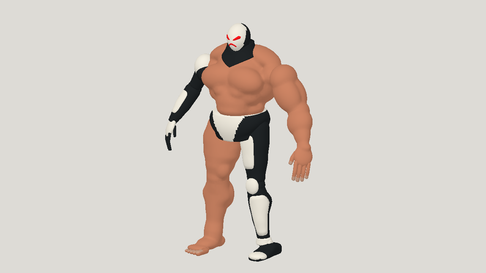
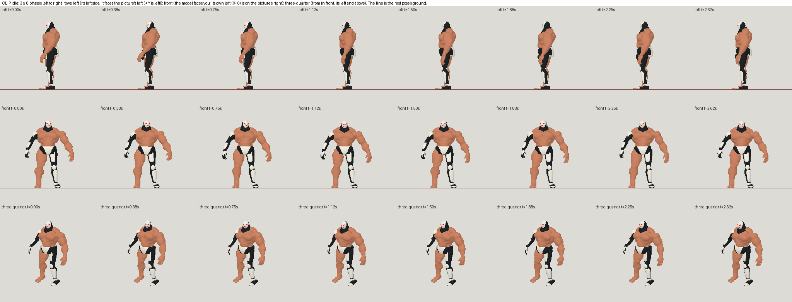
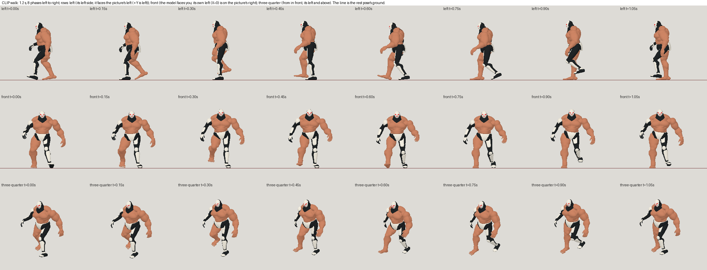
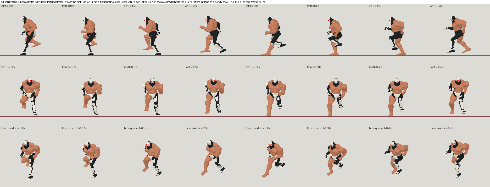
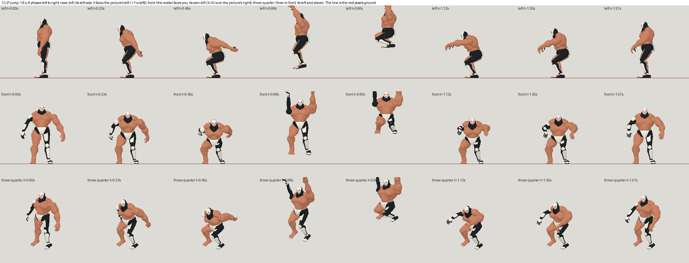
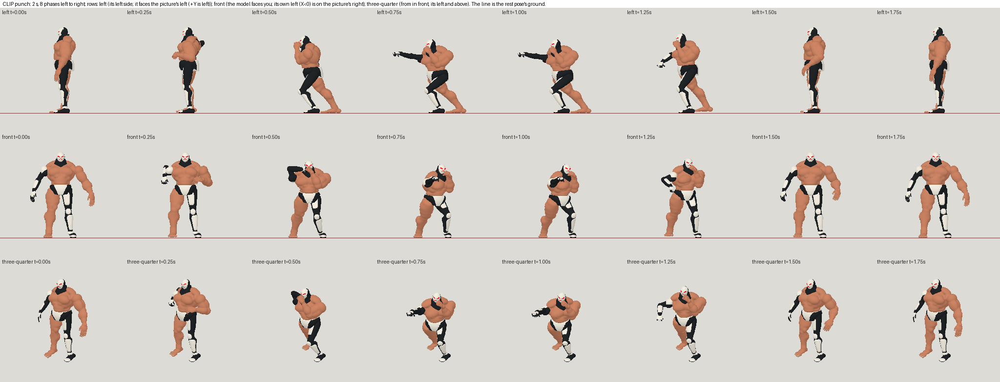
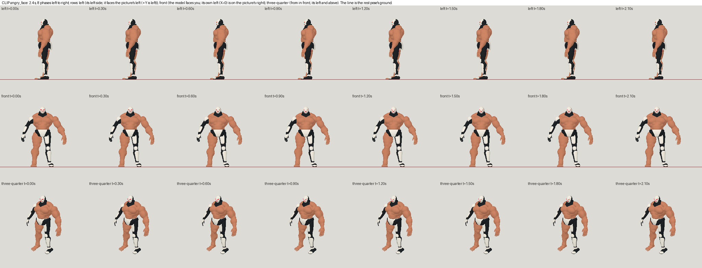

# Claude Opus 5.5 xhigh: hulking cyborg

| Measure | Value |
|---|---|
| Model | claude-opus-5-5 |
| Driver | Claude Code subscription CLI |
| Effort | xhigh |
| Scope | 5 completed evaluations; selected a05; 12 rig builds, 10 passing; delivered r12; offline game package. |
| Completed | true |
| Evaluations | 5 |
| Runtime seconds | 12563.8 |
| Driver turns | 554 |
| Prompt tokens | 235316172 |
| Cached prompt tokens | 231556102 |
| Cache write tokens | 3758766 |
| Completion tokens | 1050643 |
| Reasoning tokens | 662560 |
| Model calls | unknown |
| Cost USD (estimated) | 93.7088544 |
| Numeric score | 0.6159 |
| Gates passed | 2 |
| Gates total | 2 |

Token counts use the report's provider conventions. Reasoning is included in completion tokens; cache counters are not extra prompt tokens. Estimated cost is not an invoiced charge.

Torso skin covers the artificial right shoulder, and the spaced carbon fingers read as claws. Ten of twelve rig submissions passed. The game package passes only with trial limits: run skate 0.220 m/s and walk–run blend slip 0.454 m/s against 0.05 and 0.1. The flat walk-to-run scenario fails slip 0.158 m/s (limit 0.05) in the reference runtime and Godot; walk playback, 6% slope and 0.10 m step pass (step not run in Godot). Offline game checks only.

Selected static score 0.6159; numeric best 0.6159. First GLB is the delivered animated rig; second is the selected static model.

Cost is an incomplete Claude Code list-price estimate, at least US$93.71: the session total stopped updating partway through rigging; 109 later main-thread turns are unpriced and later reviewer subagents may be. The run used a Max subscription, so it is not an invoice. Runtime is summed turn time; 2 usage-limit pauses excluded.

Geometry, weights and clips are unchanged; no gates relaxed by the publisher. Motion reference videos stay private.

[Download selected model](model-01.glb)

[Download selected model](model-02.glb)
