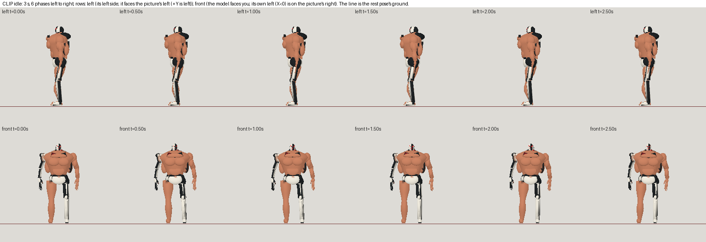
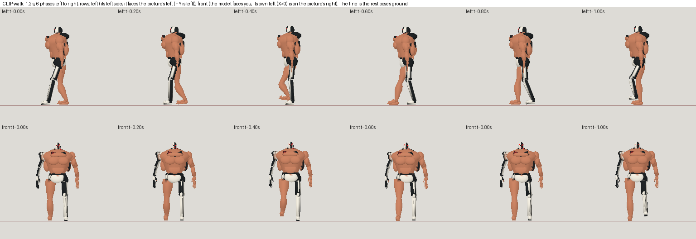
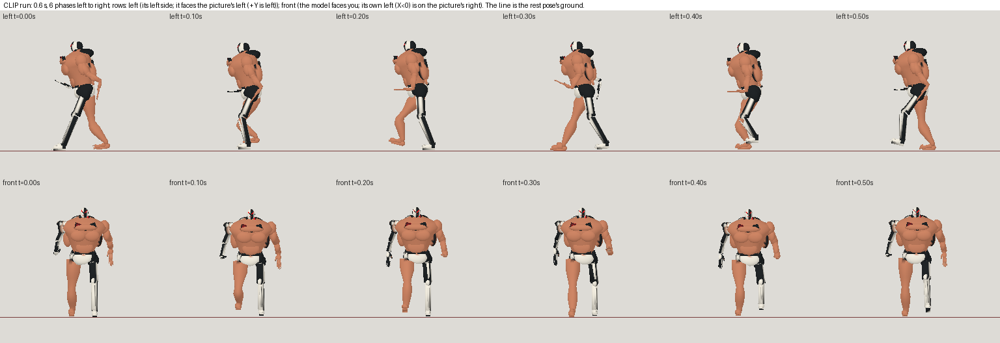
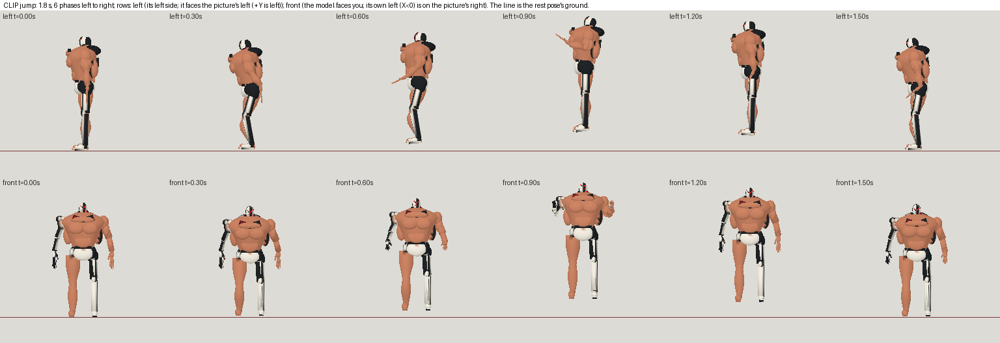
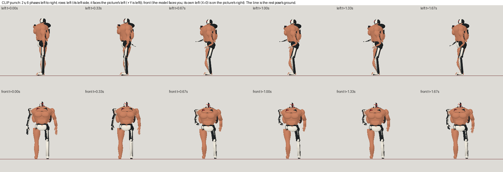
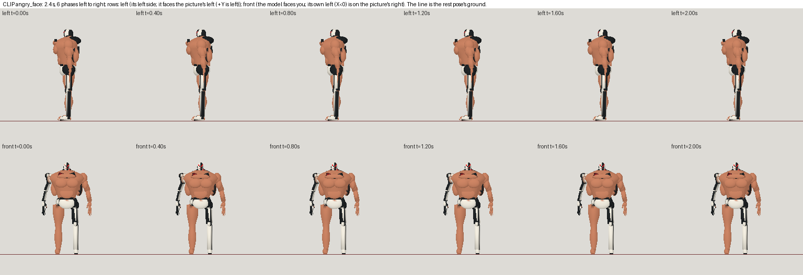

# Local Qwen3.8 high: cyborg with failed animations

| Measure | Value |
|---|---|
| Model | qwen3.8-27b-local |
| Driver | mesh-jig API agent through local llama-server |
| Effort | high |
| Scope | Five reviewed models; visual a05; twelve failed rig submissions; attempted rig choice a08; IK not reached. |
| Completed | false |
| Evaluations | 5 |
| Runtime seconds | unknown |
| Driver turns | unknown |
| Prompt tokens | 5066023 |
| Cached prompt tokens | 4499897 |
| Cache write tokens | unknown |
| Completion tokens | 1113726 |
| Reasoning tokens | unknown |
| Model calls | 108 |
| Cost USD (reported) | 0 |
| Numeric score | 0.4569 |
| Gates passed | 2 |
| Gates total | 2 |

Token counts use the report's provider conventions. Reasoning is included in completion tokens; cache counters are not extra prompt tokens. Estimated cost is not an invoiced charge.

Failed rig: all 12 submissions failed. Qwen's attempted choice a08 is shown unchanged: idle/walk/run/jump edge stretch 2.92x/8.09x/11.48x/4.17x versus 2.5x. Skin and limb deformation remain. IK was not reached.

First GLB: unchanged failed animation a08. Second GLB: selected static a05. Numeric leader a04 scored 0.4625; selected a05 scored 0.4569.

Local Qwen3.8-27B Q4_K_XL, requested high (template xhigh), 120000 reply-token ceiling. No hosted API charge; electricity/hardware costs not estimated.

All completed model, selection and rig calls included. No repair, altered gates or unmeasured post-budget draft.

[Download selected model](model-01.glb)

[Download selected model](model-02.glb)
