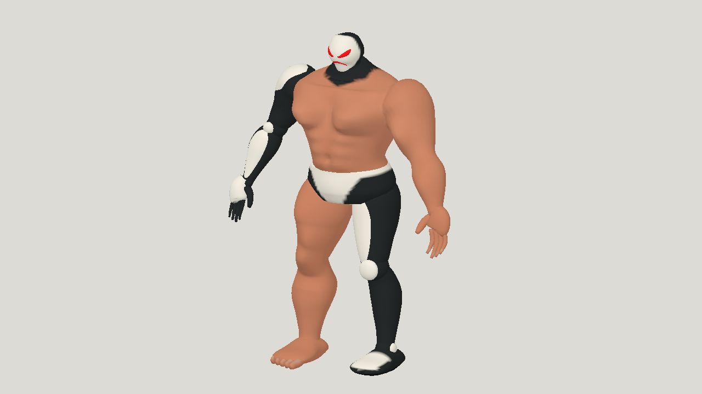

# Hulking cyborg · GPT-6.2 Sol high

| Measure | Value |
|---|---|
| Model | GPT-6.2 Sol high |
| Driver | Codex |
| Effort | high |
| Scope | Fresh v9 reference trial. Five completed static evaluations from six submissions, three passing native rigs from twelve submissions, and three game proposals. |
| Completed | unknown |
| Evaluations | 5 |
| Runtime seconds | unknown |
| Driver turns | unknown |
| Prompt tokens | unknown |
| Cached prompt tokens | unknown |
| Cache write tokens | unknown |
| Completion tokens | unknown |
| Reasoning tokens | unknown |
| Model calls | unknown |
| Cost USD (unavailable) | unknown |
| Numeric score | 0.6064 |
| Gates passed | 2 |
| Gates total | 2 |

Token counts use the report's provider conventions. Reasoning is included in completion tokens; cache counters are not extra prompt tokens. Estimated cost is not an invoiced charge.

The selected model scored 0.6064 and passes both static checks. The front ivory shin insert is absent.

All six clips pass the native rig contract. The approved MiniMax H3 motion references guided idle, walk, run, jump and punch from the second rig submission onward. The first, text-guided rig failed its jump deformation check.

Punch follows the two-second approved grid timing with the artificial right arm. The striking fist sits lower and closes less tightly, and the rear heel stays flatter. Walk, run and jump were retimed to fit the native clips at about 1.42×, 1.18× and 1.11× their selected reference cycle rates. The left arm lifts less in Jump. Angry Face follows the written brief.

Experimental terrain shows the second proposal. Right-foot run skate reached 0.982 m/s and the walk–run blend reached 0.609 m/s against 0.35 m/s allowed. Run slip in the scene reached 1.042 m/s with IK off, 0.560 m/s on flat ground and 0.529 m/s on the cross-slope. The obstacle stress reached 1.457 m/s slip and a 41.2 m/s joint-speed spike.

Codex subscription usage and cost are unavailable.

[Download selected model](model-01.glb)

[Download selected model](model-02.glb)
