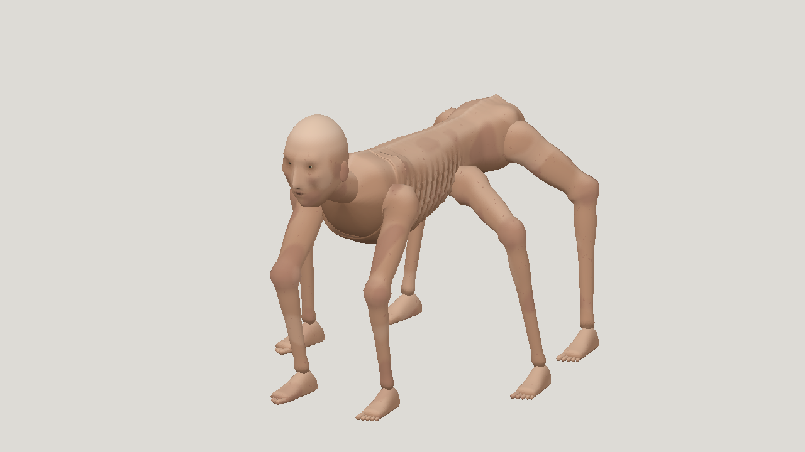

# Opus 5.5 High Antigravity horror: a02 static

| Measure | Value |
|---|---|
| Model | Claude Opus 5.5 |
| Driver | Antigravity subscription CLI |
| Effort | high |
| Scope | Attempt 2 of two completed evaluations in a stopped five-evaluation run; static mesh only |
| Completed | false |
| Evaluations | 2 |
| Runtime seconds | unknown |
| Driver turns | unknown |
| Prompt tokens | unknown |
| Cached prompt tokens | unknown |
| Cache write tokens | unknown |
| Completion tokens | unknown |
| Reasoning tokens | unknown |
| Model calls | unknown |
| Cost USD (unavailable) | unknown |
| Numeric score | 0.486 |
| Gates passed | 0 |
| Gates total | 1 |

Token counts use the report's provider conventions. Reasoning is included in completion tokens; cache counters are not extra prompt tokens. Estimated cost is not an invoiced charge.

Partial run stopped after 2 of 5 successful evaluations. Attempt 2 of 2 completed; static only. No rig or animations. Resemblance 0.344 fails 0.40. Subscription quota interrupted the run; generation is paused at the user's request. Simplified face, tubular limbs and flat skin colour remain.

No rigging was started. Numeric agreement is not finished visual quality.

[Download selected model](model-01.glb)
