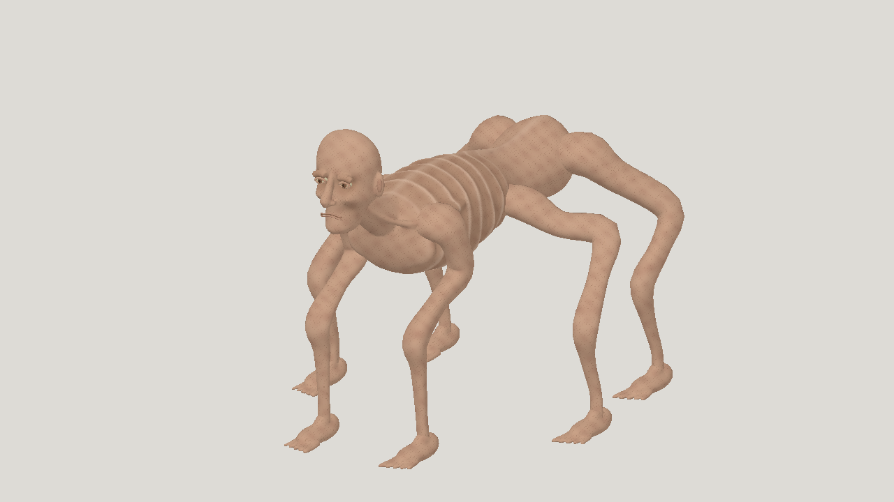
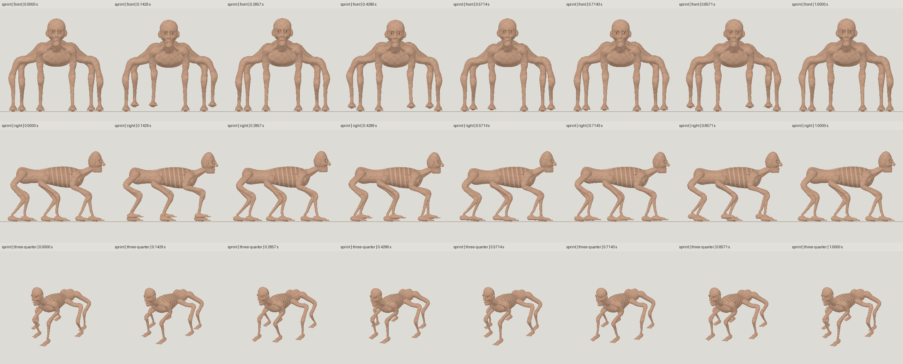
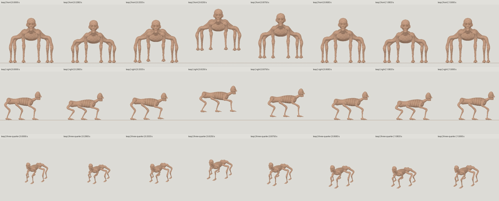

# GPT-6 Astra max: horror motion continuation

| Measure | Value |
|---|---|
| Model | gpt-6-astra |
| Driver | Codex worker explicitly configured as gpt-6-astra at max reasoning |
| Effort | max |
| Scope | Three new passing rig candidates in three submissions on the earlier max model; zero new static evaluations. Selected r03-contact-drive on a05-skin-face. |
| Completed | true |
| Evaluations | 0 |
| Runtime seconds | unknown |
| Driver turns | unknown |
| Prompt tokens | unknown |
| Cached prompt tokens | unknown |
| Cache write tokens | unknown |
| Completion tokens | unknown |
| Reasoning tokens | unknown |
| Model calls | unknown |
| Cost USD (unavailable) | unknown |
| Numeric score | 0.4755 |
| Gates passed | 0 |
| Gates total | 1 |

Token counts use the report's provider conventions. Reasoning is included in completion tokens; cache counters are not extra prompt tokens. Estimated cost is not an invoiced charge.

This continues the earlier Astra max model with newly authored sprint and leap. Astra high is an independent modeling run. This is not a controlled effort-only benchmark.

Motion author assignment is explicitly gpt-6-astra with max reasoning. A resolved runtime model identifier is not exposed. Subscription tokens, exact runtime and cost are unavailable.

Original static model: five successful evaluations, 13 submissions including preflights. Selected a05 score 0.4755; numeric leader a02b 0.4832. Static resemblance 0.3331 fails 0.40. No geometry or texture repairs in this continuation.

Three in-contract motion candidates, three submitted builds, zero failures; maximum allowed twelve. Self-reviewed by the same author, not a blind review. The earlier idle, crawl and gentle-turn evidence remains preserved privately.

sprint: one-second in-place loop, two opposed-tripod cycles, zero root travel. leap: 1.5-second authored one-shot, 0.900 m forward along Blender +Y, crouch, drive, airborne reach, impact absorption and supported settle. The site player replays clips.

29 joints, at most three nonzero influences. All original 124 accessors, material/image/texture descriptors and source binary prefix are unchanged. Source dimensions and 30,718 triangles are retained.

At 96 Hz, sprint/leap maximum ground drop is 0.753/2.662 mm and maximum edge stretch is 1.497/1.468. No sampled area exceeds 1.5x edge stretch. Sprint loop seam is below 0.001 mm.

The leap all-vertex apex is 419.087 mm above rest ground. It starts and settles on all six feet; post-landing foot path is at most 2.370 mm. Sprint retains at least three near-ground feet at the audited samples.

Remaining defects: narrow anterior inner-elbow creases and faceting, up to 0.07475 percent surface area with an edge compressed below half length, a 10.59 mm root attachment pair-drift diagnostic, rigid broad feet and in-place stance sweep. These readings do not certify collision-free or physically balanced motion.

The inherited face, speckled skin, regular ribs and smooth limbs remain simplified. This is a completed motion experiment, not a finished-quality asset. Game-engine import is untested.

Model-01 is the new animated output; model-02 is its frozen static input. Image-01 is the original selected static hero; images 02 and 03 are full-trajectory sprint and leap strips. No reference inputs, raw scripts, logs or run directories are included.

[Download selected model](model-01.glb)

[Download selected model](model-02.glb)
