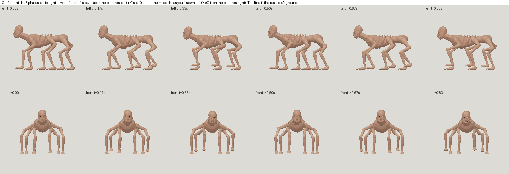
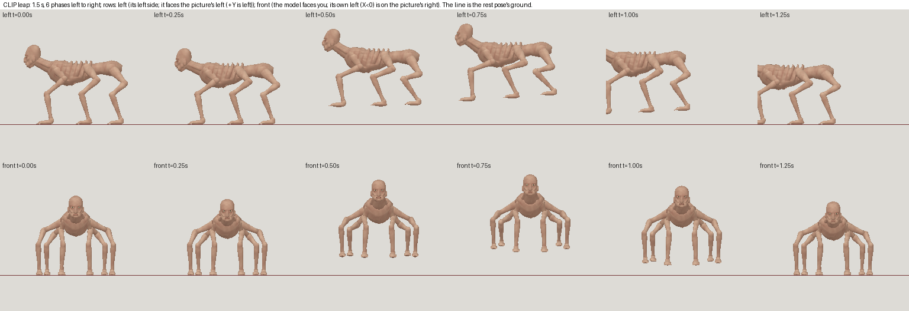

# GPT-6.2 Astra high: horror animation and terrain trial

| Measure | Value |
|---|---|
| Model | gpt-6.2-astra |
| Driver | Codex desktop subscription with native mesh-jig tools |
| Effort | high |
| Scope | Five fresh static evaluations, three passing native rigs and three game proposals. Visual selection a05-thorax at 0.5131. Numeric best 0.5174. Selected rig r03-recovery, terrain a02. |
| Completed | false |
| Evaluations | 5 |
| Runtime seconds | unknown |
| Driver turns | unknown |
| Prompt tokens | unknown |
| Cached prompt tokens | unknown |
| Cache write tokens | unknown |
| Completion tokens | unknown |
| Reasoning tokens | unknown |
| Model calls | unknown |
| Cost USD (unavailable) | unknown |
| Numeric score | 0.5131 |
| Gates passed | 0 |
| Gates total | 1 |

Token counts use the report's provider conventions. Reasoning is included in completion tokens; cache counters are not extra prompt tokens. Estimated cost is not an invoiced charge.

Experimental terrain. Static resemblance 0.367 falls short of 0.40. Three native rigs passed. IK a02 passed sprint playback, flat ground and cross-slope. The obstacle review found lost support and a joint-speed spike of 26.4 m/s. The extra leap blend slid at 1.93 m/s. No game-ready delivery.

The longer ribcage, three leg attachment stations and planted feet led the visual choice. Raised rib tips and simplified face and feet remain visible. The numeric leader was a03 at 0.5174.

One Codex subscription session authored both subjects at high effort. Per-subject token usage and cost were unavailable.

[Download selected model](model-01.glb)

[Download selected model](model-02.glb)
