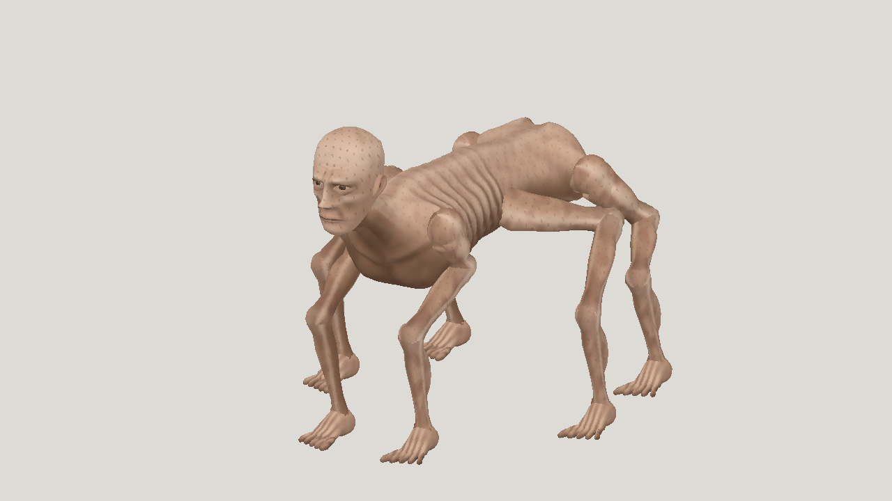
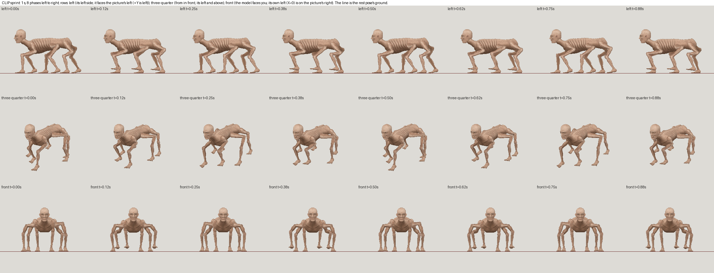
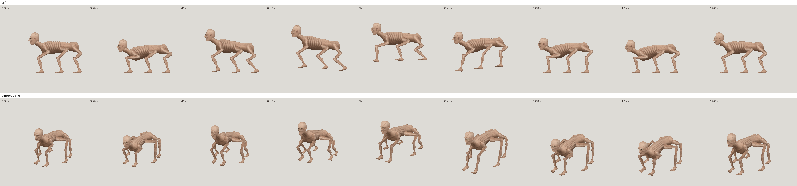

# GPT-6.2 Astra High: time-limited horror

| Measure | Value |
|---|---|
| Model | gpt-6.2-astra |
| Driver | Codex CLI with ChatGPT subscription at Standard speed |
| Effort | high |
| Scope | One standalone run. Ten evaluated static builds, three passing native rigs and eleven reviews. |
| Completed | true |
| Evaluations | 10 |
| Runtime seconds | 1786.925924 |
| Driver turns | unknown |
| Prompt tokens | 15653067 |
| Cached prompt tokens | 15310848 |
| Cache write tokens | unknown |
| Completion tokens | 68461 |
| Reasoning tokens | unknown |
| Model calls | unknown |
| Cost USD (estimated) | 11.6 |
| Numeric score | 0.5485 |
| Gates passed | 0 |
| Gates total | 1 |

Token counts use the report's provider conventions. Reasoning is included in completion tokens; cache counters are not extra prompt tokens. Estimated cost is not an invoiced charge.

US$11.60 is the equivalent value of the logged builder and reviewer tokens at Standard rates.

A10 scored 0.5485 and won the visual selection. The two GLBs contain the selected sprint/leap rig and its frozen static source.

Static resemblance 0.392 falls short of 0.400. Both clips pass the native rig checks. Sprint shows residual toe skate and some limb-to-flank contacts open. Terrain and runtime IK were outside the trial.

The leap travels 0.90 m and has 427 mm of full-mesh ground clearance at apex.

[Download selected model](model-01.glb)

[Download selected model](model-02.glb)
