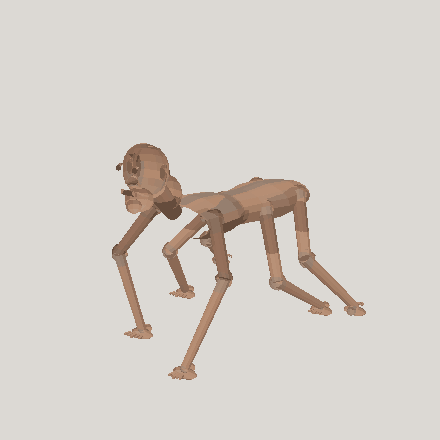
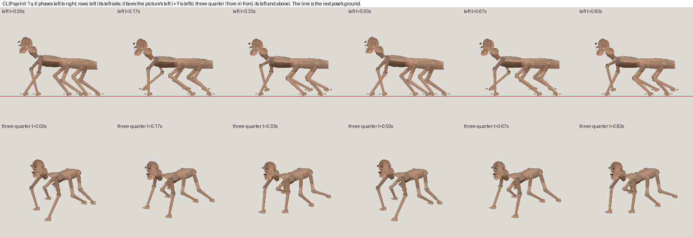
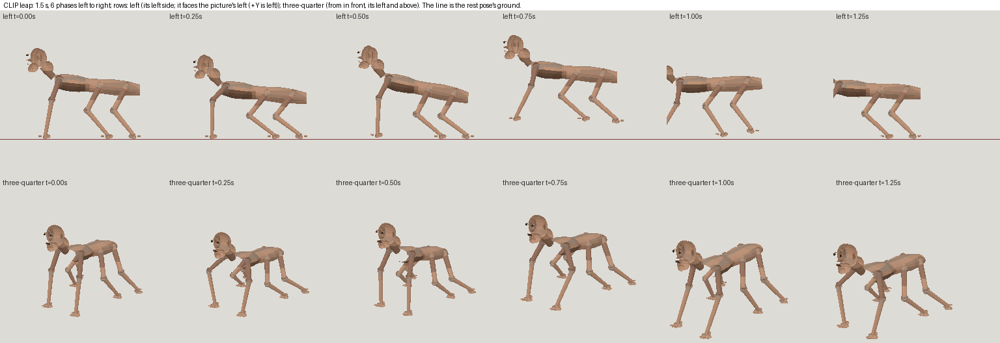
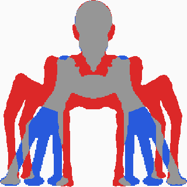

# Six-limbed horror · Bonsai 2.5 27B, local, assisted rig

| Measure | Value |
|---|---|
| Model | bonsai-2.5-27b-q2_0 |
| Driver | Mesh Jig local agent via stock llama.cpp on RTX 4090 |
| Effort | medium |
| Scope | Static run: two of five evaluations across fourteen submissions. The published animation is a separate assisted follow-up. |
| Completed | false |
| Evaluations | 2 |
| Runtime seconds | 5466.4 |
| Driver turns | 106 |
| Prompt tokens | 3533802 |
| Cached prompt tokens | unknown |
| Cache write tokens | unknown |
| Completion tokens | 367254 |
| Reasoning tokens | unknown |
| Model calls | 108 |
| Cost USD (unavailable) | unknown |
| Numeric score | 0.3209 |
| Gates passed | 0 |
| Gates total | 1 |

Token counts use the report's provider conventions. Reasoning is included in completion tokens; cache counters are not extra prompt tokens. Estimated cost is not an invoiced charge.

Two of five modeling evaluations finished. The selected mesh scored 0.3209 and missed its resemblance gate. Bonsai's five standalone rig submissions failed. Bonsai supplied the skeleton and motion controls for this version. Codex repaired the skin weights and foot placement. The repaired sprint and leap pass the rig contract. Gaps in the chest and detached details remain from the static mesh.

The 1-second sprint loops in place. The 1.5-second leap travels 0.90 m and reaches 286 mm of full-mesh clearance.

Static run timing and tokens cover the bounded modeling run. Local inference incurred no hosted API charges. Electricity and hardware costs are unmeasured.

[Download selected model](model-01.glb)

