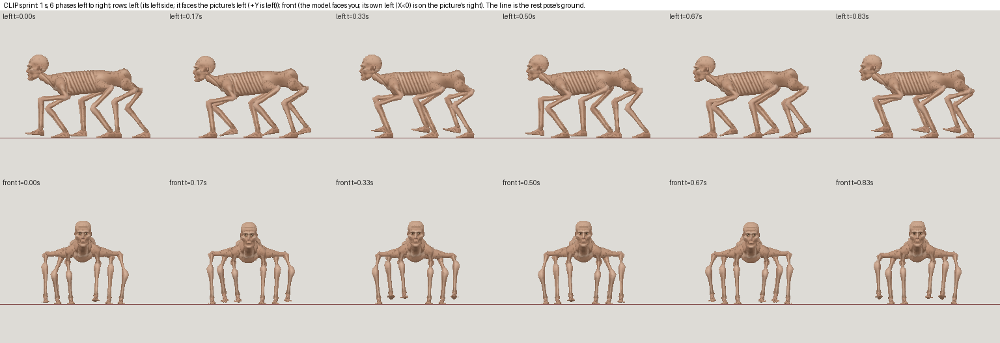
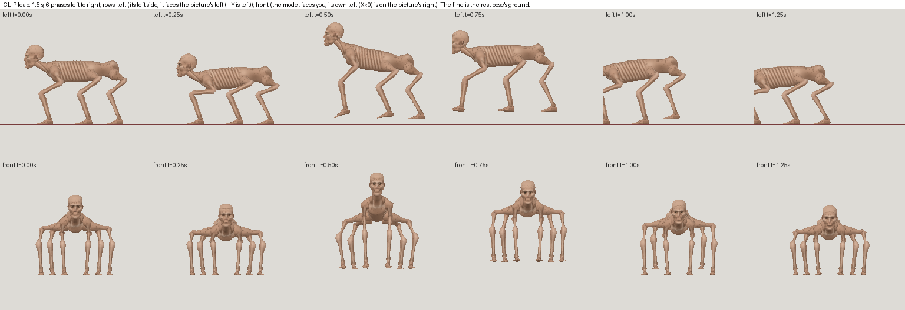

# Gemini 4 Carbon high: horror sprint and leap

| Measure | Value |
|---|---|
| Model | google/gemini-4-carbon |
| Driver | mesh-jig API agent through OpenRouter |
| Effort | high |
| Scope | One partial visual run: two of five reviewed evaluations; selected a02; three passing rigs; accepted game a02. |
| Completed | false |
| Evaluations | 2 |
| Runtime seconds | unknown |
| Driver turns | unknown |
| Prompt tokens | 2940133 |
| Cached prompt tokens | 1309416 |
| Cache write tokens | 0 |
| Completion tokens | 460350 |
| Reasoning tokens | 304784 |
| Model calls | 58 |
| Cost USD (reported) | 7.995875 |
| Numeric score | 0.4887 |
| Gates passed | 0 |
| Gates total | 1 |

Token counts use the report's provider conventions. Reasoning is included in completion tokens; cache counters are not extra prompt tokens. Estimated cost is not an invoiced charge.

Partial visual run: 2 of 5 reviewed attempts after upstream 504 retries exhausted. Resemblance 0.352 fails the 0.40 gate. Three passing rigs; game candidate a02 accepted after one invalid proposal. Browser terrain can still show contact and blending defects.

Settled cost covers completed model, selection, rig and game calls. Interrupted startup and failed retry charges are unknown.

Visual choice scored 0.4887; numeric leader a01 scored 0.5111. Geometry and clips were not repaired for publication.

[Download selected model](model-01.glb)
