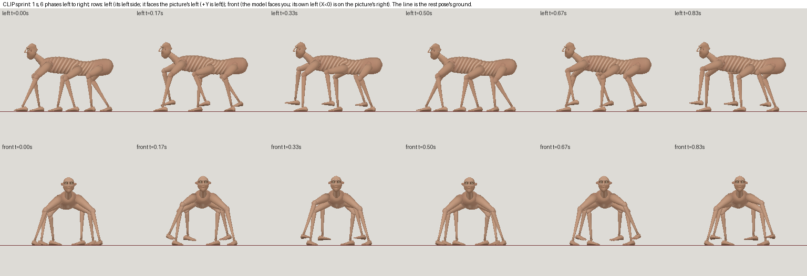
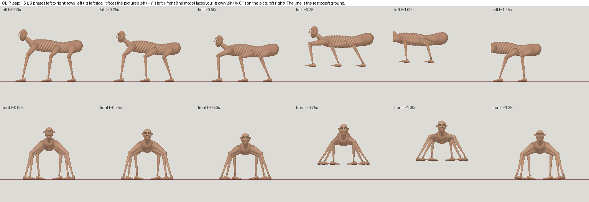

# DeepSeek V4.1 Flash 1017: horror

| Measure | Value |
|---|---|
| Model | deepseek/deepseek-v4.1-flash-1017 |
| Driver | mesh-jig API agent via OpenRouter |
| Effort | low |
| Scope | Rig and animation stage at low effort, six successful builds. Selected model from five visual iterations. Game stage separately tested at high effort. |
| Completed | true |
| Evaluations | unknown |
| Runtime seconds | 2803.9 |
| Driver turns | 69 |
| Prompt tokens | 3715078 |
| Cached prompt tokens | 3250176 |
| Cache write tokens | 0 |
| Completion tokens | 342396 |
| Reasoning tokens | unknown |
| Model calls | unknown |
| Cost USD (reported) | 0.172298 |
| Numeric score | 0.3402 |
| Gates passed | 0 |
| Gates total | 1 |

Token counts use the report's provider conventions. Reasoning is included in completion tokens; cache counters are not extra prompt tokens. Estimated cost is not an invoiced charge.

Resemblance fails the 0.40 gate. Tube-like limbs and 50-200 mm gaps at limb roots in leap. Required sprint terrain checks pass; additional obstacle review exposes a leg snap at 7.6 s. Experimental, not production-ready.

Total reported modelling, rig and game cost: US$0.478962477. Package token and runtime metrics describe the rig stage only.

One run per subject; selected visual model and highest numeric score may differ. No consumer-engine playtest.

[Download selected model](model-01.glb)
