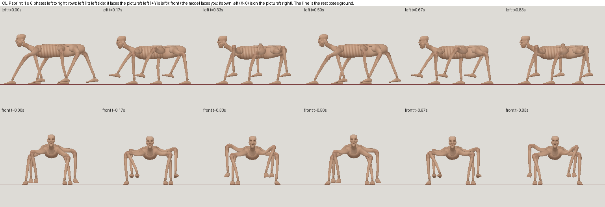
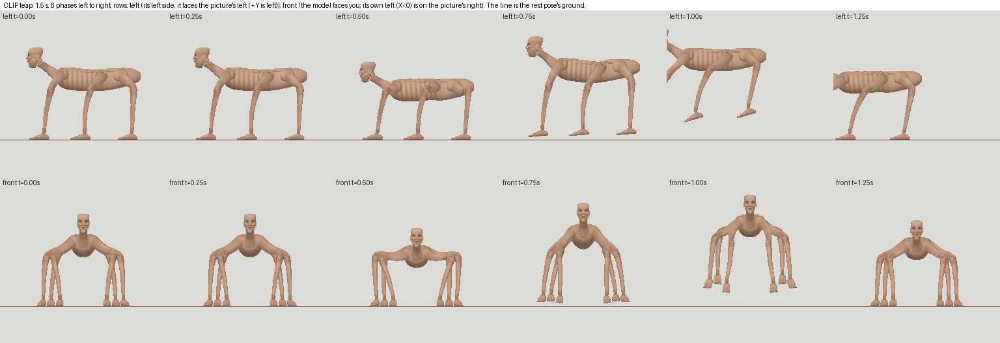

# DeepSeek V4.1 Flash 1017 high: horror

| Measure | Value |
|---|---|
| Model | deepseek/deepseek-v4.1-flash-1017 |
| Driver | mesh-jig API agent via OpenRouter |
| Effort | high |
| Scope | Final high-effort rig stage: 6 passing builds. Five reviewed modelling iterations across controlled continuations; game stage tested separately. |
| Completed | true |
| Evaluations | unknown |
| Runtime seconds | 626.4 |
| Driver turns | 33 |
| Prompt tokens | 1963720 |
| Cached prompt tokens | 1484288 |
| Cache write tokens | 0 |
| Completion tokens | 135054 |
| Reasoning tokens | unknown |
| Model calls | unknown |
| Cost USD (reported) | 0.426327 |
| Numeric score | 0.372 |
| Gates passed | 0 |
| Gates total | 1 |

Token counts use the report's provider conventions. Reasoning is included in completion tokens; cache counters are not extra prompt tokens. Estimated cost is not an invoiced charge.

Resemblance fails the 0.40 gate. Native rig passes. Flat/slope sprint checks pass; obstacles fail penetration (52.8 mm), foot slip (1.39 m/s) and joint speed (49.9 m/s). Terrain remains experimental.

Total reported model, rig and game charges including failed attempts: US$1.346716231. Package tokens and runtime cover the final rig stage only.

The reply cap rose from 65536 to 100000 during the campaign. Process steering, restarts and a reasoning-state fix make this an exploratory trial, not a controlled effort ranking. No consumer-engine playtest.

[Download selected model](model-01.glb)
