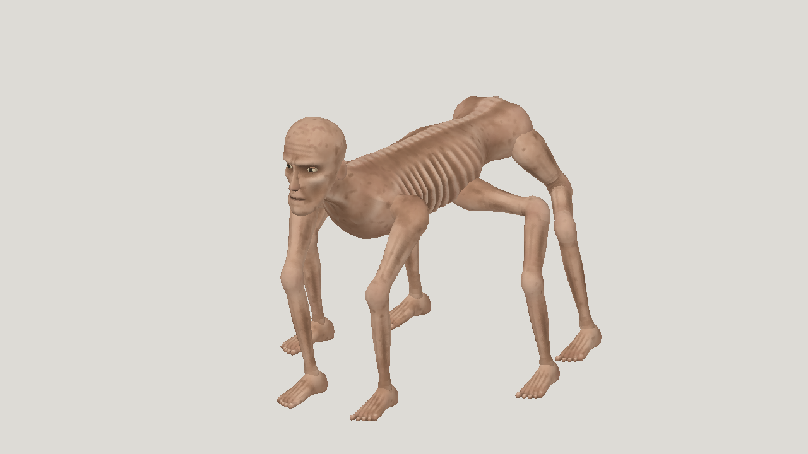

# Latest textured horror: Fable 5.2 high, API agent

| Measure | Value |
|---|---|
| Model | claude-fable-5-2 |
| Driver | mesh-jig API agent, native Anthropic Messages API |
| Effort | high |
| Scope | One visual-agent modeling run that stopped at 3 of 5 attempts and one rig run that stopped after its first passing build; selected geometry and animation, sprint and leap included. Runtime, tokens and cost cover both stages. Not production quality. |
| Completed | false |
| Evaluations | 3 |
| Runtime seconds | 3611.7 |
| Driver turns | unknown |
| Prompt tokens | 770528 |
| Cached prompt tokens | unknown |
| Cache write tokens | unknown |
| Completion tokens | 282652 |
| Reasoning tokens | unknown |
| Model calls | unknown |
| Cost USD (estimated) | 17.46 |
| Numeric score | 0.5184 |
| Gates passed | 0 |
| Gates total | 1 |

Token counts use the report's provider conventions. Reasoning is included in completion tokens; cache counters are not extra prompt tokens. Estimated cost is not an invoiced charge.

Three successful static evaluations. The visual pick, a03, scores 0.5184; the numeric best, a02, scores 0.5190. Resemblance 0.365 misses the 0.40 gate. Modeling stopped on attempt 4 on a tool-call reply that was not valid JSON, likely cut at the output cap.

Rig: 1 of 1 build passed before an HTTP 400 ended the run; 23 joints, 28,864 triangles, one 1024 px script-painted texture. Sprint seam under 0.001 mm. Leap has a crouch, a rearing push-off and a compressed landing, clears 413 mm at the apex and travels 0.90 m forward; largest ground drop 4.5 mm at 48 Hz. Limbs stay attached.

Runtime is 2,907 s modeling plus 705 s rigging. Cost is estimated at list price from recorded tokens: US$13.86 modeling plus US$3.60 rigging. One modeling call's charge was not recorded and is not included. No prompt caching was used.

[Download selected model](model-01.glb)
