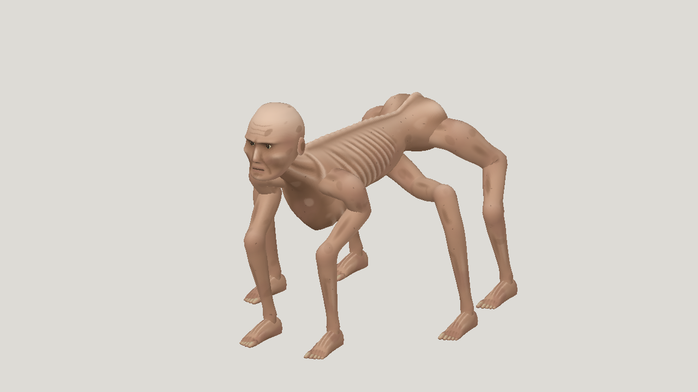

# Latest textured horror: Fable 5.2 high, Claude Code

| Measure | Value |
|---|---|
| Model | claude-fable-5-2 |
| Driver | Claude Code builder using the mesh-jig CLI |
| Effort | high |
| Scope | One five-evaluation static run and its rig by a Claude Code builder with a shell, selected geometry and animation; sprint and leap included. The builder saw numeric scores after each build, a different workflow from the API agent. Completed protocol, not production quality. |
| Completed | true |
| Evaluations | 5 |
| Runtime seconds | 3060 |
| Driver turns | unknown |
| Prompt tokens | unknown |
| Cached prompt tokens | unknown |
| Cache write tokens | unknown |
| Completion tokens | unknown |
| Reasoning tokens | unknown |
| Model calls | unknown |
| Cost USD (unavailable) | unknown |
| Numeric score | 0.5689 |
| Gates passed | 1 |
| Gates total | 1 |

Token counts use the report's provider conventions. Reasoning is included in completion tokens; cache counters are not extra prompt tokens. Estimated cost is not an invoiced charge.

Five successful static evaluations. The fifth is both the visual pick and the numeric best at 0.5689. Resemblance 0.402 passes the 0.40 gate, the first horror build to do so. The builder also took unlogged draft measurements between evaluations.

Rig: 4 of 5 builds passed, 30 joints, 27,528 triangles, one 1024 px script-painted texture. Sprint seam under 0.001 mm. Leap clears 355 mm at the apex and travels 0.90 m forward; largest ground drop 2.3 mm at 48 Hz. Limbs stay attached.

Skin is smoother and flatter in colour than the reference, rib grooves are regular, the middle limb pair hangs as a lobe under the belly, feet are wedges and the legs stay stiff in flight.

Runtime is approximate: about 51 minutes from first file read to delivered rig, 37 modeling and 14 rigging. Claude Code does not report the builder's own token use, so no cost is given.

[Download selected model](model-01.glb)
