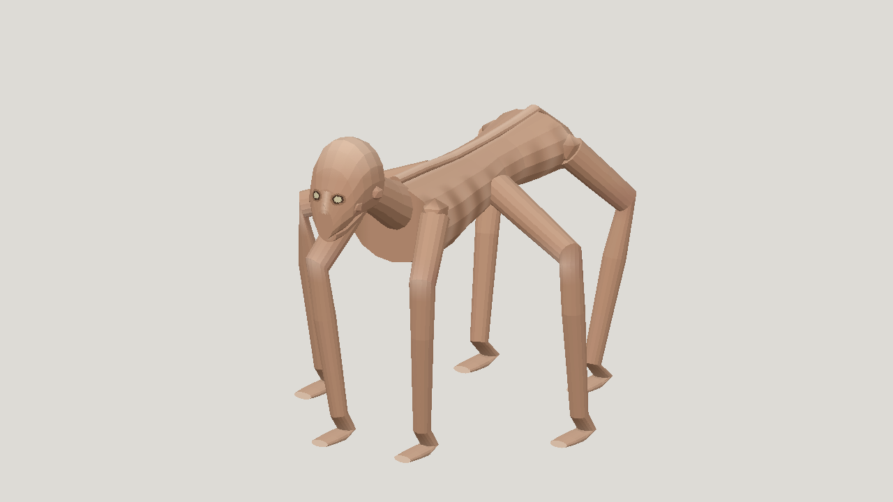
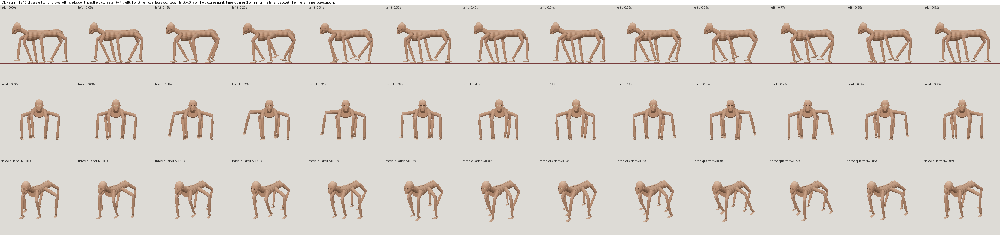
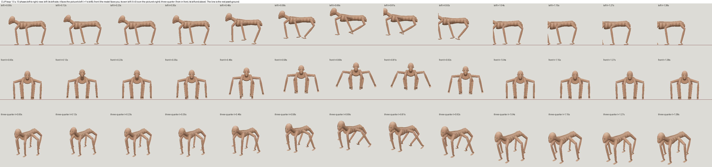

# Gemini Flash high horror with sprint and leap

| Measure | Value |
|---|---|
| Model | Gemini 3.8 Flash (High) |
| Driver | Antigravity CLI subscription |
| Effort | high |
| Scope | One independent run: five successful modeling evaluations, then three passing rig candidates from five submissions. Own visual model a05 and rig r05. |
| Completed | true |
| Evaluations | 5 |
| Runtime seconds | 3349.874244 |
| Driver turns | 3 |
| Prompt tokens | unknown |
| Cached prompt tokens | unknown |
| Cache write tokens | unknown |
| Completion tokens | unknown |
| Reasoning tokens | unknown |
| Model calls | unknown |
| Cost USD (unavailable) | unknown |
| Numeric score | 0.3694 |
| Gates passed | 0 |
| Gates total | 1 |

Token counts use the report's provider conventions. Reasoning is included in completion tokens; cache counters are not extra prompt tokens. Estimated cost is not an invoiced charge.

Static model: 3,216 triangles; numeric score 0.3694 and resemblance 0.276, below the 0.40 gate. Six limbs are recognizable, but angular anatomy, simplified face, flat feet and limited rib or skin detail remain.

Animation: 23 joints, one-second looping sprint and 1.5-second forward leap. Three of five rig submissions passed the unchanged contract. Rest geometry and colours are preserved. Leap travels 0.95 m with about 0.545 m lowest-point apex clearance.

Motion caveats: foot float and sliding remain. Only 58 percent of sprint keys have any point within 8 mm of rest ground. Limb-root separations reach 16 mm in sprint and 22-23 mm in leap. Gate passes do not certify anatomical continuity or natural movement.

Runtime is the CLI-reported elapsed duration of the same conversation including the interrupted handoff and continuation. Subscription cost and normalized token totals are unavailable. One run and a different driver are not a general ranking.

Image 1 is the selected static hero render. Images 2 and 3 are 13-phase sprint and leap strips. Model 1 is the selected animation; model 2 is its frozen static source. No model or rig code was repaired by another builder.

[Download selected model](model-01.glb)

[Download selected model](model-02.glb)
