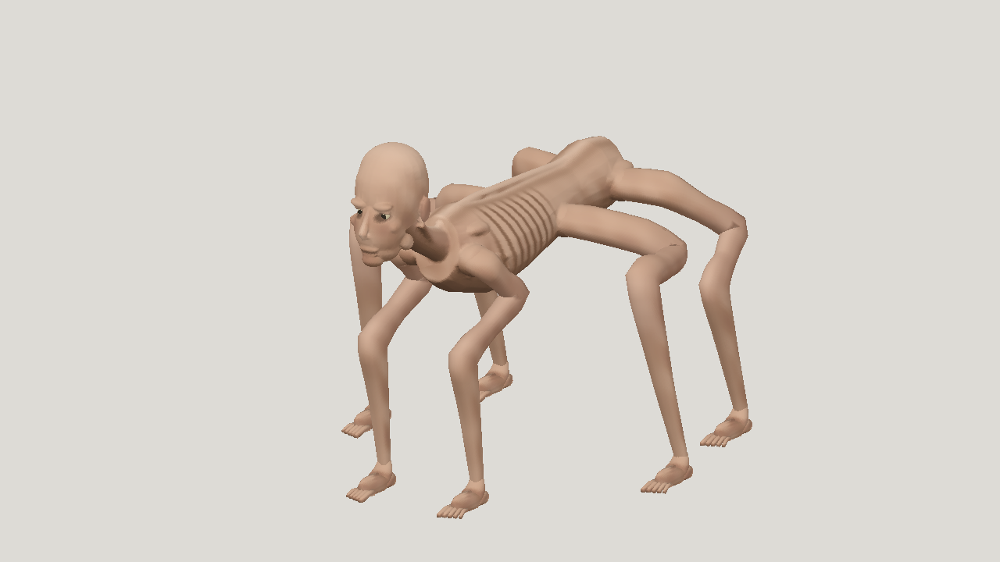

# Six-limbed horror: Gemini 4 Hydrogen High

| Measure | Value |
|---|---|
| Model | gemini-4-hydrogen-high |
| Driver | Antigravity native subscription CLI |
| Effort | high |
| Scope | Five successful model evaluations; selected a05. Five rig submissions, three passing candidates; selected r05 with sprint and leap. |
| Completed | true |
| Evaluations | 5 |
| Runtime seconds | unknown |
| Driver turns | unknown |
| Prompt tokens | unknown |
| Cached prompt tokens | unknown |
| Cache write tokens | unknown |
| Completion tokens | unknown |
| Reasoning tokens | unknown |
| Model calls | unknown |
| Cost USD (unavailable) | unknown |
| Numeric score | 0.4797 |
| Gates passed | 0 |
| Gates total | 1 |

Token counts use the report's provider conventions. Reasoning is included in completion tokens; cache counters are not extra prompt tokens. Estimated cost is not an invoiced charge.

32,000-triangle ceiling and script-painted 1024 px atlas; selected model has 26,568 triangles.

Selected visual pick score 0.4797; numeric leader a03 scored 0.4996. All five models missed the 0.4 resemblance diagnostic; selected model measured 0.332.

Simplified tubular/faceted limbs, blocky joins and coarse paint remain. Passing sampled motion gates is not production-quality or engine certification.

Thirty-bone rig, maximum three influences. Sprint is a one-second in-place loop; leap is 1.5 seconds and travels 0.86 m forward. Independent 60 Hz checks found 240.8 mm leap clearance and at most 2.16 mm ground penetration, within the 8 mm limit.

Original geometry, accessors and texture pixels are preserved through rigging. The native CLI completed the files but reported a malformed final-call error; independent artifact validation succeeded without another model run.

Runtime, token usage and subscription cost are unavailable. No paid API fallback was used.

[Download selected model](model-01.glb)
