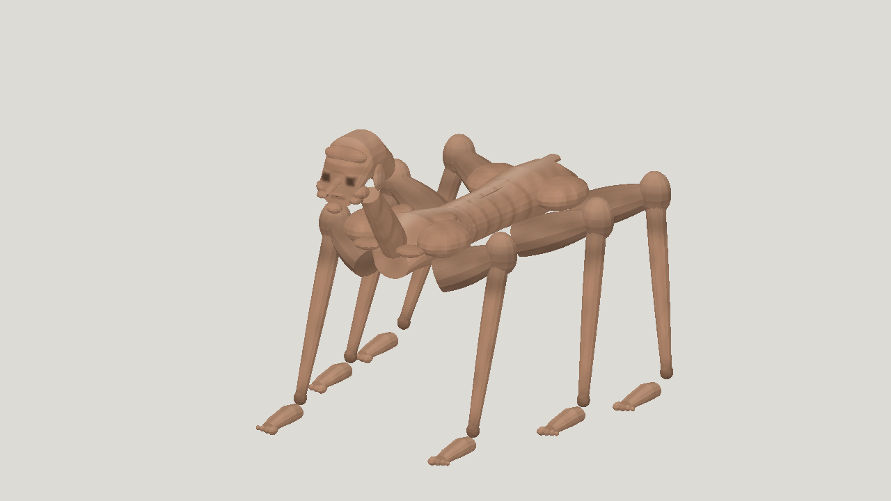

# Inkling 2 Mini High: horror

| Measure | Value |
|---|---|
| Model | thinkingmachines/inkling-2-mini |
| Driver | Mesh Jig API agent via OpenRouter |
| Effort | high |
| Scope | One OpenRouter run via Prime Intellect. Five static meshes; no rig passed. |
| Completed | false |
| Evaluations | 5 |
| Runtime seconds | 6969.3 |
| Driver turns | unknown |
| Prompt tokens | 1208329 |
| Cached prompt tokens | 954112 |
| Cache write tokens | unknown |
| Completion tokens | 740083 |
| Reasoning tokens | 657634 |
| Model calls | unknown |
| Cost USD (reported) | 0.255402855 |
| Numeric score | 0.3185 |
| Gates passed | 0 |
| Gates total | 1 |

Token counts use the report's provider conventions. Reasoning is included in completion tokens; cache counters are not extra prompt tokens. Estimated cost is not an invoiced charge.

Static resemblance missed the gate on all five meshes. Rigging made no submissions: three calls each hit the output limit. Static only.

The first GLB is the frozen static mesh.

Reported cost includes all available API receipts for the selected subject.

[Download selected model](model-01.glb)
