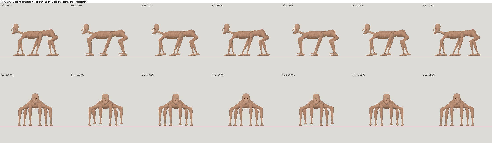
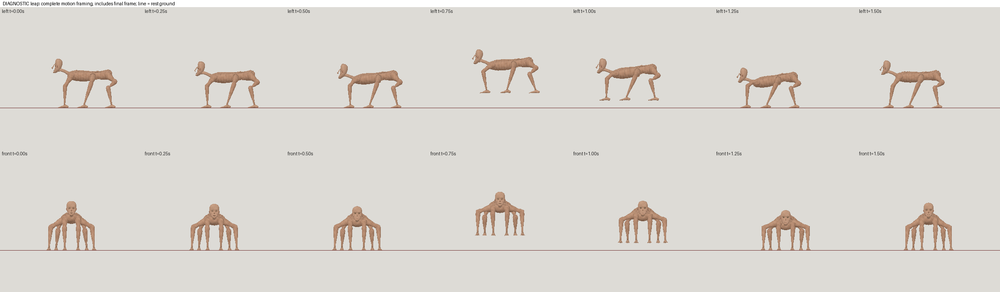

# Kimi K3.1 Pro high: partial horror result

| Measure | Value |
|---|---|
| Model | moonshotai/kimi-k3.1-pro |
| Driver | mesh-jig API workflow via OpenRouter |
| Effort | high |
| Scope | One bounded run: two compatibility preflights, five model evaluations, twelve failed rig submissions; diagnostic a12 sprint and leap. |
| Completed | false |
| Evaluations | 5 |
| Runtime seconds | unknown |
| Driver turns | unknown |
| Prompt tokens | 4328608 |
| Cached prompt tokens | 3827099 |
| Cache write tokens | unknown |
| Completion tokens | 179071 |
| Reasoning tokens | 99134 |
| Model calls | 105 |
| Cost USD (reported) | 3.5591478 |
| Numeric score | 0.4568 |
| Gates passed | 0 |
| Gates total | 1 |

Token counts use the report's provider conventions. Reasoning is included in completion tokens; cache counters are not extra prompt tokens. Estimated cost is not an invoiced charge.

Partial / non-contract-valid: diagnostic a12; 0 of 12 rigs pass. Resemblance 0.3129 below 0.40. Leap stretch 2.6281x exceeds 2.5x; sprint gates pass.

OpenRouter; model moonshotai/kimi-k3.1-pro; exclusive provider endpoint moonshotai/mxfp4; high reasoning requested and reasoning usage observed.

Selected model a04: 31718 triangles, painted 1024 atlas, score 0.4568. Five model evaluations; six submissions including one repaired triangle-cap failure. Rig a12 is diagnostic, not a passing rig.

Total US$3.5591478 reported; 105 paid dispatches; zero unresolved reservations. Includes two compatibility preflights and all recovery and closeout calls. No additional inference for publication.

Prompt counters include cached tokens; reasoning is a subset of completion tokens, not additional output. Provider-defined counters are summed from response usage.

No overall wall-time claim: preflight runtime was not measured separately. Model and rig stage runtimes below exclude preflights.

preflight: 2 calls; US$0.002158 reported; 440 prompt tokens (190 cached), 162 completion (73 reasoning).

model: 43 calls; US$1.9962756 reported; 968261 prompt tokens (757698 cached), 142361 completion (79751 reasoning).

rig: 60 calls; US$1.5607142 reported; 3359907 prompt tokens (3069211 cached), 36548 completion (19310 reasoning).

model stage recorded runtime: 4669.4 seconds.

rig stage recorded runtime: 1864.8 seconds.

Rig cap blocked further builds; driver stopped at 60 turns with no accepted done. Scripts after a12 were not evaluated. Sprint is restrained and leap relatively stiff; no game-engine certification.

[Download selected model](model-01.glb)
