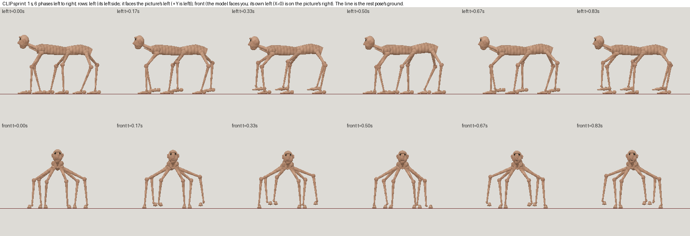
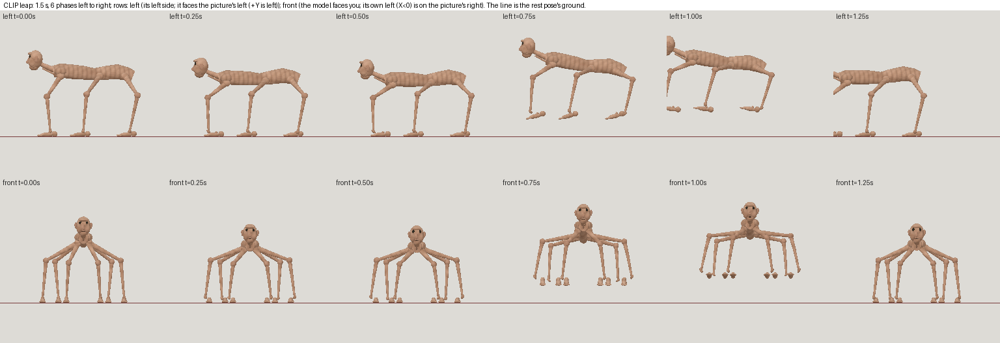

# Muse Ember high: horror sprint and leap

| Measure | Value |
|---|---|
| Model | meta/muse-ember |
| Driver | mesh-jig API agent through OpenRouter |
| Effort | high |
| Scope | One five-evaluation visual run; selected a02; three passing rigs; three failed game proposals. |
| Completed | false |
| Evaluations | 5 |
| Runtime seconds | unknown |
| Driver turns | unknown |
| Prompt tokens | 1718301 |
| Cached prompt tokens | 1127188 |
| Cache write tokens | 0 |
| Completion tokens | 148364 |
| Reasoning tokens | 89342 |
| Model calls | 56 |
| Cost USD (reported) | 0.137802 |
| Numeric score | 0.3112 |
| Gates passed | 0 |
| Gates total | 1 |

Token counts use the report's provider conventions. Reasoning is included in completion tokens; cache counters are not extra prompt tokens. Estimated cost is not an invoiced charge.

Experimental terrain demo; qualification failed. Resemblance 0.2276 fails the 0.40 gate. Three passing rigs from eight submissions. All three game proposals failed; a03 misses six foot-contact clusters and slips 0.35209 m/s against 0.35. No accepted game-ready package.

Provider-reported settled cost covers all 56 completed model, selection, rig and game calls. Zero unpriced entries.

Visual choice scored 0.3112; numeric leader a01 scored 0.3627. Geometry, clips and failed IK were not repaired for publication.

[Download selected model](model-01.glb)
