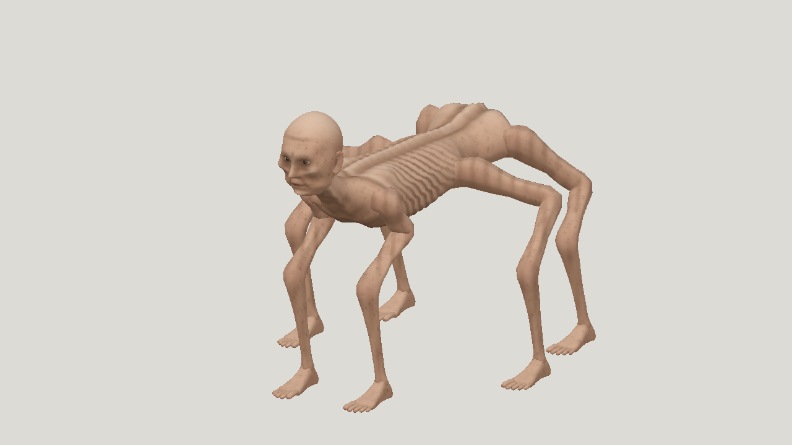
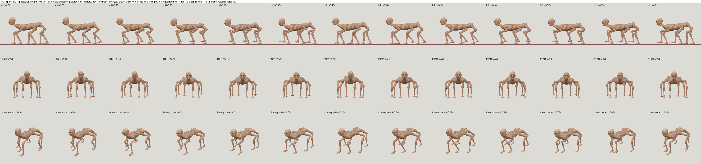
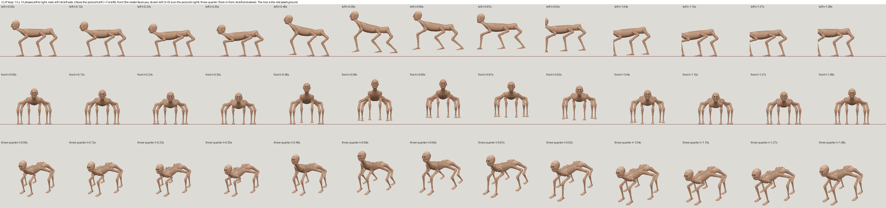

# Gemini 4 Neon high: horror sprint and leap

| Measure | Value |
|---|---|
| Model | gemini-4-neon-high |
| Driver | Antigravity subscription CLI |
| Effort | high |
| Scope | Five successful evaluations; selected a05; four rig submissions, three passing; delivered r04. |
| Completed | true |
| Evaluations | 5 |
| Runtime seconds | unknown |
| Driver turns | unknown |
| Prompt tokens | unknown |
| Cached prompt tokens | unknown |
| Cache write tokens | unknown |
| Completion tokens | unknown |
| Reasoning tokens | unknown |
| Model calls | unknown |
| Cost USD (unavailable) | unknown |
| Numeric score | 0.5171 |
| Gates passed | 0 |
| Gates total | 1 |

Token counts use the report's provider conventions. Reasoning is included in completion tokens; cache counters are not extra prompt tokens. Estimated cost is not an invoiced charge.

Resemblance 0.375 fails 0.40. Egg-smooth skull on a thin neck, regular corrugated ribs, striped limb paint and spindly even-width limbs. Three passing rigs from four submissions; upper front limbs part from the torso by up to 36 mm in the leap. Sprint and leap pass sampled rig checks; no game-engine import tested.

Selected static score 0.5171, also the numeric best. First GLB is the delivered animated rig; second is the selected static model.

Subscription run: no cost is reported. The terminal sandbox was bypassed for the exact build, evaluation and rig commands after the owner approved it.

Geometry, weights and clips are unchanged; no gates relaxed by the publisher.

[Download selected model](model-01.glb)

[Download selected model](model-02.glb)
