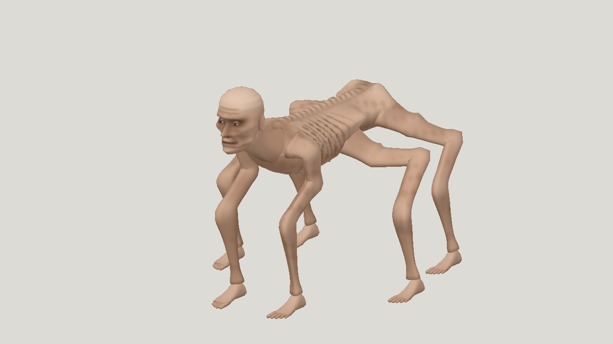
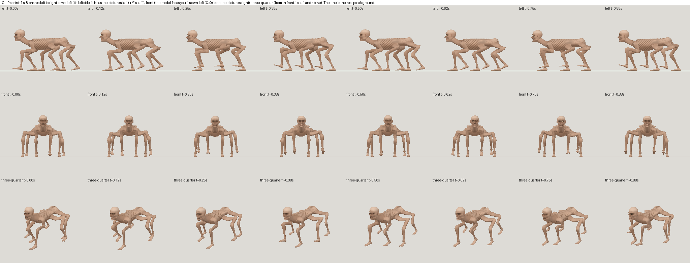
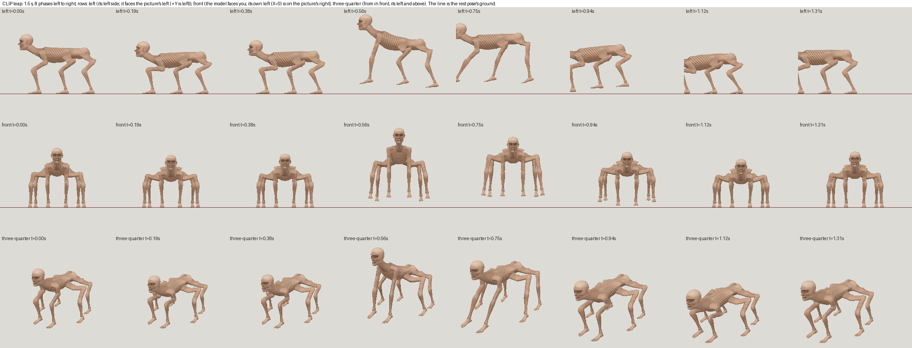

# Gemini 4 Neon High: time-limited horror

| Measure | Value |
|---|---|
| Model | gemini-4-neon |
| Driver | Antigravity subscription CLI |
| Effort | high |
| Scope | One standalone run. 8 evaluated meshes and 3 passing native rigs. |
| Completed | false |
| Evaluations | 8 |
| Runtime seconds | 4655.533963 |
| Driver turns | unknown |
| Prompt tokens | 16262457 |
| Cached prompt tokens | 13329443 |
| Cache write tokens | unknown |
| Completion tokens | 468216 |
| Reasoning tokens | 158108 |
| Model calls | unknown |
| Cost USD (estimated) | 17.82 |
| Numeric score | 0.5486 |
| Gates passed | 1 |
| Gates total | 1 |

Token counts use the report's provider conventions. Reasoning is included in completion tokens; cache counters are not extra prompt tokens. Estimated cost is not an invoiced charge.

Static resemblance 0.402 passes 0.400. 3 of 4 native rigs passed. The latest passing rig has an in-place sprint and a 0.92 m leap. Residual foot skate remains. The budget stopped the run after eight scored meshes.

The first GLB carries the native sprint and leap. The second is the frozen mesh.

The cost values the logged Antigravity tokens at Google Standard Gemini API rates.

[Download selected model](model-01.glb)

[Download selected model](model-02.glb)
