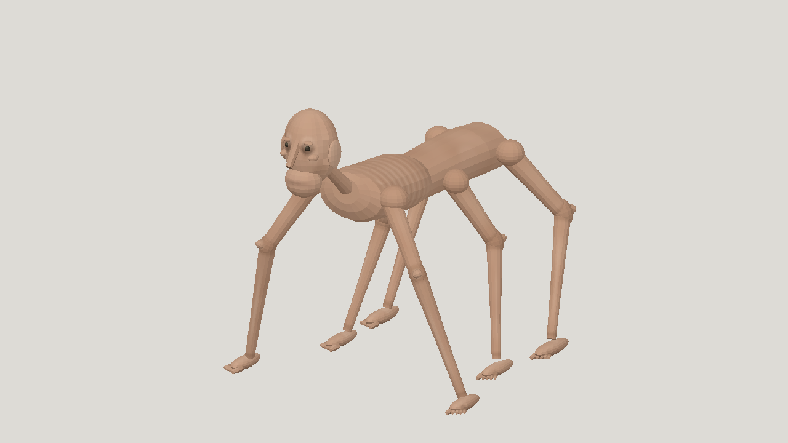

# Nex-N2.6 High horror

| Measure | Value |
|---|---|
| Model | nex-agi/nex-n2.6 |
| Driver | Mesh Jig API via OpenRouter |
| Effort | high |
| Scope | Five visual model iterations followed by rigging and sprint/leap animation; selected a05/a10 |
| Completed | true |
| Evaluations | 5 |
| Runtime seconds | 8638.0 |
| Driver turns | unknown |
| Prompt tokens | 3695289 |
| Cached prompt tokens | unknown |
| Cache write tokens | unknown |
| Completion tokens | 840203 |
| Reasoning tokens | unknown |
| Model calls | unknown |
| Cost USD (reported) | 0.469932 |
| Numeric score | 0.3258 |
| Gates passed | 0 |
| Gates total | 1 |

Token counts use the report's provider conventions. Reasoning is included in completion tokens; cache counters are not extra prompt tokens. Estimated cost is not an invoiced charge.

US$0.469932 covers completed model and rig calls; interrupted startup calls have unknown additional cost.

Primitive mannequin-like anatomy and flat paint. Sprint head bob, shallow crouch and late forward leap; sampled gates pass but joint seams move. Not game-engine certified.

[Download selected model](model-01.glb)
