# Four OpenAI horror experiments, high reasoning, 10 November 2026

| Measure | Value |
|---|---|
| Model | GPT-6 Astra; GPT-6.1 Sol; GPT-6.1 Terra; GPT-6 Luna |
| Driver | Four independent assigned Codex workers; direct construction |
| Effort | high |
| Scope | Four completed fixed-budget experiments, five successful static evaluations per model, with the worker visual selections and their selected sprint/leap rigs. Not finished-quality assets. |
| Completed | true |
| Evaluations | 20 |
| Runtime seconds | unknown |
| Driver turns | unknown |
| Prompt tokens | unknown |
| Cached prompt tokens | unknown |
| Cache write tokens | unknown |
| Completion tokens | unknown |
| Reasoning tokens | unknown |
| Model calls | unknown |
| Cost USD (unavailable) | unknown |
| Numeric score | unknown |
| Gates passed | unknown |
| Gates total | unknown |

Token counts use the report's provider conventions. Reasoning is included in completion tokens; cache counters are not extra prompt tokens. Estimated cost is not an invoiced charge.

Four independent completed high-reasoning Codex experiments, five successful static evaluations each. All twenty fail the 0.40 resemblance gate. These are comparison outcomes, not finished-quality assets.

Numerical rig gates at 24 fps and sampled checks at 60 Hz pass for the selected exports. This does not establish convincing movement, continuous foot contact or collision-free motion. Luna 60 Hz numeric checks were added non-mutating by the publisher; its worker originally reported 60 Hz visual review.

All four share frozen fresh inputs. Historical Fable harness provenance, workflows and runtime differ; this is not a controlled equal-runtime comparison. Subscription usage and cost are not reported.

GPT-6 Astra high, Codex, 10 Nov: selected a05-integrated-finish, score 0.4707, numeric best of five 0.4750, resemblance 0.3346 fails 0.40; 28985 triangles; selected r03-attached-ankles, 3 numerical passes in 3 rig submissions.

Completed experiment, not finished quality: resemblance fails; simplified face/anatomy, modest sprint propulsion, weak launch/landing, four low-weight neck vertices and 0.29% folded area remain.

Astra original strips had a misplaced ground line and are excluded. Its included strips are publisher renders of the unchanged GLB, with a line projected from the rest-ground vertex and framing from 60 Hz swept bounds. The original artifact is not repaired.

GPT-6 Astra high, Codex, 10 Nov assets: model-01 animated, model-02 frozen static; image-01 hero, image-02 sprint, image-03 leap.

GPT-6.1 Sol high, Codex, 10 Nov: selected a05-toes-and-skin, score 0.4692, numeric best of five 0.4692, resemblance 0.3345 fails 0.40; 26632 triangles; selected r03-fast-tripod, 3 numerical passes in 3 rig submissions.

Completed experiment, not finished quality: resemblance fails; simplified anatomy, rapid stepping rather than propulsion, modest leap compression and a 16 mm rear attachment diagnostic remain.

Sol identity follows the admitted gpt-6.1-sol high assignment; a resolved API identifier was not reported.

GPT-6.1 Sol high, Codex, 10 Nov assets: model-03 animated, model-04 frozen static; image-04 hero, image-05 sprint, image-06 leap.

GPT-6.1 Terra high, Codex, 10 Nov: selected a05-detail, score 0.3977, numeric best of five 0.4077, resemblance 0.2740 fails 0.40; 24076 triangles; selected r05, 3 numerical passes in 5 rig submissions.

Substantial visual-quality failure, not a finished asset: failed resemblance, floating/sliding sprint, near-rigid leap and simplified anatomy. Numerical rig passes do not establish convincing movement.

GPT-6.1 Terra high, Codex, 10 Nov assets: model-05 animated, model-06 frozen static; image-07 hero, image-08 sprint, image-09 leap.

GPT-6 Luna high, Codex, 10 Nov: selected a03-proportions-palette, score 0.4134, numeric best of five 0.4134, resemblance 0.2698 fails 0.40; 12808 triangles; selected r06-neutral-torso-leap, 3 numerical passes in 8 rig submissions.

Completed experiment, not finished quality: failed resemblance, assembled primitives, rigid limbs and weak crouch/settle. Sprint rises 15 mm; only 29% of contract keys and 29.5% of 60 Hz samples are within 8 mm of rest ground.

GPT-6 Luna high, Codex, 10 Nov assets: model-07 animated, model-08 frozen static; image-10 hero, image-11 sprint, image-12 leap.

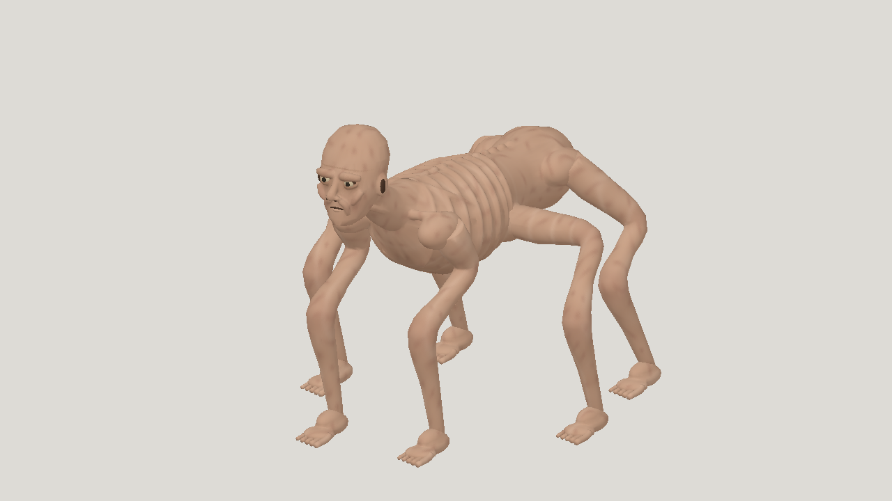

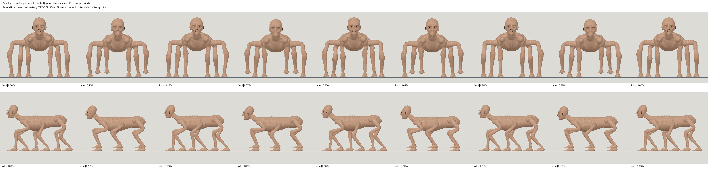

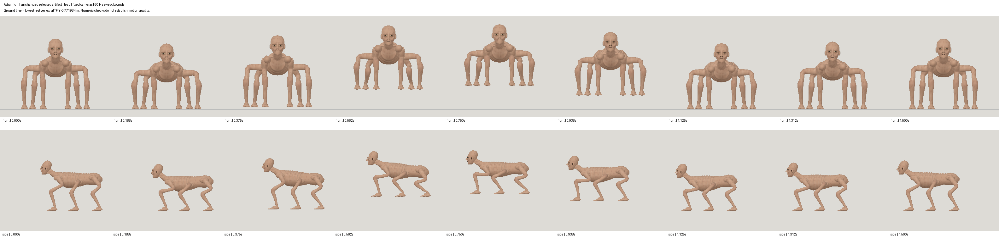

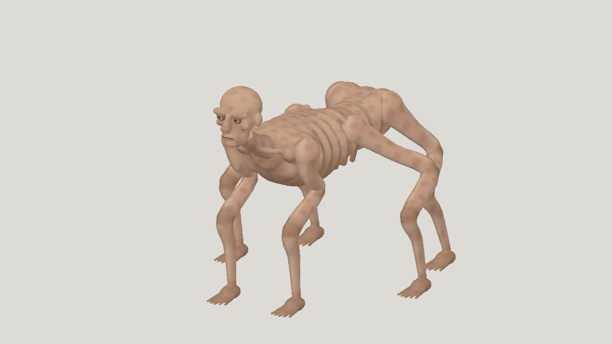

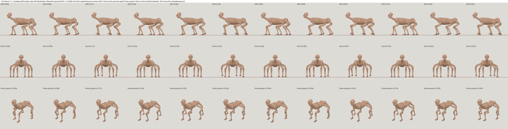

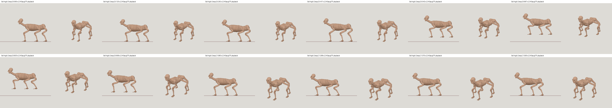

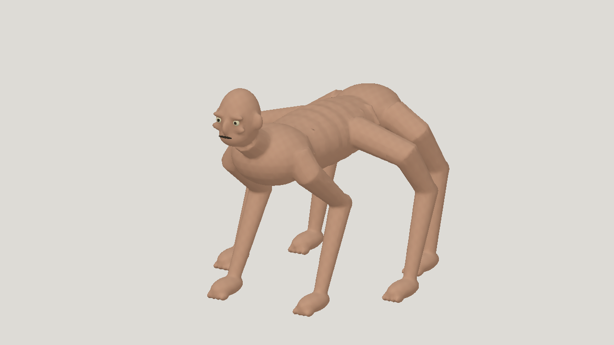

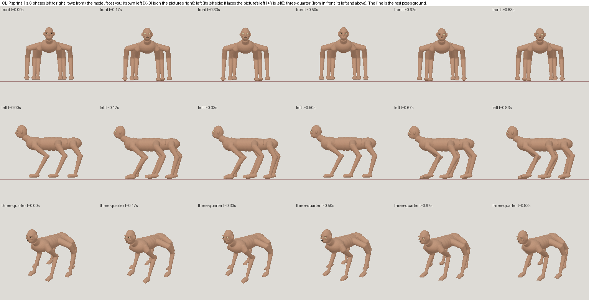

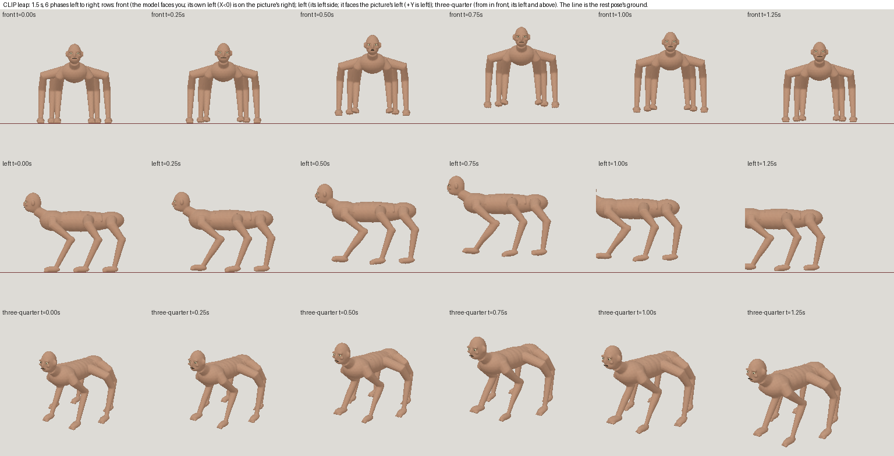

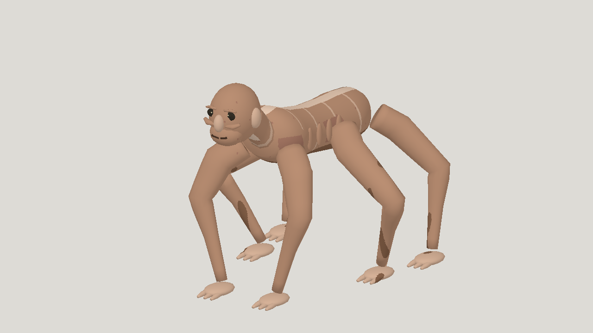

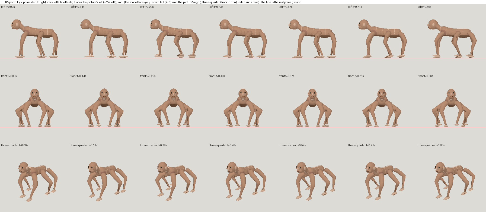

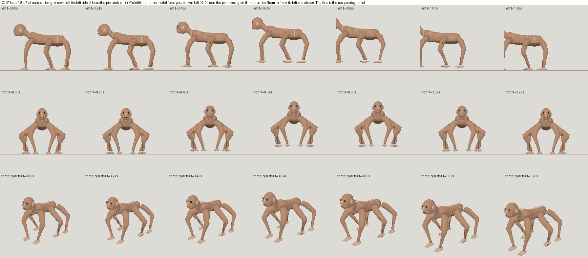

[Download selected model](model-01.glb)

[Download selected model](model-02.glb)

[Download selected model](model-03.glb)

[Download selected model](model-04.glb)

[Download selected model](model-05.glb)

[Download selected model](model-06.glb)

[Download selected model](model-07.glb)

[Download selected model](model-08.glb)
