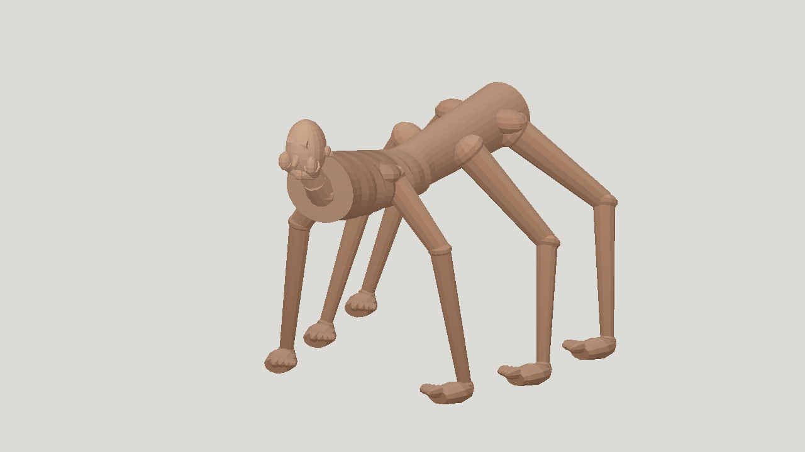
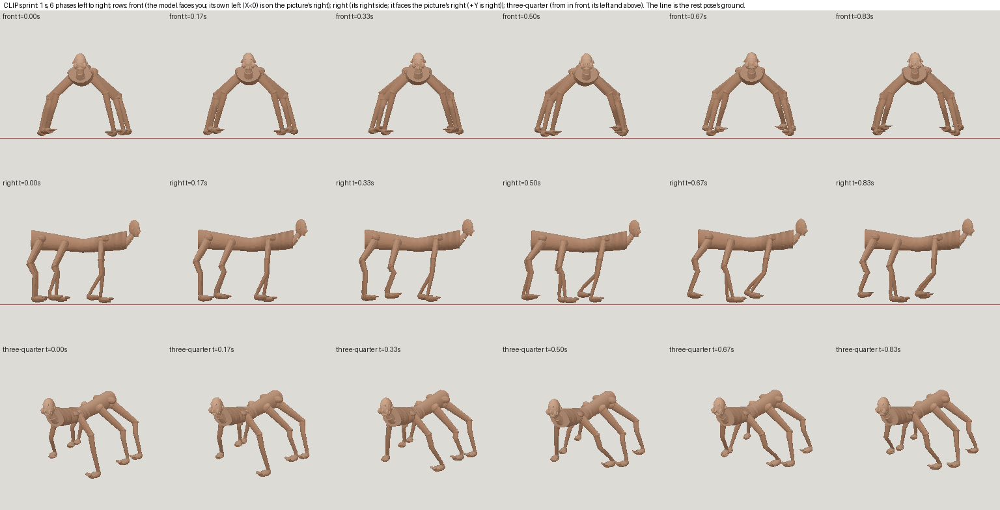
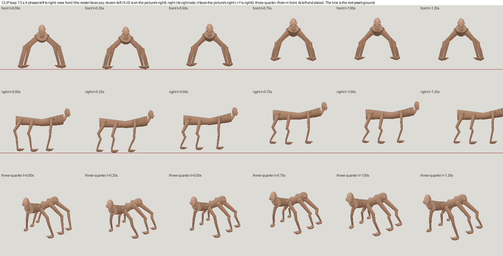

# Six-limbed horror: Qwen3.8-27B local, animated

| Measure | Value |
|---|---|
| Model | qwen3.8-27b-local |
| Driver | Mesh Jig visual agent on local Qwen; Qwen rig agent and supervised local Qwen repairs |
| Effort | low |
| Scope | Five measured meshes in one Qwen visual run. Selected a05 for its separable six limbs, then continued a failed rig run with two supervised Qwen-proposed edits. Report usage covers the visual run only; rig and later overnight work are excluded. |
| Completed | true |
| Evaluations | 5 |
| Runtime seconds | 2778.5 |
| Driver turns | 57 |
| Prompt tokens | 1327635 |
| Cached prompt tokens | unknown |
| Cache write tokens | unknown |
| Completion tokens | 112386 |
| Reasoning tokens | unknown |
| Model calls | 62 |
| Cost USD (unavailable) | unknown |
| Numeric score | 0.3304 |
| Gates passed | 0 |
| Gates total | 1 |

Token counts use the report's provider conventions. Reasoning is included in completion tokens; cache counters are not extra prompt tokens. Estimated cost is not an invoiced charge.

Selected static score 0.3304; resemblance 0.2123 misses the 0.40 gate. The numerical best in this visual run was 0.3326 on a mesh with overlapping middle and rear limbs.

The original Qwen rig run reached its turn cap with no passing build. Sol prompted the same local Qwen model for two exact leap-height edits, applied them, and validated the resulting sprint and leap GLB. This was assisted recovery, not an unattended agent pass.

The selected rig has 13068 triangles and 22 bones. Sprint and leap pass the Fable motion gates at 24 fps. Sprint maximum edge ratio 1.764, stretched area 0.30 percent, seam under 0.001 mm; leap 1.429 and zero percent, with 6.1 mm maximum ground drop.

Local inference has no reported API charge. The five-iteration visual run metrics do not include the later rig run or two direct patch calls. Numerical rig checks and preview strips do not establish finished horror resemblance or collision-free motion.

[Download selected model](model-01.glb)
