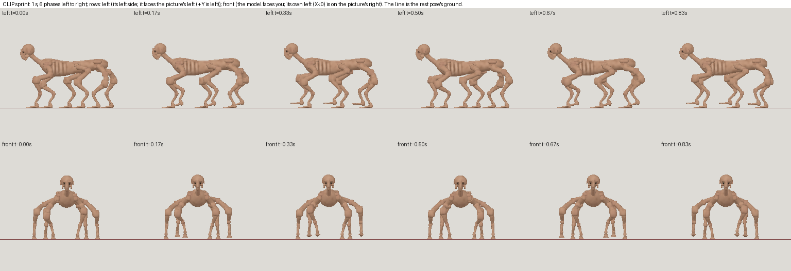
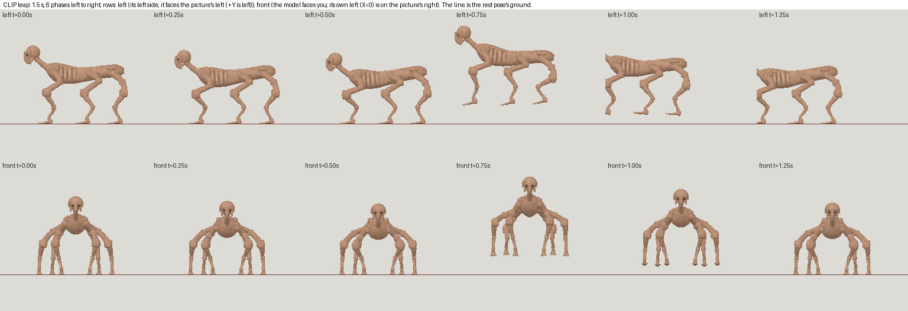

# Qwen4 Max high: horror sprint and leap

| Measure | Value |
|---|---|
| Model | qwen/qwen4-max |
| Driver | mesh-jig API agent through OpenRouter |
| Effort | high |
| Scope | One five-evaluation visual run; selected a03; three passing rigs; three failed game proposals. |
| Completed | false |
| Evaluations | 5 |
| Runtime seconds | unknown |
| Driver turns | unknown |
| Prompt tokens | 1303019 |
| Cached prompt tokens | 1031936 |
| Cache write tokens | 0 |
| Completion tokens | 258292 |
| Reasoning tokens | 176157 |
| Model calls | 48 |
| Cost USD (reported) | 1.570083 |
| Numeric score | 0.3938 |
| Gates passed | 0 |
| Gates total | 1 |

Token counts use the report's provider conventions. Reasoning is included in completion tokens; cache counters are not extra prompt tokens. Estimated cost is not an invoiced charge.

Resemblance 0.268 fails the 0.40 gate. Native rig passes, with limb-root gaps up to 55 mm. All three game proposals failed: slope foot slip 0.65 m/s and penetration 24.9 mm. Leap also dips below ground between keys. No accepted game-ready package.

Settled cost includes model, selection, rig and game calls. Interrupted startup and failed transport retry charges are unknown.

The visual choice scored 0.3938; numeric leader a02 scored 0.4207. Geometry and clips were not repaired for publication.

[Download selected model](model-01.glb)
